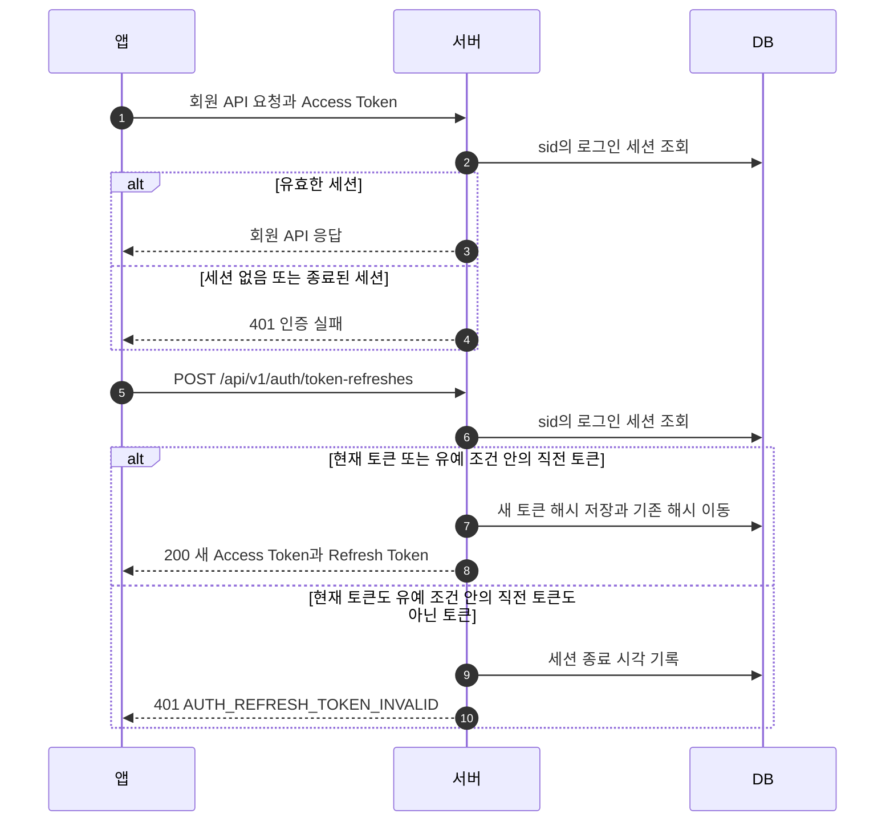
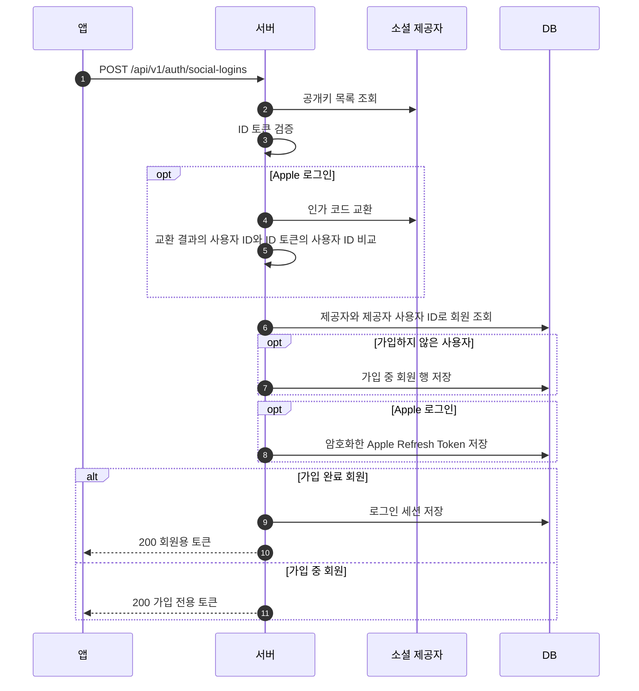
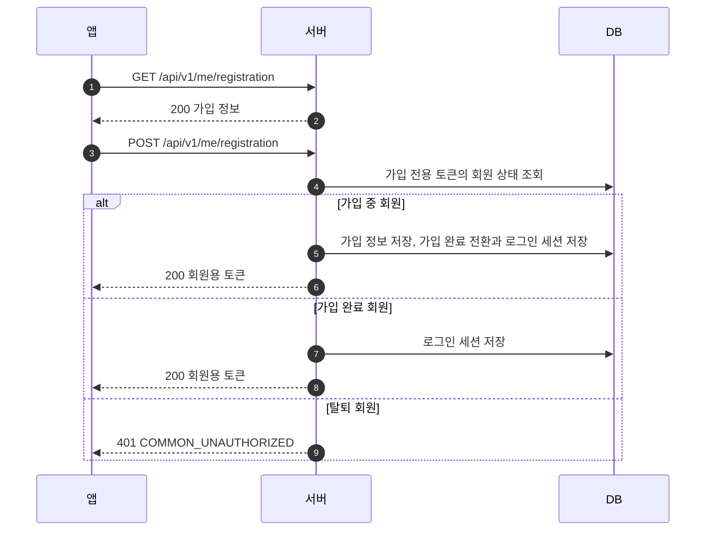

# 인증 설계서

## 개요

이 설계서는 회원 토큰과 로그인 세션, 소셜 로그인과 가입 전용 토큰의 저장 구조와 처리 흐름을 다룬다.
회원 행의 컬럼과 탈퇴 때 Apple 연결을 해제하는 처리는 [유저 설계서](user.md)를 따른다.
업무 규칙은 [인증 정책서](../policy/authentication.md)와 [유저 정책서의 회원가입](../policy/user.md#회원가입)을 따른다.

## 토큰과 로그인 세션

서버는 Access Token, Refresh Token과 가입 전용 토큰을 JWT로 발급하고, 로그인 세션을 DB에 저장한다. 근거: [PR #2](https://github.com/JECT-Study/Billit-5th-Docs/pull/2)

### 저장 데이터

| 이름 | 타입 | 제약 | 뜻 |
| --- | --- | --- | --- |
| `auth_session.id` | `UUID` | PK | 세션 ID. 회원 토큰의 `sid` 클레임 값 |
| `auth_session.member_id` | `BIGINT` | NOT NULL, FK `member.id` | 세션의 회원 |
| `auth_session.refresh_token_hash` | `VARCHAR(64)` | NOT NULL | 현재 Refresh Token의 SHA-256 해시 |
| `auth_session.refresh_token_expires_at` | `TIMESTAMPTZ` | NOT NULL | 현재 Refresh Token의 만료 시각 |
| `auth_session.previous_refresh_token_hash` | `VARCHAR(64)` | NULL | 직전 Refresh Token의 해시. NULL이면 갱신한 적이 없음 |
| `auth_session.refresh_token_rotated_at` | `TIMESTAMPTZ` | NULL | 마지막 갱신 시각. NULL이면 갱신한 적이 없음 |
| `auth_session.revoked_at` | `TIMESTAMPTZ` | NULL | 세션 종료 시각. NULL이면 유효한 세션임 |
| `auth_session.version` | `BIGINT` | NOT NULL | 같은 세션의 동시 갱신과 종료를 감지하는 낙관적 잠금 버전 |

- 서버는 Refresh Token 원문과 기기 식별자를 저장하지 않는다.
- 서버는 인증 데이터를 Redis에 저장하지 않는다. Redis는 메모리가 가득 차면 오래 쓰지 않은 키부터 지우는 `allkeys-lru` 설정이므로, 세션을 두면 회원이 의도하지 않게 로그아웃된다.

> 논의 필요
>
> Redis의 메모리 정리 정책을 바꾼 뒤 로그인 세션을 Redis에 저장함 vs DB에 저장함. Redis에 두는 다른 기능의 키도 함께 확인한다.

### 처리 흐름

유효 기간의 기준은 [인증 만료](../policy/authentication.md#인증-만료)와 [회원 식별](../policy/authentication.md#회원-식별)을 따른다.
다음 표는 서버가 발급하는 토큰의 종류다.

| 토큰 | `token_type` | 유효 기간 | 받는 요청 |
| --- | --- | --- | --- |
| Access Token | `ACCESS` | 15분 | 회원 API |
| Refresh Token | `REFRESH` | 30일 | 토큰 갱신, Access Token이 만료된 뒤의 로그아웃 |
| 가입 전용 토큰 | `REGISTRATION` | 30분 | 가입 정보 조회, 가입 완료 |

다음은 회원 API 요청과 토큰 갱신의 호출 순서다.

- 서버는 토큰을 검증할 때 서명, 만료 시각과 `token_type`을 확인한다.
- 서버는 세 토큰을 같은 서명 키로 HS512 서명한다.
- 서버는 Access Token과 Refresh Token의 `sid` 클레임에 로그인 세션 ID를 넣는다.
- 서버는 가입 전용 토큰에 `sid` 클레임을 넣지 않는다.
- 소셜 로그인이나 가입 완료로 회원 토큰을 발급하면 서버는 로그인 세션을 만든다.
- 유예 조건은 마지막 갱신 후 30초 안에 직전 Refresh Token으로 들어온 첫 재요청이다.
- 토큰 갱신에 성공하면 서버는 `refresh_token_hash`의 값을 `previous_refresh_token_hash`로 옮긴다.
- 앱은 갱신 요청을 한 번에 하나만 보낸다.
- 갱신이 끝나면 앱은 대기한 다른 요청을 새 Access Token으로 다시 보낸다.
- 로그아웃하면 서버는 요청 토큰의 `sid`로 찾은 세션 하나의 `revoked_at`을 기록한다.
- 유효한 Access Token이 있으면 서버는 로그아웃할 세션을 Access Token으로 찾는다.
- Access Token이 만료되었으면 서버는 로그아웃할 세션을 본문의 Refresh Token으로 찾는다.

서버는 다음 경로를 Access Token 없이 받는다.

| 경로 | 받는 이유 |
| --- | --- |
| `/healthz`, `/readyz`, 관리 포트의 actuator | 배포 중 상태 확인 |
| `/swagger-ui.html`, `/api-docs/**`, `/scalar/**` | 게이트웨이가 접근을 제한하는 API 문서 |
| 소셜 로그인, 토큰 갱신, 로그아웃 | Access Token 없이 호출하는 [인증 API](../api-spec/authentication.md#api-목록) |

서버는 그 밖의 경로에 회원 Access Token을 요구한다.
가입 API는 [가입 전용 토큰](#가입-전용-토큰)으로 확인한다.

> 논의 필요
>
> Access Token이 만료되기 전 일반 API 응답에서 서버가 토큰을 갱신함 vs 앱이 갱신 API를 호출함

> 추후 검토
>
> 요청마다 로그인 세션을 조회하는 DB 부하가 문제가 되면 세션 캐시를 검토한다.

### 트랜잭션과 동시성

- 같은 Refresh Token으로 갱신을 동시에 요청하면 서버는 `version` 검사로 한 건만 갱신한다.
- 같은 세션의 갱신과 로그아웃이 동시에 들어오면 서버는 `version` 검사로 충돌을 감지한다.

### 실패 처리

- 회원 API에 Refresh Token이나 가입 전용 토큰을 보내면 서버는 `401`로 거절한다.
- Access Token의 `sid` 세션이 없거나 `revoked_at`이 기록돼 있으면 서버는 `401`로 거절한다.
- 현재 토큰도 유예 조건 안의 직전 토큰도 아닌 Refresh Token으로 갱신하면 서버는 그 세션의 `revoked_at`을 기록한다.
- 현재 토큰도 유예 조건 안의 직전 토큰도 아닌 Refresh Token으로 갱신하면 서버는 `401 AUTH_REFRESH_TOKEN_INVALID`로 거절한다.
- 재사용을 감지해 세션을 종료해도 서버는 같은 회원의 다른 세션을 유지한다.
- 만료됐거나 종료된 세션의 Refresh Token으로 갱신하면 서버는 `401 AUTH_REFRESH_TOKEN_INVALID`로 거절한다.
- 만료된 Access Token을 헤더에 붙여 로그아웃하면 서버는 본문을 확인하지 않고 `401`로 거절한다.
- 이미 종료된 세션으로 로그아웃하면 서버는 `401 COMMON_UNAUTHORIZED`로 거절한다.
- 이미 종료된 세션으로 로그아웃해 `401`을 받으면 앱은 로컬에 남은 그 세션의 토큰을 지운다.

> 논의 필요
>
> - 갱신 응답을 받지 못했을 때 재요청을 한 번만 받음 vs 여러 번 받음
> - 직전 Refresh Token의 유예 시간 30초

### 검증

- 회원 API에 Refresh Token이나 가입 전용 토큰을 보내면 서버는 `401`로 거절한다.
- 로그아웃한 세션의 Access Token으로 요청하면 서버는 Access Token이 만료되기 전이라도 `401`로 거절한다.
- 같은 Refresh Token으로 동시에 갱신하면 서버는 새 토큰을 한 번만 발급한다.
- 유예 조건 안의 직전 Refresh Token으로 재요청하면 서버는 새 토큰을 한 번만 발급한다.
- 현재 토큰도 유예 조건 안의 직전 토큰도 아닌 Refresh Token으로 요청하면 서버는 그 세션을 종료한다.
- 상태 확인 경로를 Access Token 없이 요청하면 서버는 인증 오류로 거절하지 않는다.

## 소셜 로그인

서버는 앱이 보낸 ID 토큰을 제공자의 공개키로 검증하고, 제공자와 제공자 내부 사용자 ID의 조합으로 회원을 찾는다.

### 저장 데이터

| 이름 | 타입 | 제약 | 뜻 |
| --- | --- | --- | --- |
| `apple_refresh_token.member_id` | `BIGINT` | NOT NULL, UNIQUE, FK `member.id` | Apple Refresh Token의 회원. 회원당 한 행 |
| `apple_refresh_token.encrypted_refresh_token` | `VARCHAR(1024)` | NOT NULL | AES-256-GCM으로 암호화한 Apple Refresh Token |

- 서버는 Apple Refresh Token을 회원 탈퇴 때 Apple 연결을 해제하는 데 쓴다.
- 서버는 소셜 표시 이름(Apple `fullName`, Google `name`, Kakao `nickname`)을 저장하지 않는다. 가입할 때 임의 닉네임을 부여하므로 소셜 표시 이름을 쓰는 곳이 없다([USER-01](../api-spec/user.md#user-01-가입-정보-조회)).

### 처리 흐름

다음 표는 서버가 검증하는 제공자별 ID 토큰의 발급 대상이다.

| 제공자 | ID 토큰의 발급 대상(`aud`) |
| --- | --- |
| Google | 웹 클라이언트 ID |
| Kakao | 네이티브 앱 키 |
| Apple | 앱 번들 ID `app.billit.mobile` |

다음은 소셜 로그인의 호출 순서다.

- 앱은 Apple 로그인 요청에 `idToken`과 `authorizationCode`를 보낸다.
- 서버는 ID 토큰의 서명, 발급자, 발급 대상, 만료 시각과 사용자 ID를 검증한다.
- 서버는 제공자의 공개키 목록을 10분간 캐시한다.
- 서버는 이메일로 회원을 찾거나 합치지 않는다.
- 처음 인증한 소셜 계정이면 서버는 가입 중(`PENDING`) 회원 행을 만든다.
- 가입 중 회원에게 서버는 회원용 토큰 없이 가입 전용 토큰만 발급한다.
- 가입 중 회원 행이 있는 소셜 계정으로 다시 로그인하면 서버는 회원 행을 새로 만들지 않고 기존 행으로 새 가입 전용 토큰을 발급한다.
- 서버는 Apple Refresh Token을 환경 변수 `AUTH_TOKEN_ENCRYPTION_KEY`의 키로 암호화한다.
- 새 Apple Refresh Token을 받으면 서버는 그 회원의 기존 값을 교체한다.

### 트랜잭션과 동시성

- 같은 소셜 계정으로 처음 로그인을 동시에 요청하면 서버는 [`member`의 소셜 계정 UNIQUE 제약](user.md#저장-데이터)으로 회원 행을 하나만 만든다.

### 실패 처리

- 제공자가 장애나 타임아웃으로 응답하지 않으면 서버는 `503 AUTH_SOCIAL_PROVIDER_UNAVAILABLE`로 응답한다.
- ID 토큰 검증에 실패하면 서버는 `401 AUTH_SOCIAL_AUTHENTICATION_FAILED`로 거절한다.
- Apple 인가 코드 교환 결과의 사용자 ID가 ID 토큰의 사용자 ID와 다르면 서버는 회원 행을 만들지 않고 `401 AUTH_SOCIAL_AUTHENTICATION_FAILED`로 거절한다.
- 탈퇴(`WITHDRAWN`) 회원의 소셜 계정으로 로그인하면 서버는 `401 AUTH_SOCIAL_AUTHENTICATION_FAILED`로 거절한다.
- 탈퇴 처리로 `social_provider_user_id`를 지운 소셜 계정으로 로그인하면 서버는 가입 중 회원 행을 새로 만든다.
- Apple 로그인 응답을 받지 못하면 앱은 Apple 인증부터 다시 진행해 새 인가 코드를 받는다.
- 서버는 같은 Apple 인가 코드의 교환을 재시도하지 않는다.

> 논의 필요
>
> 탈퇴 회원의 재로그인과 재가입 시점. 정책의 미결 사항은 [재가입](../policy/user.md#재가입)을 따른다.

### 검증

- 같은 소셜 계정으로 동시에 처음 로그인하면 서버는 회원 행을 하나만 만든다.
- 탈퇴 회원의 소셜 계정으로 로그인하면 서버는 `401 AUTH_SOCIAL_AUTHENTICATION_FAILED`로 거절한다.
- 이메일이 같은 다른 소셜 계정으로 로그인하면 서버는 기존 회원과 다른 회원으로 처리한다.

## 가입 전용 토큰

서버는 소셜 인증을 마쳤지만 가입을 완료하지 않은 사용자에게 [소셜 로그인](#소셜-로그인)에서 가입 전용 토큰을 발급하고, 가입 완료 응답을 받지 못한 재시도를 같은 토큰으로 받는다.

### 처리 흐름

다음은 가입 전용 토큰을 받은 뒤 가입을 완료할 때까지의 호출 순서다.

- 서버는 검증한 소셜 제공자와 제공자 내부 계정 ID로 가입 주체를 정한다.
- 서버는 앱이 가입 요청에 보낸 소셜 계정 ID로 가입 대상을 바꾸지 않는다.
- 가입 주체는 처음 소셜 로그인할 때 만드는 가입 중(`PENDING`) 회원 행이다. 근거: [PR #2](https://github.com/JECT-Study/Billit-5th-Docs/pull/2)
- 서버는 가입 전용 토큰에 가입 중 회원 행의 회원 ID를 넣는다.
- 서버는 가입 전용 토큰으로 인증한 요청을 가입 완료 회원의 요청으로 취급하지 않는다.
- 앱은 가입 전용 토큰을 `Authorization: Bearer {registrationToken}` 헤더로 보낸다.
- 서버는 가입 정보 조회 API와 가입 완료 API에서만 가입 전용 토큰을 받는다.
- 가입을 완료하면 서버는 같은 회원 행을 가입 완료(`ACTIVE`)로 바꾼다.
- 가입 전용 토큰이 만료되어도 서버는 회원 행의 상태를 바꾸지 않는다.
- 가입 전용 토큰의 회원이 이미 가입을 완료했으면 서버는 가입 완료 요청의 내용을 비교하지 않는다.
- 서버는 최초 가입 완료 응답의 회원용 토큰을 저장해 다시 반환하지 않는다. 근거: [PR #2](https://github.com/JECT-Study/Billit-5th-Docs/pull/2)
- 서버는 가입 완료 요청으로 가입 전용 토큰의 유효 기간을 연장하지 않는다.

> 논의 필요
>
> - 다시 소셜 인증해 새 가입 전용 토큰을 받은 뒤 이전 토큰의 허용 여부
> - 가입 완료 요청마다 만든 로그인 세션 중 이전 세션을 바로 종료함 vs 로그아웃이나 탈퇴할 때 함께 종료함

### 트랜잭션과 동시성

- 같은 소셜 계정으로 가입 완료를 동시에 요청하면 서버는 회원과 약관 동의 기록을 중복해 만들지 않는다.
- 서버는 가입 완료를 커밋한 뒤에 회원용 토큰을 발급한다.

> 논의 필요
>
> 여러 가입 전용 토큰으로 동시에 가입 완료를 요청할 때의 응답

### 실패 처리

- 가입 전용 토큰이 없거나 만료되었거나 변조되었으면 서버는 `401 COMMON_UNAUTHORIZED`로 거절한다.
- 가입 전용 토큰으로 토큰 갱신을 요청하면 서버는 회원용 토큰을 발급하지 않는다.
- 이미 가입을 완료한 회원의 가입 전용 토큰으로 가입 정보를 조회하면 서버는 `403 COMMON_FORBIDDEN`으로 거절한다.
- 가입 전용 토큰의 회원이 탈퇴(`WITHDRAWN`)했으면 서버는 가입 정보 조회와 가입 완료를 `401 COMMON_UNAUTHORIZED`로 거절하고 로그인 세션을 만들지 않는다.
- 가입 완료 검증이나 트랜잭션이 실패하면 서버는 회원용 토큰을 반환하지 않는다. 오류 코드는 [USER-03 가입 완료](../api-spec/user.md#user-03-가입-완료)의 오류 표를 따른다.
- 가입 완료 응답을 받지 못하면 앱은 같은 가입 전용 토큰과 같은 가입 내용으로 가입 완료를 다시 요청한다.
- 가입 완료를 커밋한 뒤 회원용 토큰 발급에 실패해도 앱은 같은 가입 전용 토큰으로 가입 완료를 다시 요청한다.
- 소셜 로그인 응답을 받지 못하면 앱은 소셜 인증부터 다시 시작한다.

### 검증

- 가입 전용 토큰으로 가입 정보 조회와 가입 완료를 요청하면 서버는 `200`을 반환한다.
- 가입 전용 토큰으로 토큰 갱신을 요청하면 서버는 회원용 토큰을 발급하지 않는다.
- 가입 요청에 다른 소셜 계정 ID를 보내도 서버는 가입 전용 토큰에 연결된 회원 행으로 가입을 완료한다.
- 만료되거나 변조된 가입 전용 토큰으로 요청하면 서버는 `401 COMMON_UNAUTHORIZED`로 거절한다.
- 가입을 완료한 회원의 가입 전용 토큰으로 가입 정보를 조회하면 서버는 `403 COMMON_FORBIDDEN`으로 거절한다.
- 탈퇴한 회원의 가입 전용 토큰으로 가입 완료를 요청하면 서버는 `401 COMMON_UNAUTHORIZED`로 거절한다.
- 같은 소셜 계정으로 가입 완료를 동시에 요청하면 서버는 회원과 약관 동의 기록을 하나씩만 저장한다.
- 가입 완료 응답을 받지 못한 뒤 같은 요청을 다시 보내면 서버는 회원과 약관 동의 기록을 추가로 저장하지 않는다.
- 가입을 커밋한 뒤 토큰 발급에 실패하고 같은 요청을 다시 보내면 서버는 회원용 토큰을 발급한다.
- 필수 동의나 만 18세 이상 확인 검증에 실패하면 서버는 회원 행을 가입 중(`PENDING`)으로 유지한다.
- 필수 동의나 만 18세 이상 확인 검증에 실패하면 서버는 회원용 토큰을 반환하지 않는다.
