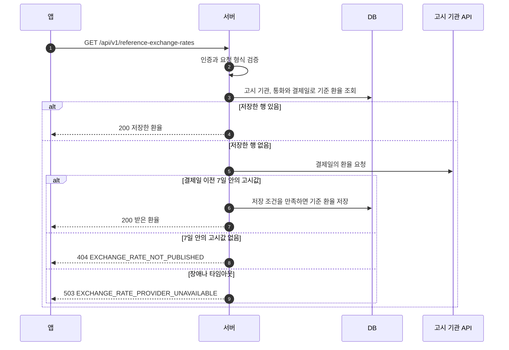

# 환율 설계서

## 개요

이 설계서는 개인 저장 환율의 저장, 조회와 삭제, 결제일 기준 API 환율의 저장과 조회, 지출을 저장한 뒤 적용 환율을 보존하는 방식을 다룬다.
기본 환율을 고르는 조건과 환전 날짜의 입력 기준은 [환율 정책](../policy/exchange-rate.md)을, 지출의 환율 저장 컬럼은 [지출 설계서](expense.md#저장-데이터)을 따른다.

## 저장 데이터

| 이름 | 타입 | 제약 | 뜻 |
| --- | --- | --- | --- |
| `manual_exchange_rate.trip_id` | `BIGINT` | NOT NULL, FK `trip.id` | 환율을 기록한 여행 |
| `manual_exchange_rate.created_by_trip_member_id` | `BIGINT` | NOT NULL, FK `trip_member.id` | 환율을 등록한 참여자 |
| `manual_exchange_rate.currency` | `CHAR(3)` | NOT NULL | 환전한 외화의 통화 코드 |
| `manual_exchange_rate.rate` | `DECIMAL(24,12)` | NOT NULL | 외화 1단위의 원화 금액 |
| `manual_exchange_rate.exchange_date` | `DATE` | NOT NULL | 회원이 입력한 환전 당시의 현지 날짜 |
| `manual_exchange_rate.exchange_method` | `exchange_method` | NOT NULL | 환전 수단. `CASH`와 `TRAVEL_CARD` |
| `manual_exchange_rate.created_at` | `TIMESTAMPTZ` | NOT NULL | 등록 시각 |
| `reference_exchange_rate.provider` | `VARCHAR(50)` | NOT NULL | 환율을 고시한 기관의 코드. `ECB`는 유럽중앙은행 |
| `reference_exchange_rate.currency` | `CHAR(3)` | NOT NULL | 외화의 통화 코드 |
| `reference_exchange_rate.rate_date` | `DATE` | NOT NULL | 이 환율을 적용하는 날짜. 조회 요청의 결제일 |
| `reference_exchange_rate.base_date` | `DATE` | NOT NULL | 고시 기관이 환율을 고시한 실제 기준일 |
| `reference_exchange_rate.rate` | `DECIMAL(24,12)` | NOT NULL | 고시 기관이 제공한 외화 1단위의 원화 금액 |
| `reference_exchange_rate.created_at` | `TIMESTAMPTZ` | NOT NULL | 행을 저장한 시각 |

- 서버는 환전 시각, 시간대, 현재 위치와 국가코드를 저장하지 않는다.
- `manual_exchange_rate`에는 `uq_manual_exchange_rate_record` 제약 `UNIQUE (trip_id, created_by_trip_member_id, currency, exchange_date, exchange_method, rate)`를 둔다.
- 서버는 `manual_exchange_rate`의 행을 저장한 뒤 수정하지 않고 삭제만 한다. 삭제한 행은 복구하지 않는다. 근거: [Issue #78 논의 결과](https://github.com/JECT-Study/Billit-5th-Docs/issues/78)
- 지출은 적용 환율을 값으로 복사하므로 `manual_exchange_rate`를 참조하지 않는다.
- `reference_exchange_rate`에는 `uq_reference_exchange_rate_provider_currency_rate_date` 제약 `UNIQUE (provider, currency, rate_date)`를 둔다.
- `reference_exchange_rate`에는 `ck_reference_exchange_rate_base_date_range` 제약 `CHECK (base_date <= rate_date AND base_date >= rate_date - 7)`을 둔다.
- `reference_exchange_rate`는 결제일마다 한 행을 둔다. 고시가 없는 날짜의 행에는 이전에 고시된 환율과 그 기준일을 저장하므로, 같은 고시값이 여러 행에 들어간다.
- 서버는 `reference_exchange_rate`의 행을 저장한 뒤 갱신하거나 삭제하지 않는다. 과거 고시 환율은 바뀌지 않는다.

## 처리 흐름

### 개인 환율 등록

- 서버는 요청자의 여행 참여 정보에서 `created_by_trip_member_id`를 정한다.
- 같은 기록의 중복 등록은 `uq_manual_exchange_rate_record` 제약으로 막는다. 근거: [Issue #74](https://github.com/JECT-Study/Billit-5th-Docs/issues/74)

### 개인 환율 삭제

- 서버는 요청자의 여행 참여 정보에서 `created_by_trip_member_id`를 정한다.
- 서버는 기록 ID, 여행과 `created_by_trip_member_id`가 모두 같은 행을 삭제한다.
- 삭제한 행이 없으면 서버는 `404 COMMON_NOT_FOUND`를 반환한다.

### 결제일 기준 환율 조회

다음은 결제일 기준 환율 조회의 처리 순서다.



- 서버는 Frankfurter API로 `ECB` 고시 환율을 조회한다. 서버는 결제 통화를 기준 통화로, `KRW`를 대상 통화로 요청한다.
- 서버는 회원이 입력한 현지 결제 날짜 `paidDate`를 조회 날짜로 쓴다.
- 서버는 UTC+14의 현재 날짜보다 뒤인 `paidDate`를 `400 COMMON_INVALID_REQUEST`로 거절한다. 근거: [Issue #148 논의 결과](https://github.com/JECT-Study/Billit-5th-Docs/issues/148)
- 서버는 고시 기관이 반환한 실제 기준일을 요청 날짜로 덮어쓰지 않는다.
- 결제일과 기준일의 차이가 7일 이내면 서버는 그 고시값을 결제일의 환율로 쓴다. 근거: [Issue #75](https://github.com/JECT-Study/Billit-5th-Docs/issues/75)
- 받은 고시값의 기준일이 결제일과 같거나, 결제일이 서버 날짜(`Asia/Seoul`)보다 2일 이상 이전이면 서버는 그 고시값을 `reference_exchange_rate`에 저장한다.
- 결제일에 아직 고시되지 않았을 수 있는 최근 날짜의 이전 고시값을 저장하면, 나중에 결제일의 고시값이 나와도 저장한 행이 바뀌지 않는다. 그래서 서버는 위 저장 조건을 만족하지 않는 고시값을 응답에만 쓴다.
- 서버는 고시 기관이 제공한 환율을 반올림하지 않고 저장한다.
- 서버는 응답의 `rate`를 소수점 셋째 자리에서 `HALF_UP`으로 반올림한다.
- 서버는 고시 기관 API를 호출하는 동안 DB 트랜잭션을 열어 두지 않는다.
- 최종 부담액을 계산하는 환율의 통화는 지출의 결제 통화와 같다.

### 지출의 적용 환율

- 지출에 적용한 환율의 저장은 [지출 설계서](expense.md#지출-저장)를 따른다.
- 개인 저장 환율을 삭제해도 서버는 기존 지출과 정산의 환율을 바꾸지 않는다.

## 쿼리

`:requester_trip_member_id`는 인증된 요청자의 여행 참여 정보에서 구한다.
`:payment_currency`는 회원이 지출에 선택한 결제 통화다.
쿼리는 등록 시각인 `created_at`을 정렬 기준으로 쓰고, 같으면 `id`로 정렬한다.
환전 날짜 `exchange_date`는 순서에 영향을 주지 않는다.
[FX-01 내 환율 목록](../api-spec/exchange-rate.md#fx-01-내-환율-목록)은 같은 정렬로 기록을 페이지 단위로 반환한다.

다음 쿼리는 요청자가 같은 여행에서 결제 통화로 등록한 개인 저장 환율 중 등록 시각이 가장 늦은 기록 하나를 조회한다.

```sql
-- 결제 통화의 최근 개인 저장 환율
SELECT id, currency, rate, exchange_date, exchange_method, created_at
FROM manual_exchange_rate
WHERE trip_id = :trip_id
  AND created_by_trip_member_id = :requester_trip_member_id
  AND currency = :payment_currency
ORDER BY created_at DESC, id DESC
LIMIT 1;
```

다음은 개인 저장 환율 기록 3개로 쿼리 결과를 보여 주는 가상 예시다.

```text
기록 A: USD, 10:00 등록
기록 B: USD, 11:00 등록
기록 C: JPY, 12:00 등록

1. 회원이 본인 현금 지출의 결제 통화로 USD를 고른다.
   결과: 기록 B를 적용한다. 등록 시각이 더 늦은 기록은 B다.

2. 회원이 결제 통화를 JPY로 바꾼다.
   결과: 기록 C를 적용한다.

3. 회원이 기록 B를 삭제한 뒤 결제 통화로 USD를 고른다.
   결과: 기록 A를 적용한다.

4. 회원이 결제 통화를 EUR로 바꾼다.
   결과: 쿼리는 행을 반환하지 않는다. 기본 환율은 결제일 기준 API 환율이다.
```

다음 쿼리는 요청자가 본인이 등록한 개인 저장 환율 하나를 삭제한다.
`:exchange_rate_id`는 요청 경로의 `exchangeRateId`다.
삭제 조건이 본인 기록인지 확인하며, 쿼리는 단독 트랜잭션으로 실행한다.

```sql
-- 본인이 등록한 개인 저장 환율 삭제
DELETE FROM manual_exchange_rate
WHERE id = :exchange_rate_id
  AND trip_id = :trip_id
  AND created_by_trip_member_id = :requester_trip_member_id;
```

다음 쿼리는 결제일의 기준 환율을 조회한다.
`:provider`는 `ECB`이고, `:currency`와 `:paid_date`는 요청의 `currency`와 `paidDate`다.
쿼리는 트랜잭션 없이 실행한다.

```sql
-- 결제일의 기준 환율
SELECT provider, currency, rate_date, base_date, rate
FROM reference_exchange_rate
WHERE provider = :provider
  AND currency = :currency
  AND rate_date = :paid_date;
```

다음 쿼리는 고시 기관에서 받은 환율을 저장한다.
같은 행이 이미 있으면 쿼리는 행을 저장하지 않는다.

```sql
-- 기준 환율 저장
INSERT INTO reference_exchange_rate (provider, currency, rate_date, base_date, rate, created_at)
VALUES (:provider, :currency, :paid_date, :base_date, :rate, :now)
ON CONFLICT (provider, currency, rate_date) DO NOTHING;
```

다음은 결제일의 고시값이 없는 상황의 가상 예시다.
서버 날짜는 2026-11-09(월)이고 2026-11-07(토)과 2026-11-08(일)에는 고시가 없다.

```text
1. 회원이 결제일 2026-11-06(금)의 JPY 환율을 조회한다.
   결과: 고시 기관이 기준일 2026-11-06의 환율을 준다. 기준일이 결제일과 같으므로 서버는 rate_date 2026-11-06 행을 저장한다.

2. 회원이 결제일 2026-11-07(토)의 JPY 환율을 조회한다.
   결과: 고시 기관이 기준일 2026-11-06의 환율을 준다. 결제일이 서버 날짜보다 2일 이전이므로 서버는 rate_date 2026-11-07, base_date 2026-11-06 행을 저장한다.

3. 회원이 결제일 2026-11-08(일)의 JPY 환율을 조회한다.
   결과: 고시 기관이 기준일 2026-11-06의 환율을 준다. 결제일이 서버 날짜보다 1일 이전이므로 서버는 행을 저장하지 않고 응답에만 쓴다.

4. 회원이 결제일 2026-11-07(토)의 JPY 환율을 다시 조회한다.
   결과: 서버는 저장한 rate_date 2026-11-07 행을 반환하고 고시 기관 API를 호출하지 않는다.
```

## 트랜잭션과 동시성

- 같은 여행에서 본인이 같은 기록의 등록을 동시에 요청하면 서버는 `uq_manual_exchange_rate_record` 제약으로 한 건만 저장한다.
- 같은 기록의 삭제를 동시에 요청하면 서버는 한 요청만 행을 삭제하고 나머지 요청을 `404 COMMON_NOT_FOUND`로 거절한다.
- 같은 고시 기관, 통화와 결제일의 기준 환율 조회가 동시에 오면 서버는 각 요청에서 고시 기관 API를 호출할 수 있다.
- 같은 고시 기관, 통화와 결제일의 행을 동시에 저장하면 서버는 `ON CONFLICT DO NOTHING`으로 한 행만 저장하고 두 요청 모두 받은 환율로 응답한다.

## 실패 처리

- 결제 통화의 개인 저장 환율이 없으면 조회 쿼리는 다른 통화의 기록을 반환하지 않는다.
- 개인 환율 등록이 `uq_manual_exchange_rate_record` 제약을 위반하면 서버는 `409 EXCHANGE_RATE_DUPLICATED`를 반환한다.
- 삭제 조건에 맞는 행이 없으면 서버는 `404 COMMON_NOT_FOUND`를 반환한다. 기록이 없거나, 이미 삭제했거나, 다른 회원이 등록한 기록이면 같다.
- 고시 기관이 결제일과 그 이전 7일 안의 고시값을 반환하지 않으면 서버는 `404 EXCHANGE_RATE_NOT_PUBLISHED`를 반환한다.
- 고시 기관이 장애나 타임아웃으로 응답하지 않으면 서버는 `503 EXCHANGE_RATE_PROVIDER_UNAVAILABLE`을 반환한다.
- 서버는 고시 기관의 장애를 고시값이 없는 상태로 판단하지 않는다.
- 고시 기관 API의 조회에 실패하면 서버는 `reference_exchange_rate`에 행을 저장하지 않는다.
- API 환율 조회에 실패하면 서버는 임의 환율을 반환하지 않는다.

## 검증

- 같은 여행에 결제 통화와 다른 통화의 기록만 있으면 조회 쿼리는 행을 반환하지 않는다.
- 같은 여행의 다른 참여자만 결제 통화의 기록을 등록했으면 조회 쿼리는 행을 반환하지 않는다.
- 결제 통화의 기록이 여러 개면 조회 쿼리는 `created_at`이 가장 늦은 기록을 반환한다.
- 가장 최근 기록을 삭제하면 조회 쿼리는 남은 기록 중 `created_at`이 가장 늦은 기록을 반환한다.
- `created_at`이 같은 기록이 있으면 조회 쿼리는 `id`가 큰 기록을 반환한다.
- 개인 저장 환율을 삭제해도 서버는 기존 지출의 `exchange_rate`를 바꾸지 않는다.
- 같은 여행에서 본인이 통화, 환전 날짜, 환전 수단과 환율이 같은 기록을 동시에 두 번 등록하면 서버는 한 건만 저장하고 다른 요청을 `409`로 거절한다.
- 환전 날짜만 다른 기록을 등록하면 서버는 별개 기록으로 저장한다.
- 본인이 등록한 기록을 삭제하면 서버는 `204`를 반환하고 행을 지운다.
- 다른 회원이 등록한 기록의 삭제를 요청하면 서버는 행을 지우지 않고 `404`를 반환한다.
- 이미 삭제한 기록의 삭제를 다시 요청하면 서버는 `404`를 반환한다.
- `currency`가 `KRW`이면 서버는 `400`으로 거절한다.
- `currency`가 `KRW`이면 서버는 고시 기관 API를 호출하지 않는다.
- `paidDate`가 UTC+14의 현재 날짜와 같으면 서버는 환율을 조회한다.
- `paidDate`가 UTC+14의 현재 날짜보다 뒤이면 서버는 `400`으로 거절하고 고시 기관 API를 호출하지 않는다.
- 결제일의 행이 `reference_exchange_rate`에 있으면 서버는 고시 기관 API를 호출하지 않는다.
- 고시 기관이 결제일보다 7일 넘게 이전인 기준일의 환율을 반환하면 서버는 `404`를 반환하고 행을 저장하지 않는다.
- 결제일이 서버 날짜보다 2일 미만 이전이고 기준일이 결제일과 다르면 서버는 행을 저장하지 않는다.
- 고시 기관 API가 타임아웃되면 서버는 `503`을 반환하고 행을 저장하지 않는다.
- 고시 기관이 `9.0909`를 반환하면 서버는 `9.0909`를 저장하고 응답의 `rate`를 `9.09`로 반환한다.
