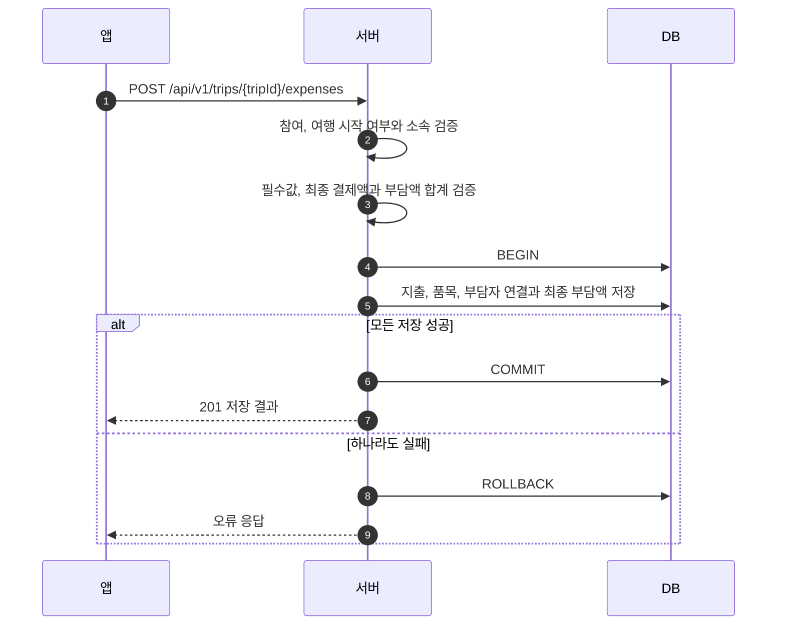
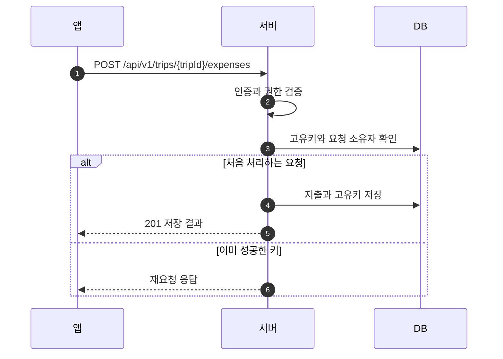
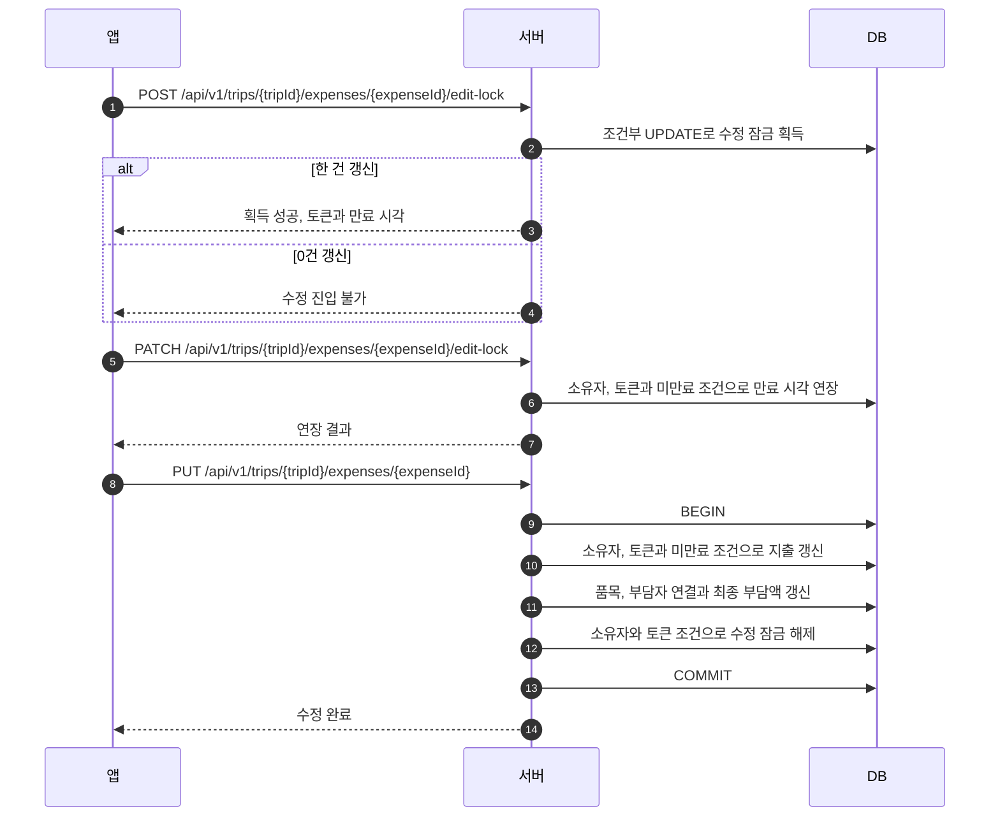
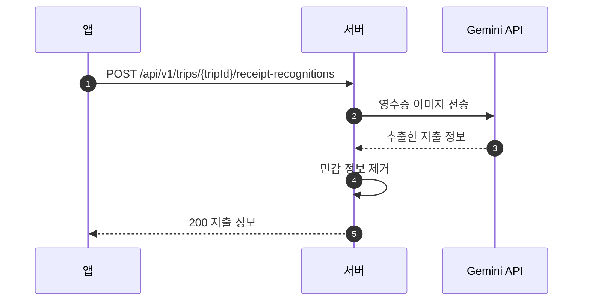

# 지출 설계서

## 개요

이 설계서는 지출의 계산과 저장, 지출 생성 멱등성, 지출 수정 잠금과 영수증 이미지 처리를 다룬다.
정산 준비가 지출을 점유하는 처리와 두 잠금의 경합은 [정산 설계서](settlement.md#정산-준비-잠금)를, 기본 환율 조회는 [환율 설계서](exchange-rate.md)를 따른다.
업무 규칙은 [지출 정책서](../policy/expense.md)와 [환율 정책서](../policy/exchange-rate.md)를 따른다.

## 지출 저장

서버는 지출, 품목, 품목별 부담자와 최종 부담액을 한 트랜잭션으로 저장하고, 적용 환율을 지출에 값으로 복사한다.

### 저장 데이터

| 이름 | 타입 | 제약 | 뜻 |
| --- | --- | --- | --- |
| `expense.trip_id` | `BIGINT` | NOT NULL, FK `trip.id` | 지출이 속한 여행 |
| `expense.name` | `VARCHAR(50)` | NOT NULL | 지출명 |
| `expense.split_type` | `split_type` | NOT NULL | 분배 방식. `EQUAL`(전체 1/N)과 `ITEM`(품목별) |
| `expense.original_amount` | `BIGINT` | NOT NULL | 할인 전 총액 |
| `expense.discount_amount` | `BIGINT` | NOT NULL | 전체 할인액 |
| `expense.amount` | `BIGINT` | NOT NULL | 최종 결제액 |
| `expense.currency` | `CHAR(3)` | NOT NULL | 결제 통화 |
| `expense.paid_date` | `DATE` | NOT NULL | 회원이 입력한 결제 당시의 현지 날짜 |
| `expense.payment_method` | `payment_method` | NOT NULL | 결제 수단. `CARD`, `CASH`, `TRAVEL_CARD` 중 하나 |
| `expense.payer_trip_member_id` | `BIGINT` | NOT NULL, FK `trip_member.id` | 결제자 |
| `expense.created_by_trip_member_id` | `BIGINT` | NOT NULL, FK `trip_member.id` | 기록자 |
| `expense.exchange_rate` | `DECIMAL(24,12)` | NOT NULL | 적용 환율. 결제 통화 1단위의 원화 금액 |
| `expense.exchange_rate_source` | `rate_source` | NOT NULL | 환율 결정 방식. `AUTO`(API 환율)와 `MANUAL`(직접 입력) |
| `expense.krw_amount` | `BIGINT` | NOT NULL | 최종 결제액의 원화 환산액 |
| `expense.settlement_id` | `BIGINT` | NULL, FK `settlement.id` | 지출을 점유한 정산. NULL이면 점유한 정산이 없음 |
| `expense.deleted_at` | `TIMESTAMPTZ` | NULL | 삭제 시각. NULL이면 삭제하지 않은 지출 |
| `expense_item.expense_id` | `BIGINT` | NOT NULL, FK `expense.id` | 품목이 속한 지출 |
| `expense_item.name` | `VARCHAR(50)` | NULL | 품목명. NULL이면 입력하지 않음 |
| `expense_item.amount` | `BIGINT` | NOT NULL | 할인 전 품목 금액 |
| `expense_item.discount_amount` | `BIGINT` | NOT NULL | 상품 할인액 |
| `expense_item.sort_order` | `INTEGER` | NOT NULL | 화면 표시 순서 |
| `expense_item_member.expense_item_id` | `BIGINT` | NOT NULL, FK `expense_item.id` | 부담자가 나누는 품목 |
| `expense_item_member.expense_id` | `BIGINT` | NOT NULL, FK `expense.id` | 품목이 속한 지출 |
| `expense_item_member.trip_member_id` | `BIGINT` | NOT NULL, FK `trip_member.id` | 품목의 부담자 |
| `expense_share_amount.expense_id` | `BIGINT` | NOT NULL, FK `expense.id` | 부담액의 지출 |
| `expense_share_amount.trip_id` | `BIGINT` | NOT NULL, FK `trip.id` | 부담액의 여행 |
| `expense_share_amount.trip_member_id` | `BIGINT` | NOT NULL, FK `trip_member.id` | 부담자 |
| `expense_share_amount.amount` | `BIGINT` | NOT NULL | 결제 통화의 최종 부담액 |
| `expense_share_amount.krw_amount` | `BIGINT` | NOT NULL | 원화로 환산한 최종 부담액 |

- 금액 컬럼의 `BIGINT`는 통화의 최소 단위 정수다. USD 12.34는 1234로 저장한다.
- `expense_item_member`는 `(expense_item_id, trip_member_id)` 조합을 한 행만 둔다.
- `expense_share_amount`는 `(expense_id, trip_member_id)` 조합을 한 행만 둔다.
- 전체 1/N 지출이면 서버는 `expense_item` 행 없이 선택한 참여자별 부담액을 `expense_share_amount`에 저장한다.
- 품목별 지출이면 서버는 품목과 부담자 연결을 저장하고, 참여자별 합계를 `expense_share_amount`에 저장한다.
- 서버는 결제 시각, 시간대, 현재 위치와 국가코드를 저장하지 않는다.
- 서버는 등록 시각 `created_at`과 결제 날짜 `paid_date`를 구분해 저장한다.
- 지출을 저장하면 서버는 적용한 환율의 출처와 기준일을 함께 보존한다([저장된 지출과 정산](../policy/exchange-rate.md#저장된-지출과-정산)).
- `expense.settlement_id`의 점유와 해제는 [정산 준비 잠금](settlement.md#정산-준비-잠금)을 따른다.

> 논의 필요
>
> - API 환율의 제공 기관과 실제 기준일을 저장할 컬럼
> - 금액 컬럼의 `BIGINT` 유지 여부, 원화 소수 보존과 `DECIMAL(24,12)`의 계산 중 정밀도
> - 입력 길이를 제한하지 않는 지출명 정책과 `VARCHAR(50)`의 차이
> - 같은 여행과 같은 지출 소속을 서비스에서 검증함 vs 복합 FK를 둠

### 처리 흐름

다음은 지출 생성 요청의 처리 순서다.



- 부담액 계산 결과를 확인하는 단계에서 서버는 지출을 저장하지 않는다.
- 서버는 요청자의 여행 참여, 여행 시작 여부, 결제자와 부담자의 같은 여행 소속을 검증한다.
- 서버는 같은 저장 요청의 중복 반영을 [지출 생성 멱등성](#지출-생성-멱등성)으로 막는다.
- 지출을 수정하면 서버는 생성과 같은 계산 기준을 적용한다.
- 지출 수정 API는 `PUT`으로 수정할 수 있는 입력값 전체를 받는다. 품목 행을 모두 지우고 다시 만드는지는 아래 논의 필요를 따른다.

부담액의 계산 순서는 아래와 같다.

1. 입력값과 부담 참여자를 검증한다.
2. 적용 환율을 확인한다.
3. 총액이나 품목별 할인을 반영한다.
4. 선택한 참여자에게 분배하고 자투리를 배정한다.
5. 원화로 환산하고 합계를 검증한다.

다음 표는 분배 방식별 최종 결제액이다.

| 분배 방식 | 최종 결제액 |
| --- | --- |
| 전체 1/N | `original_amount - discount_amount` |
| 품목별 | `original_amount - SUM(품목 discount_amount) - expense.discount_amount` |

- 상품 할인은 `expense_item.discount_amount`에만 저장하고, 최종 결제액에서 한 번만 뺀다.
- 전체 할인은 상품 할인을 반영한 참여자별 부담액에 비례해 나눈다.
- 자투리는 소수점 이하 값이 큰 참여자부터 배정한다.

다음은 저장 결과를 보여 주는 가상 예시다.

```text
1. 민지가 12,000원짜리 식사를 결제하고 지훈, 서연과 전체 1/N으로 나눈다. 할인과 환산은 없다.
   결과: `expense` 한 행(결제자 민지, `amount = 12000`, `currency = KRW`, `exchange_rate = 1`)과 `expense_share_amount` 세 행(각 4,000원)을 저장한다. `expense_item`과 `expense_item_member`에는 행을 만들지 않는다.

2. 민지와 지훈이 8,000원짜리 피자를 나누고 민지만 4,000원짜리 음료를 마신다. 피자에만 상품 할인 2,000원이 있다.
   결과: `expense.original_amount = 12000`, `expense.discount_amount = 0`, `expense.amount = 10000`이다. 피자 행의 `discount_amount`는 2,000원이다. 부담액은 민지 7,000원, 지훈 3,000원이다.

3. 2번 지출에 전체 할인 1,000원이 더 있다.
   결과: 민지의 할인액은 700원, 지훈은 300원이다. 최종 부담액은 민지 6,300원, 지훈 2,700원이고 합계는 최종 결제액 9,000원이다.

4. 10,000원을 세 명에게 원 단위로 나눈다.
   결과: 3,333원씩 배정하면 1원이 남는다. 세 참여자의 소수점 이하 값이 같으므로, 남은 1원의 배정 대상은 동률 기준을 정해야 결정된다.
```

> 논의 필요
>
> - 계산 위치, 환산과 분배의 순서, 반올림 시점, 자투리 동률 순서, 비례 할인액의 반올림, 품목 합계 검증식, 남은 금액의 배정 대상: [분배와 할인](../policy/expense.md#분배와-할인)과 [환산과 자투리](../policy/expense.md#환산과-자투리)의 논의 필요를 따른다.
> - 지출을 수정할 때 기존 품목 행을 교체함 vs 부분 갱신함

### 트랜잭션과 동시성

- 서버는 지출, 품목, 품목별 부담자 연결과 최종 부담액을 한 트랜잭션에서 저장한다.
- 서버는 커밋에 성공한 뒤에만 저장 결과를 반환한다.
- 지출을 수정하면 서버는 [지출 수정 잠금](#지출-수정-잠금)을 검증한 트랜잭션에서 지출과 종속 데이터를 갱신하고 잠금을 해제한다.

### 실패 처리

- 저장 중 하나라도 실패하면 서버는 같은 트랜잭션에서 저장한 지출, 품목, 부담자 연결과 부담액을 모두 롤백한다.
- 참여자별 `amount`의 합계가 `expense.amount`와 다르면 서버는 저장을 거절한다.

> 논의 필요
>
> 참여자별 `krw_amount`의 합계와 `expense.krw_amount`를 일치시키는 방식

### 검증

- 할인과 자투리를 반영해도 참여자별 부담액의 합계는 최종 결제액과 같다.
- 같은 입력으로 두 번 계산하면 서버는 같은 부담액을 저장한다.
- 부담액 저장이 실패하면 서버는 같은 요청의 지출과 품목도 저장하지 않는다.

## 지출 생성 멱등성

앱은 지출 저장 요청에 고유키를 함께 보내고, 서버는 같은 키의 재요청으로 지출을 다시 저장하지 않는다.

### 처리 흐름

다음은 고유키가 있는 지출 저장 요청의 처리 순서다.



- 같은 저장을 재시도하면 앱은 같은 고유키를 보낸다.
- 서버는 지출 생성 요청에만 고유키를 받는다.
- 서버는 잠금 토큰과 저장 요청의 고유키를 섞어 쓰지 않는다.

다음은 커밋한 뒤 앱이 응답을 받지 못한 상황의 가상 예시다.

```text
1. 민지가 숙소비 저장을 누르고 앱이 고유키 `save-A`를 보낸다. 서버는 지출 501을 저장해 커밋했지만 앱은 응답을 받지 못한다.
   결과: 지출 501이 한 건 저장되어 있다.

2. 앱이 같은 숙소비 저장을 `save-A`로 다시 보낸다.
   결과: 서버는 새 지출을 만들지 않는다. 숙소비는 한 건만 남는다.
```

> 논의 필요
>
> - 고유키의 저장 위치: `expense`의 컬럼 vs 별도 요청 기록 테이블
> - 키 타입: `UUID` vs 길이를 제한한 문자열
> - 키의 중복 범위: 서비스 전체 vs 요청자와 작업 종류별
> - 같은 키로 이미 성공한 요청에 기존 지출 결과를 반환함 vs 중복 처리 결과를 안내함
> - 앱이 같은 저장의 재시도에 키를 유지하고 새 지출 입력에 새 키를 만드는 시점
> - 같은 키로 내용이 다른 요청의 거절 여부, 비교할 입력과 정규화 방식
> - 처리 중이거나 실패한 요청의 재시도 허용 시점과 대기 또는 거절 방식
> - 키의 만료 여부, 지출을 삭제한 뒤의 재요청과 키 재사용

> 추후 검토
>
> 지출 수정과 정산 확정에 같은 고유키 체계를 적용할지 검토한다.

### 트랜잭션과 동시성

- 서버는 처음 처리하는 요청의 지출과 고유키를 한 트랜잭션에서 저장한다.
- 서버는 고유키를 사전에 조회한 결과만으로 같은 키의 동시 요청을 막지 않는다.
- 서버는 고유키 중복을 확인한 트랜잭션 안에서 기존 결과를 조회할 수 있다고 가정하지 않는다.

### 실패 처리

- 지출, 품목이나 부담액의 저장이 롤백되면 서버는 고유키를 성공한 요청으로 남기지 않는다.
- 다른 제약을 위반하면 서버는 그 오류를 고유키 중복으로 판단하지 않는다.

### 검증

- 같은 고유키의 요청이 동시에 오면 서버는 지출을 한 건만 저장한다.
- 커밋한 뒤 응답을 받지 못한 요청을 같은 고유키로 다시 보내면 서버는 지출을 추가로 저장하지 않는다.
- 전체 롤백된 요청을 같은 고유키로 다시 보내면 서버는 지출을 저장한다.

## 지출 수정 잠금

서버는 수정 소유자, 토큰과 만료 시각을 `expense` 행에 저장하고, 조건부 갱신에 성공한 요청에만 지출 수정을 허용한다.
잠금의 유효 시간과 연장 단위는 [수정과 잠금](../policy/expense.md#수정과-잠금)을 따른다.

### 저장 데이터

| 이름 | 타입 | 제약 | 뜻 |
| --- | --- | --- | --- |
| `expense.edit_lock_owner_trip_member_id` | `BIGINT` | NULL, FK `trip_member.id` | 수정 잠금 소유자. NULL이면 수정 잠금이 없음 |
| `expense.edit_lock_expires_at` | `TIMESTAMPTZ` | NULL | 수정 잠금 만료 시각. NULL이면 수정 잠금이 없음 |

- 서버는 수정 작업을 식별하는 토큰을 `expense`에 소유자, 만료 시각과 함께 저장한다.
- 수정 잠금이 없으면 소유자, 만료 시각과 토큰은 모두 NULL이다.
- 수정 잠금이 있으면 소유자, 만료 시각과 토큰은 모두 값이 있다.
- 서버는 잠금을 해제하거나 교체할 때 소유자, 만료 시각과 토큰을 함께 바꾼다.
- 서버는 수정을 시작할 때마다 토큰을 새로 발급한다.
- 토큰은 인증과 권한 검증을 대체하지 않는다.

> 논의 필요
>
> - 토큰의 타입, 헤더 이름과 발급 주체
> - 소유자, 토큰과 만료 시각의 일관성을 DB CHECK로 보장함 vs 애플리케이션에서 검증함
> - 현재 시각의 출처와 만료 경계
> - 잠금만 바꾸는 갱신의 `updated_at` 갱신 여부
> - 연장 상한: [수정과 잠금 정책](../policy/expense.md#수정과-잠금)의 논의 필요를 따른다.

### 처리 흐름

다음은 수정 잠금의 획득부터 수정 저장까지의 호출 순서다.



- 서버는 요청자가 지출의 기록자나 관리자인지 검증한다.
- 서버는 `:now`와 `:expires_at`을 앱의 입력이 아니라 서버 시각으로 계산한다.
- 획득할 때 `:expires_at`은 `:now`에 잠금의 유효 시간을 더한 값이고, 연장할 때는 기존 `edit_lock_expires_at`에 연장 단위를 더한 값이다.
- 같은 사용자라도 서버는 유효한 잠금을 새 획득 요청으로 덮어쓰지 않는다. 앱은 기존 토큰으로 연장한다.
- 수정 화면을 나가면 앱은 `DELETE /api/v1/trips/{tripId}/expenses/{expenseId}/edit-lock`으로 잠금을 해제한다.
- 같은 사용자의 요청도 다른 작업일 수 있으므로, 서버는 잠금을 해제할 때 사용자 ID와 토큰을 함께 비교한다.

### 쿼리

서버는 수정 권한을 검증한 뒤 아래 쿼리를 단독 트랜잭션에서 실행한다.
다음 쿼리는 정산 점유가 없고 유효한 수정 잠금이 없는 지출의 수정 잠금을 획득한다.

```sql
-- 수정 잠금 획득
UPDATE expense
SET edit_lock_owner_trip_member_id = :requester_trip_member_id,
    edit_lock_token = :new_token,
    edit_lock_expires_at = :expires_at
WHERE id = :expense_id
  AND trip_id = :trip_id
  AND deleted_at IS NULL
  AND settlement_id IS NULL
  AND (
      edit_lock_expires_at IS NULL
      OR edit_lock_expires_at <= :now
  )
RETURNING id, edit_lock_token, edit_lock_expires_at;
```

서버는 아래 쿼리를 단독 트랜잭션에서 실행한다.
다음 쿼리는 소유자와 토큰이 맞고 만료되지 않은 수정 잠금의 만료 시각을 늘린다.

```sql
-- 수정 잠금 연장
UPDATE expense
SET edit_lock_expires_at = GREATEST(edit_lock_expires_at, :expires_at)
WHERE id = :expense_id
  AND trip_id = :trip_id
  AND deleted_at IS NULL
  AND settlement_id IS NULL
  AND edit_lock_owner_trip_member_id = :requester_trip_member_id
  AND edit_lock_token = :token
  AND edit_lock_expires_at > :now
RETURNING id, edit_lock_expires_at;
```

`GREATEST`는 늦게 도착한 연장 요청이 이미 늘어난 만료 시각을 줄이지 않게 한다.

서버는 수정할 수 있는 결제 정보 전체와 부담액을 아래 쿼리와 같은 조건으로 갱신한다.
다음은 수정 저장 트랜잭션의 첫 단계에서 소유자, 토큰과 만료 조건을 다시 검사하며 지출명과 금액을 바꾸는 축약 쿼리다.

```sql
-- 수정 저장의 지출 갱신
UPDATE expense
SET name = :name,
    original_amount = :original_amount,
    discount_amount = :discount_amount,
    amount = :amount,
    krw_amount = :krw_amount,
    updated_at = :now
WHERE id = :expense_id
  AND trip_id = :trip_id
  AND deleted_at IS NULL
  AND settlement_id IS NULL
  AND edit_lock_owner_trip_member_id = :requester_trip_member_id
  AND edit_lock_token = :token
  AND edit_lock_expires_at > :now
RETURNING id;
```

서버는 아래 쿼리를 수정 저장 트랜잭션의 마지막 단계와 정상 이탈 요청에서 실행한다.
다음 쿼리는 소유자와 토큰이 맞을 때만 수정 잠금을 비운다.

```sql
-- 수정 잠금 해제
UPDATE expense
SET edit_lock_owner_trip_member_id = NULL,
    edit_lock_token = NULL,
    edit_lock_expires_at = NULL
WHERE id = :expense_id
  AND trip_id = :trip_id
  AND settlement_id IS NULL
  AND edit_lock_owner_trip_member_id = :requester_trip_member_id
  AND edit_lock_token = :token
RETURNING id;
```

### 트랜잭션과 동시성

- 서버는 수정 저장의 권한 검증, 지출 갱신, 종속 데이터 갱신과 잠금 해제를 한 트랜잭션에서 실행한다.
- 서버는 지출 갱신으로 얻은 행 잠금을 커밋할 때까지 유지한다.
- 서버는 수정 저장의 지출 조회와 지출 갱신을 다른 트랜잭션으로 나누지 않는다.
- 서버는 행 잠금을 기다린 뒤에 현재 시각과 새 만료 시각을 다시 계산한다.
- 회원이 화면에서 지출을 편집하는 동안 서버는 DB 트랜잭션을 열어 두지 않는다.
- 정산 준비가 같은 지출을 점유하려고 경합하면 서버는 [수정과 정산 준비의 경합](settlement.md#수정과-정산-준비의-경합)을 따른다.

### 실패 처리

- 수정 잠금 획득의 갱신이 0건이면 서버는 수정 진입을 거절한다.
- `settlement_id`가 만료된 준비 정산을 가리키면 서버는 [만료된 정산 준비 정리](settlement.md#만료된-정산-준비-정리)를 거친 뒤 수정 잠금 획득을 다시 시도한다.
- 수정 잠금 연장의 갱신이 0건이면 서버는 기존 토큰의 수정 권한을 인정하지 않는다.
- 만료된 토큰으로 연장을 요청하면 서버는 잠금을 되살리지 않는다. 앱은 수정 잠금을 다시 획득해야 한다.
- 수정 저장의 지출 갱신이 0건이면 서버는 트랜잭션을 롤백하고 저장을 거절한다.
- 수정 잠금 해제의 갱신이 0건이면 서버는 수정 저장 트랜잭션을 롤백한다.
- 수정 저장 중 종속 데이터 갱신이 실패하면 서버는 지출 갱신과 잠금 해제를 함께 롤백한다.
- 이전 토큰으로 해제를 요청하면 서버는 새 작업의 소유자, 토큰과 만료 시각을 유지한다. 응답 표시는 [EXP-06 수정 잠금 해제](../api-spec/expense.md#exp-06-수정-잠금-해제)를 따른다.

다음은 이전 토큰의 해제 요청이 늦게 도착한 가상 예시다.

```text
1. 민지가 지출 101의 수정 잠금을 획득한다.
   결과: 소유자 민지, 토큰 `edit-A`가 저장된다.

2. `edit-A`가 만료된 뒤 민지가 다시 수정 잠금을 획득한다.
   결과: 소유자 민지, 토큰 `edit-B`가 저장된다.

3. 첫 화면에서 보낸 `edit-A`의 해제 요청이 늦게 도착한다.
   결과: 토큰이 달라 0건 갱신이며 `edit-B`가 유지된다.
```

### 검증

- 같은 사용자가 수정 잠금을 다시 획득한 뒤 이전 토큰으로 해제하거나 저장하면 서버는 새 작업의 잠금과 데이터를 바꾸지 않는다.
- 만료된 수정 토큰으로 연장하면 서버는 잠금을 되살리지 않는다.
- 수정 저장 중 종속 데이터 갱신이 실패하면 서버는 지출 변경과 잠금 해제를 모두 롤백한다.

## 영수증 이미지 처리

서버는 앱에서 받은 영수증 이미지를 Gemini API로 보내 지출 정보를 추출한다.
서버는 영수증 이미지를 메모리에서만 처리한다. 근거: [Issue #16](https://github.com/JECT-Study/Billit-5th-Docs/issues/16)

### 처리 흐름

다음은 영수증 인식의 호출 순서다.



- 서버는 Gemini API를 결제를 연결한 Cloud 프로젝트의 유료 티어로만 호출한다.
- 서버는 Google 검색 그라운딩을 쓰지 않는다. 그라운딩은 요청 데이터를 30일 따로 보관하기 때문이다.
- 서버는 이미지를 Gemini API에 보내기 전에 민감 정보를 가리지 않는다.
- 서버는 Gemini 응답에서 카드번호, 카드 승인번호, 영수증 번호, 카드사와 전화번호를 빼고 앱에 반환한다.
- 서버는 카드번호, 카드 승인번호, 영수증 번호, 카드사와 전화번호를 저장하지 않는다.
- 서버는 영수증 이미지를 디스크와 Object Storage에 쓰지 않는다.
- 인식이 끝나면 서버는 원본 이미지를 버린다.
- 서버는 웹 서버 접근 로그와 애플리케이션 로그에 요청 본문을 남기지 않는다.
- 서버는 동시에 처리하는 영수증 인식 요청의 수를 제한한다.

수탁자와 국외 이전은 [개인정보 정책서](../policy/privacy.md#처리-위탁과-국외-이전)를, 서버 설정과 동시에 처리할 요청의 최대 수는 [운영 환경과 개인정보 보호](operations-privacy.md#영수증-인식-경로의-서버-설정)를 따른다.

> 논의 필요
>
> 영수증 이미지의 용량 상한. [EXP-09 영수증 인식](../api-spec/expense.md#exp-09-영수증-인식)에서 정한다.

### 검증

- 실제 영수증 이미지를 업로드하면 서버는 요청을 처리하는 동안 Tomcat 임시 디렉터리에 파일을 만들지 않는다.
- 서버는 영수증 인식 응답에 카드번호, 카드 승인번호, 영수증 번호, 카드사와 전화번호를 담지 않는다.
