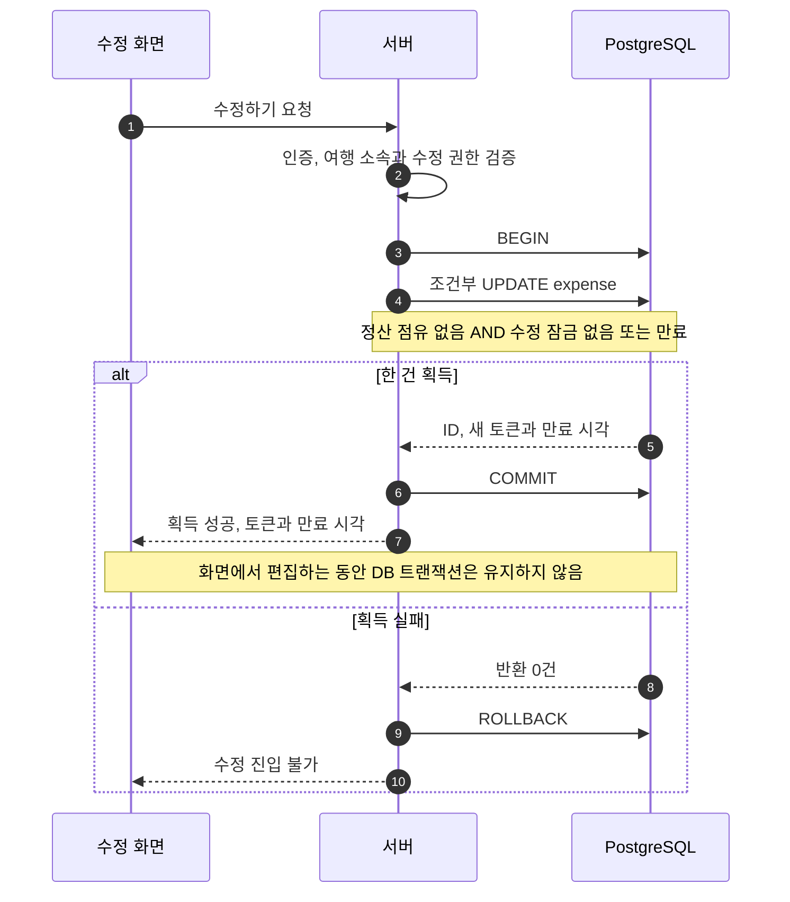
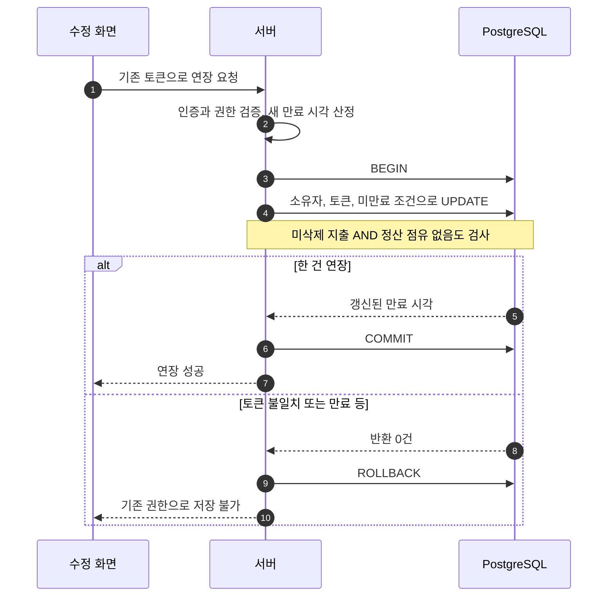
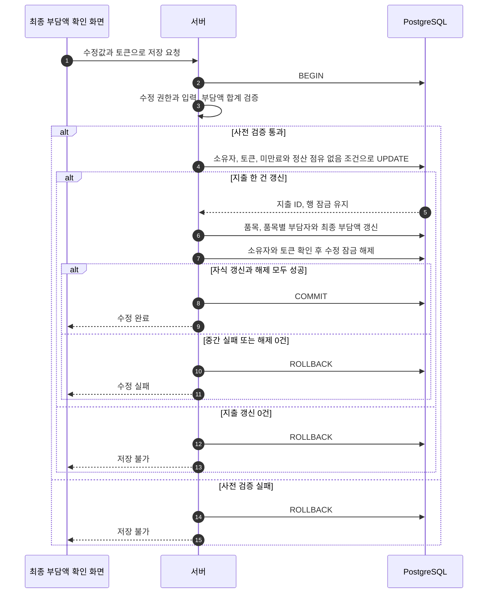
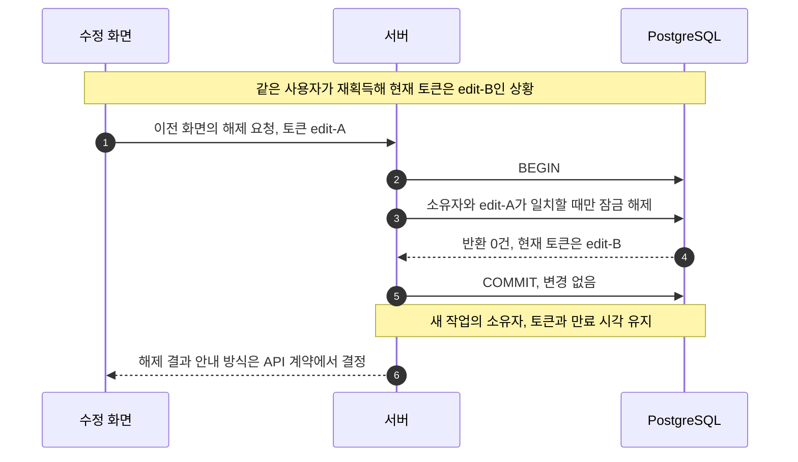

# 지출 설계서

관련 정책: [지출](../policy/expense.md), [환율](../policy/exchange-rate.md)

## 결정한 방향

- 입력, 검증과 부담액 계산, 최종 확인 후 저장을 구분한다. 미리보기만으로 지출을 확정 저장하지 않는다.
- 지출, 품목, 품목별 부담자와 최종 부담액은 한 트랜잭션으로 저장하는 기존 검토안을 따른다.
- 적용 환율은 지출에 값으로 복사해 보존한다. 개인 저장 환율을 변경해도 기존 지출에 소급 적용하지 않는다.
- 지출 분배의 자투리는 소수점 이하 값이 큰 참여자부터 배정한다.

> 논의 필요
>
> 프론트 계산값 검증 vs 서버 계산 API 제공: 소수점 정확성 POC로 비교한다.
>
> 자투리 동률 순서와 환산 및 분배 순서는 계산 영역의 논의 사항을 따른다.

## 저장 데이터

결제 날짜는 사용자가 입력한 결제 당시의 현지 날짜를 `expense.paid_date DATE`에 그대로 저장한다. API는 `paidDate`를 `YYYY-MM-DD`로 전달하며 UTC 변환을 하지 않는다. 결제 시각, 시간대, 현재 위치와 국가코드는 저장하지 않는다. 등록 시각인 `created_at`과 결제 날짜는 구분한다.

아래 컬럼은 기존 검토 DDL `expense.sql`에 있는 구조다. 새로 추가할 컬럼은 [지출 테이블 변경](#지출-테이블-변경)에 모은다.

| 테이블 | 주요 컬럼과 현재 타입 | 저장하는 내용 |
| --- | --- | --- |
| `expense` | `trip_id BIGINT`, `name VARCHAR(50)`, `split_type` | 소속 여행, 지출명과 전체 1/N 또는 품목별 분배 방식 |
| `expense` | `original_amount BIGINT`, `discount_amount BIGINT`, `amount BIGINT`, `currency CHAR(3)` | 할인 전 총액, 전체 할인액, 최종 결제액과 결제 통화 |
| `expense` | `paid_date DATE`, `payment_method`, `payer_trip_member_id BIGINT`, `created_by_trip_member_id BIGINT` | 결제 날짜, 결제 수단, 결제자와 기록자 |
| `expense` | `exchange_rate DECIMAL(24,12)`, `exchange_rate_source`, `krw_amount BIGINT` | 적용 환율, 자동 또는 수동 지정 구분과 원화 환산 총액 |
| `expense_item` | `expense_id BIGINT`, `name VARCHAR(50) NULL`, `amount BIGINT`, `discount_amount BIGINT`, `sort_order INTEGER` | 품목명, 할인 전 금액, 상품 할인과 표시 순서 |
| `expense_item_member` | `expense_item_id BIGINT`, `expense_id BIGINT`, `trip_member_id BIGINT` | 각 품목을 부담하는 참여자 |
| `expense_share_amount` | `expense_id BIGINT`, `trip_id BIGINT`, `trip_member_id BIGINT`, `amount BIGINT`, `krw_amount BIGINT` | 참여자별 최종 부담액과 원화 환산 부담액 |

전체 1/N은 `expense_item` 행 없이 `expense_share_amount`에 선택 참여자별 부담액을 저장하는 기존 구조다. 품목별은 품목과 부담자 연결을 저장하고, 참여자별 합계를 `expense_share_amount`에 저장한다.

참여자 식별은 `member.id`가 아닌 `trip_member.id`를 사용한다. 비회원도 같은 식별 체계로 부담액과 송금에 포함해야 한다.

### 예시: 식사 한 건을 저장하면 어디에 들어가는가

민지가 12,000원을 결제했고 지훈, 서연과 셋이 전체 1/N으로 나눈다. 할인과 환산이 없는 원화 지출을 가정한다.

| 저장 위치 | 저장할 값 |
| --- | --- |
| `expense` | 식사 한 건, 결제자 민지, `original_amount = 12000`, `discount_amount = 0`, `amount = 12000`, `currency = KRW`, `exchange_rate = 1` |
| `expense_item` | 전체 1/N이므로 품목 행을 만들지 않는다. |
| `expense_item_member` | 품목이 없으므로 연결 행도 만들지 않는다. |
| `expense_share_amount` | 민지 4,000원, 지훈 4,000원, 서연 4,000원으로 세 행을 만든다. |

민지가 돈을 냈다는 사실은 `payer_trip_member_id`에, 민지도 4,000원을 부담한다는 사실은 부담액 행에 각각 남는다. 누가 결제했는지와 누가 얼마를 썼는지를 나눠 저장해야 나중에 정산 잔액을 계산할 수 있다.

## 계산 흐름

```text
입력값과 부담 참여자 검증
→ 적용 환율 확인
→ 총액 또는 품목별 할인 반영
→ 선택 참여자에게 분배하고 자투리 배정
→ 원화 환산 및 합계 검증
→ 최종 부담액 확인
→ 저장 요청
```

위 흐름은 계산에 필요한 단계를 나타낸다.

> 논의 필요
>
> 환산 후 분배 vs 분배 후 환산, 단계별 반올림 시점

| 분할 방식 | 최종 결제액 |
| --- | --- |
| 전체 1/N | `original_amount - discount_amount` |
| 품목별 | `original_amount - SUM(품목 discount_amount) - expense.discount_amount` |

상품 할인은 한 번만 차감한다.

> 논의 필요
>
> 품목 합계와 총액을 같은 할인 기준으로 비교한다. 5차 화면정의서는 상품 할인 반영 합계와 총액을 비교하면서 총액을 할인 전으로 정의하므로 검증식을 확정해야 한다. 세금과 봉사료 차액을 별도 배정하는 경우 배정 대상도 정한다.

### 예시: 품목 할인과 전체 할인을 구분하는 이유

민지와 지훈이 8,000원짜리 피자를 나누고, 민지만 4,000원짜리 음료를 마셨다. 피자에만 2,000원 할인이 있고 전체 할인은 없다고 가정한다.

| 품목 | 할인 전 | 상품 할인 | 할인 후 | 부담자와 금액 |
| --- | --- | --- | --- | --- |
| 피자 | 8,000원 | 2,000원 | 6,000원 | 민지 3,000원, 지훈 3,000원 |
| 음료 | 4,000원 | 0원 | 4,000원 | 민지 4,000원 |
| 합계 | 12,000원 | 2,000원 | 10,000원 | 민지 7,000원, 지훈 3,000원 |

이 예시의 `expense.original_amount`는 12,000원, `expense.discount_amount`는 0원, `expense.amount`는 10,000원이다. 피자 할인 2,000원은 해당 `expense_item.discount_amount`에 들어간다. 할인 금액을 지출 전체 할인에도 넣으면 두 번 차감하므로 안 된다.

전체 할인은 상품 할인을 반영한 개인별 부담액에 비례해 나눈다. 위 예시에서 전체 할인이 1,000원이면 민지의 할인액은 700원, 지훈은 300원이다. 최종 부담액은 각각 6,300원과 2,700원이며 합계는 최종 결제액 9,000원이다.

> 논의 필요
>
> 비례 할인액의 반올림과 잔여액 처리 기준을 결정한다.

### 예시: 자투리 동률

10,000원을 세 명에게 나누면 각 계산값은 3,333.333…원이다. 원 단위로 배정한다고 가정하면 우선 3,333원씩 배정한 뒤 1원이 남는다.

소수점이 모두 같으므로 ‘소수점이 큰 순서’만으로는 마지막 1원의 배정 대상을 고를 수 없다.

> 논의 필요
>
> 동률 참여자 우선순위와 환산 금액의 최종 저장 단위를 정한다.

## 저장 트랜잭션

1. 요청자의 여행 참여, 여행 시작 여부, 결제자와 부담자의 같은 여행 소속을 검증한다.
2. [지출 생성 멱등성](#지출-생성-멱등성)로 같은 저장 요청의 중복 반영을 막는다.
3. 필수값, 최종 결제액과 부담액 합계를 검증한다. 검증 방식은 위 POC 선택안을 따른다.
4. `expense`, 필요한 품목과 부담자 연결, 최종 부담액을 저장한다.
5. 하나라도 실패하면 전체 롤백한다. 성공한 경우에만 저장 결과를 반환한다.

수정은 [수정 잠금](#지출-수정)을 검증한 뒤 같은 트랜잭션에서 지출과 종속 데이터를 갱신하고 잠금을 해제한다.

수정 API는 PUT으로 수정 가능한 입력값 전체를 받아 검증하고 생성과 동일한 계산 기준을 적용한다. API의 전체 교체는 DB 품목 행을 모두 삭제하고 재생성한다는 뜻은 아니다. 품목 ID 유지와 내부 갱신 방식은 아래 논의를 따른다.

> 논의 필요
>
> 수정 저장 시 기존 품목 행 교체 vs 부분 갱신

### 예시: 품목은 저장됐지만 부담액 저장이 실패한 경우

앞의 피자 지출에서 `expense`와 품목 행을 저장한 뒤, 부담액 저장 중 오류가 발생했다고 가정한다. 한 트랜잭션이므로 새로 저장한 지출과 품목도 모두 롤백한다. ‘지출은 있는데 누가 부담하는지 없는 상태’로 남기지 않는다. 저장 요청 고유키도 지출이 없는 성공 기록으로 남기지 않아야 한다.

## 제약과 검증

- 기존 복합 PK `(expense_item_id, trip_member_id)`와 `(expense_id, trip_member_id)`는 같은 품목의 부담자와 같은 지출의 최종 부담액 중복을 막는다.
- 참여자별 `amount` 합계는 `expense.amount`와 같아야 한다. 원화 합계의 처리 기준은 아래 계산 단위 논의에 포함한다.
- 독립 FK만으로 동일 여행 소속이나 `expense_item_member.expense_id`와 품목의 소속 지출 일치를 보장하지 않는다.
- `BIGINT`는 검토 DDL에서 통화 최소 단위 정수로 사용한다. USD 12.34는 1234다.

> 논의 필요
>
> 참여자 원화 금액 합계와 expense.krw_amount의 일치 방식, 통화별 최소 단위 및 원화 소수 보존
>
> 동일 여행 및 품목 소속 일치는 서비스 검증 vs 복합 FK

## 논의 필요

> 논의 필요
>
> | 안건 | 확인할 내용 |
> | --- | --- |
> | 계산 위치 | 프론트 소수점 정확성 POC, 서버 계산 API 필요 여부와 저장 시 재검증 |
> | 할인 | 비례 할인액의 반올림과 잔여액, 품목 합계 검증식과 세금 및 봉사료 차액 배정 |
> | 자투리 | 두 번 배정되는 시나리오, 동률 순서, 환산 및 반올림 시점 |
> | 저장 타입 | `BIGINT`의 실제 단위, `DECIMAL(24,12)` 정밀도와 계산 중 정밀도 |
> | 화면과 컬럼 차이 | 입력 길이 제한 없는 지출명과 `VARCHAR(50)` |

실제 구현 검증에서는 할인과 자투리 후 합계 보존, 동일 입력의 동일 결과, 일부 저장 실패 시 전체 롤백을 확인한다.

## 지출 생성 멱등성

관련 정책: [지출 입력과 저장](../policy/expense.md#입력과-저장)

### 회의 결정

앱에서 고유키를 생성해 지출 저장 요청에 함께 보낸다. 서버는 같은 키의 재요청으로 지출을 다시 저장하지 않는다. DB 커밋 후 응답을 받지 못해 재시도하더라도 같은 지출이 두 건 생기면 안 된다.

이 절의 회의 결정은 지출 생성 요청에 대한 것이다. 여행 생성은 아래 별도 결정에 따라 적용한다. 수정과 정산 확정까지 같은 키 체계를 적용하는 것은 별도 검토 대상이다. 잠금 토큰과 저장 요청의 고유키는 목적과 생애주기가 다르므로 혼용하지 않는다.

#### 예시: 저장됐지만 앱이 응답을 받지 못한 경우

민지가 숙소비 저장 버튼을 눌렀다. 앱은 고유키 `save-A`를 보냈고 서버는 지출 501 저장을 완료했지만, 네트워크가 끊겨 앱에는 성공 응답이 도착하지 않았다. 키 이름과 지출 번호는 설명용이다.

| 순서 | 앱의 행동 | 서버가 보장할 결과 |
| --- | --- | --- |
| 1 | `save-A`로 숙소비를 저장한다. | 지출 501을 한 번 저장한다. |
| 2 | 성공 여부를 몰라 같은 저장을 `save-A`로 재시도한다. | 기존 성공 요청임을 식별하고 새 지출을 만들지 않는다. |

응답 방식과 관계없이 숙소비는 한 건만 저장돼야 한다. 같은 저장의 재시도는 같은 키를 사용해야 서버가 원래 요청을 식별할 수 있다.

> 논의 필요
>
> 기존 지출 결과 반환 vs 중복 처리 안내, FE에서 동일 저장 키를 생성하고 유지하는 시점

### 저장 구조 제안

현재 검토 DDL에는 고유키 컬럼이나 멱등성 기록 테이블이 없다.

> 구현 제안
>
> 아래 두 저장 구조를 비교한다. 컬럼 후보와 타입은 각 안의 가정이다.

| 방식 | 필요한 데이터 | 영향 |
| --- | --- | --- |
| `expense`에 보관 | `idempotency_key`, 기존 기록자 ID, 필요하면 요청 내용 식별값 | 지출과 같은 트랜잭션으로 저장하기 쉽다. 실패 이력, 삭제 후 재시도와 보존 기간은 별도 처리가 필요하다. |
| 별도 요청 기록에 보관 | 요청자, 키, 작업 종류, 요청 내용 식별값, 결과 지출 ID, 처리 상태와 필요한 시각 | 업무 데이터와 분리해 관리할 수 있다. 요청 기록과 지출의 원자성, 진행 중 중복 요청 처리가 추가로 필요하다. |

> 논의 필요
>
> expense에 키 보관 vs 별도 요청 기록 테이블

#### expense에 보관하는 경우의 컬럼 후보

| 컬럼 | 타입 후보 | 역할 | 확정 여부 |
| --- | --- | --- | --- |
| `idempotency_key` | `UUID` 또는 길이를 제한한 문자열 | 앱이 만든 저장 요청 식별키 | 키 도입 결정, 이름과 타입 후보 |
| `created_by_trip_member_id` | 기존 `BIGINT` | 요청 소유자를 검증하는 기존 기록자 정보 | 기존 검토안 |
| `request_hash` | 해시를 저장할 문자열 또는 바이트 타입 | 같은 키에 다른 내용이 온 경우 비교 | 추가 후보 |

> 논의 필요
>
> 키 타입은 UUID vs 길이를 제한한 문자열
>
> 기록자와 키의 복합 UNIQUE vs 키 단독 UNIQUE, request_hash 도입 및 입력 정규화 기준

### 처리 흐름에서 보장할 것

```text
요청 인증과 권한 검증
→ 고유키와 요청 소유자 확인
→ 처음 처리하는 요청이면 지출과 고유키를 원자적으로 저장
→ 이미 성공한 키면 지출을 추가 생성하지 않음
```

사전 조회 후 저장만으로는 동시 요청을 막을 수 없다. 지출, 품목과 부담액의 저장이 롤백되면 키만 성공 처리로 남지 않아야 한다.

> 구현 제안
>
> 선택한 키 범위에 DB UNIQUE를 두어 동시 요청의 중복 저장을 막는다.

UNIQUE 충돌이 발생한 트랜잭션 안에서 그대로 결과를 조회할 수 있다고 가정하지 않는다. 충돌 처리 후 기존 결과 조회를 어떤 트랜잭션에서 수행할지 선택한 JPA 및 PostgreSQL 구현에 맞춰 검증한다. 다른 제약 위반을 고유키 중복으로 처리하지 않는다.

#### 예시: 같은 키의 요청이 동시에 도착하는 경우

DB UNIQUE를 사용하는 제안안을 가정한다. 요청 A와 B가 같은 키로 동시에 도착하면 둘 다 사전 조회에서 ‘저장 기록 없음’을 볼 수 있다.

이후 A가 키와 지출을 먼저 커밋하면 B는 같은 키의 저장을 완료할 수 없어야 한다. 조회 결과만 믿으면 두 지출이 생길 수 있기 때문에 DB에서도 중복을 막는 것이다. 반대로 A가 전체 롤백됐다면 키만 성공한 것으로 남아 이후 재시도를 계속 막아서는 안 된다.

#### 예시: 같은 키로 금액까지 바꿔 보낸 경우

첫 요청은 `save-A`, 30,000원이고 재요청은 `save-A`, 35,000원인 상황이다. 같은 키지만 입력 금액은 다르다.

> 구현 제안
>
> request_hash로 같은 키의 요청 내용 차이를 비교한다.

> 논의 필요
>
> 동일 키의 다른 내용 거절 여부, 비교할 입력과 응답 계약

### 논의 필요

> 논의 필요
>
> | 안건 | 선택할 내용 |
> | --- | --- |
> | 저장 위치 | `expense` 컬럼 vs 별도 요청 기록 |
> | 키 범위 | 서비스 전체 vs 요청자 및 작업 종류별 |
> | FE 키 유지 | 같은 저장의 재시도에는 키 유지, 새로운 지출 입력에는 새 키를 발급하는 시점 |
> | 동일 키와 다른 내용 | 거절 여부, 비교할 입력과 정규화 방식 |
> | 재요청 응답 | 기존 지출 결과 반환 vs 중복 처리 결과 안내 |
> | 실패와 진행 중 요청 | 재시도 허용 시점, 대기 또는 거절 방식 |
> | 보존 기간 | 키 만료 여부, 지출 삭제 후 재요청과 키 재사용 |

실제 DB 검증에서는 동일 키 동시 요청으로 지출 한 건만 저장되는지, 커밋 후 응답 유실 재시도, 전체 롤백 뒤 재시도, 다른 요청자의 키 사용과 다른 내용의 동일 키 요청을 확인한다.

## 지출 수정 잠금 획득



민지가 지출 101의 ‘수정하기’를 누르면, 서버는 권한을 검증하고 다음 조건부 갱신으로 수정 작업을 확보한다.

```sql
UPDATE expense
SET edit_lock_owner_trip_member_id = :requester_trip_member_id,
    edit_lock_token = :new_token,
    edit_lock_expires_at = :expires_at
WHERE id = :expense_id
  AND trip_id = :trip_id
  AND deleted_at IS NULL
  AND settlement_id IS NULL
  AND (
      edit_lock_expires_at IS NULL
      OR edit_lock_expires_at <= :now
  )
RETURNING id, edit_lock_token, edit_lock_expires_at;
```

| 조건 | 막는 상황 |
| --- | --- |
| `settlement_id IS NULL` | 정산 준비 또는 발행된 정산에 점유된 지출을 수정하는 상황 |
| 만료 시각 없음 또는 만료 | 다른 유효한 수정 작업을 덮어쓰는 상황 |
| `trip_id`, `deleted_at` | 다른 여행이나 삭제된 지출을 대상으로 획득하는 상황 |

반환 행이 한 건이면 획득 성공이다. 새 토큰과 만료 시각을 앱에 전달하고 트랜잭션을 끝낸다. 반환 행이 없으면 잠금을 획득하지 못한 것이다. 같은 사용자라도 유효한 잠금을 새 요청으로 덮어쓰지 않으며, 기존 토큰으로 연장하는 흐름을 사용한다.

## 지출 수정

### 수정 잠금 연장



기존 작업은 새로 획득하지 않고 소유자와 토큰이 일치하며 아직 만료되지 않았을 때 연장한다. 서버가 계산한 새 만료 시각은 현재보다 미래여야 한다.

```sql
UPDATE expense
SET edit_lock_expires_at = GREATEST(edit_lock_expires_at, :expires_at)
WHERE id = :expense_id
  AND trip_id = :trip_id
  AND deleted_at IS NULL
  AND settlement_id IS NULL
  AND edit_lock_owner_trip_member_id = :requester_trip_member_id
  AND edit_lock_token = :token
  AND edit_lock_expires_at > :now
RETURNING id, edit_lock_expires_at;
```

0건이면 기존 수정 권한으로 계속 저장할 수 없다. 만료된 토큰을 연장해 부활시키지 않고 최신 상태로 다시 획득해야 한다. `GREATEST`는 늦게 도착한 연장 요청이 이미 늘어난 만료 시각을 줄이지 않게 하는 예시다.

### 수정 저장



획득 때 검증했다고 저장을 무조건 허용하지 않는다. 다음은 지출명과 금액을 바꾸는 축약 예시이며, 실제로는 변경 가능한 결제 정보 전체와 부담액을 검증해야 한다.

```sql
UPDATE expense
SET name = :name,
    original_amount = :original_amount,
    discount_amount = :discount_amount,
    amount = :amount,
    krw_amount = :krw_amount,
    updated_at = :now
WHERE id = :expense_id
  AND trip_id = :trip_id
  AND deleted_at IS NULL
  AND settlement_id IS NULL
  AND edit_lock_owner_trip_member_id = :requester_trip_member_id
  AND edit_lock_token = :token
  AND edit_lock_expires_at > :now
RETURNING id;
```

```text
같은 트랜잭션 안에서 수행
→ 수정 권한과 입력, 부담액 합계 검증
→ 위 UPDATE 실행, 반환 0건이면 예외와 롤백
→ 품목, 품목별 부담자와 최종 부담액 갱신
→ 아래 해제 UPDATE 실행, 반환 0건이면 예외와 롤백
→ 커밋
```

처음 UPDATE로 얻은 행 잠금은 커밋까지 유지된다. 자식 데이터를 갱신하는 도중 다른 작업이 해당 지출을 먼저 점유할 수 없도록 한다. 반환값 조회와 실제 UPDATE를 별도 트랜잭션으로 나누면 안 된다.

저장 도중 실패하면 지출과 자식 변경, 잠금 해제를 함께 롤백한다. 기존 잠금은 커밋돼 있던 상태로 남으며, 이후 만료 여부에 따라 재시도나 재획득을 판단한다.

### 정상 해제와 이전 요청 방어



정상 이탈과 저장 마지막 단계에서는 현재 작업의 소유자와 토큰이 일치할 때만 수정 잠금을 비운다. 해제 자체에는 만료 전 조건을 요구하지 않는 예시다. 이미 새 작업이 점유했다면 토큰이 달라 해제되지 않는다.

```sql
UPDATE expense
SET edit_lock_owner_trip_member_id = NULL,
    edit_lock_token = NULL,
    edit_lock_expires_at = NULL
WHERE id = :expense_id
  AND trip_id = :trip_id
  AND settlement_id IS NULL
  AND edit_lock_owner_trip_member_id = :requester_trip_member_id
  AND edit_lock_token = :token
RETURNING id;
```

| 순서 | 사건 | 서버에 남는 수정 잠금 |
| --- | --- | --- |
| 1 | 민지가 첫 수정 작업을 시작한다. | 소유자 민지, 토큰 `edit-A` |
| 2 | 첫 작업이 만료되고 같은 민지가 다시 획득한다. | 소유자 민지, 토큰 `edit-B` |
| 3 | 첫 화면의 `edit-A` 해제 요청이 늦게 도착한다. | 토큰이 달라 0건 갱신, `edit-B` 유지 |

같은 사용자의 요청도 다른 작업일 수 있으므로 사용자 ID만 비교하지 않는다. 이탈 해제의 0건 응답을 어떻게 표시할지는 API 계약에서 정한다.

## 지출 테이블 변경

| 대상 | 기존 검토 DDL | 변경 방향 | 확정 범위 |
| --- | --- | --- | --- |
| 환율 출처 | `expense.exchange_rate_source`의 `AUTO/MANUAL`만 존재 | 여러 환율 출처를 구분할 정보 추가 | 출처 속성 추가는 회의 결정. 구체적인 저장 후보는 아래 구현 제안에서 다룬다. |
| 지출 저장 고유키 | 없음 | 중복 저장을 방지할 키 보관 구조 추가 | 앱 고유키 사용은 회의 결정. 저장 후보와 제약 범위는 멱등성 설계를 따른다. |

### 추가 컬럼 후보

> 구현 제안
>
> 아래 표는 추가 컬럼 후보와 타입 선택안이다. 실제 migration과 구분한다.

| 테이블 후보 | 컬럼 후보 | 타입 후보 | 값과 NULL 의미 | 관련 설계 |
| --- | --- | --- | --- | --- |
| `expense` | `edit_lock_token` | `UUID` 또는 문자열, NULL 허용 | 수정 작업 식별값. 잠금 해제 시 소유자와 만료 시각도 함께 정리한다. | [수정 잠금](#지출-수정-잠금-획득) |
| `expense` | `exchange_rate_provider` | 코드 문자열 또는 enum | API 기관 등 출처 구분 후보 | [환율 보존](#저장-데이터) |
| `expense` | `exchange_rate_base_date` | `DATE` | 환율의 실제 기준일 보존 후보 | [환율 보존](#저장-데이터) |
| `expense` 또는 요청 기록 | `idempotency_key` | `UUID` 또는 문자열 | 앱 저장 요청의 고유키 | [멱등성](#지출-생성-멱등성) |
| `expense` 또는 요청 기록 | `request_hash` | 문자열 또는 바이트 타입 | 같은 키의 입력 내용 비교 후보 | [멱등성](#지출-생성-멱등성) |

기존 `exchange_rate_source`는 API 자동값인지 수동 입력값인지 구분한다. 기관명과 기준일은 이 값과 구분한다.

> 논의 필요
>
> API 기관은 코드 문자열 vs enum, 수동 입력 시 기관 정보 유지 vs 비움
>
> 기준일 컬럼의 필수 조건, 토큰의 타입 및 NULL 조건, 준비 소유권 컬럼 추가 여부는 각 설계의 선택안을 따른다.

#### 예시: AUTO만 저장하면 나중에 알 수 없는 것

어떤 달러 지출이 기관 A의 기준일 환율을 사용했다고 가정한다. `exchange_rate_source = AUTO`만 있으면 ‘자동으로 가져왔다’는 사실은 알 수 있지만 어느 기관의 어느 날짜 환율인지 이 값만으로 알 수 없다.

출처와 기준일 컬럼 후보는 그 정보를 보존하기 위한 것이다. 기관 A와 B를 나중에 함께 사용해도 지출 당시 적용한 기준을 설명할 수 있게 한다. 수동 입력의 기관 정보 처리 선택은 위 논의 사항을 따른다.

결제와 환전 날짜는 사용자가 입력한 현지 날짜를 저장하므로 기존 `expense.paid_date DATE`와 `manual_exchange_rate.exchange_date DATE`를 유지한다. 시각과 시간대 컬럼은 추가하지 않는다.

### 기존 구조에서 유지할 관계

| 대상 | 역할 및 주의점 |
| --- | --- |
| `expense_share_amount` | `(expense_id, trip_member_id)`별 최종 부담액이다. |
| `expense_item_member` | `(expense_item_id, trip_member_id)`로 품목별 부담자 중복을 막는다. |

## 영수증 이미지

영수증 인식은 아직 구현하지 않았다. 서버는 앱에서 받은 영수증 이미지를 Gemini API로 보내 지출 정보를 추출한다. 업무 기준은 [영수증 인식 정책](../policy/expense.md#이미지-처리와-결제-정보)을 따른다.

- Gemini API는 결제를 연결한 Cloud 프로젝트의 유료 티어로만 호출한다.
- [Gemini API 추가 약관](https://ai.google.dev/gemini-api/terms)(2026-03-23 시행)에 따르면 Google은 유료 서비스의 프롬프트와 응답을 정책 위반 감시를 위해 제한된 기간 동안 기록하며, 제품 개선에는 쓰지 않는다. 약관에 구체적인 보관 기간이 없으므로 처리방침에도 기간을 적지 않는다.
- Google 검색 그라운딩은 요청 데이터를 따로 30일 보관하므로 사용하지 않는다.
- 이미지를 보내기 전에 민감 정보를 가리지 않는다. 서버는 Gemini 응답에서 카드번호, 카드 승인번호, 영수증 번호, 카드사와 전화번호를 빼고 앱에 반환하며, 이 값을 저장하지 않는다.

| 수탁자 | 위탁 업무 | 이전 국가 | 전달 항목 |
| --- | --- | --- | --- |
| Google LLC (Gemini API) | 영수증 이미지에서 지출 정보 추출 | 미국 | 영수증 이미지 |

서버는 영수증 이미지를 메모리에서만 처리하고 디스크와 Object Storage에 쓰지 않는다.
인식이 끝나면 원본 이미지를 버리며, 웹 서버 접근 로그와 애플리케이션 로그에도 요청 본문을 남기지 않는다([서버 로그](#서버-로그)).
임시 파일로 받은 뒤 지우는 방식은 삭제에 실패하거나 서버가 중간에 멈추면 파일이 남는다.
그래서 남은 파일의 정리 작업과 처리방침의 일시 저장 문구가 더 필요해 채택하지 않았다.

지금 설정에서는 큰 이미지가 디스크 임시 파일을 거치므로, 영수증 인식 경로에서 다음 설정을 바꾼다.

| 위치 | 지금 동작 | 바꿀 설정 |
| --- | --- | --- |
| Nginx | `client_body_buffer_size`(기본 16KB)보다 큰 요청 본문을 앱에 넘기기 전에 임시 파일(`client_body_temp`)로 쓴다. | 영수증 인식 경로만 `client_body_buffer_size`를 요청 본문 한도(`client_max_body_size`, 지금 15MB)와 같게 올린다. 운영은 진입점 Nginx 한 곳에서 바꾼다. 개발은 요청이 진입점 Nginx를 거쳐 개발 게이트웨이 Nginx로 한 번 더 넘어가므로 두 곳 모두에서 바꾼다. |
| Spring | multipart의 `file-size-threshold`가 기본값 0이라 업로드 파일을 Tomcat 임시 디렉터리에 파일로 받는다. | `file-size-threshold`를 요청 본문 한도 이상으로 올린다. |

이미지를 메모리에 두므로 동시에 처리하는 영수증 인식 요청의 수를 제한한다.

이미지가 디스크를 거치지 않는지는 다음 두 가지로 확인한다. Spring과 Nginx 모두 요청이 끝나면 임시 파일을 지우므로, 요청이 끝난 뒤 임시 디렉터리가 비어 있는지만 봐서는 확인할 수 없다.

- 영수증 인식 구현 PR에 실제 이미지를 업로드하고, 요청을 처리하는 도중에 Tomcat 임시 디렉터리에 파일이 생기지 않는지 검사하는 테스트를 둔다. 이 테스트가 기존 설정(`file-size-threshold` 0)에서는 실패하는지 먼저 확인한다.
- dev 배포 후 영수증 이미지를 업로드하고, 진입점 Nginx와 개발 게이트웨이 Nginx의 error log에 `a client request body is buffered to a temporary file` 경고가 없는지 Grafana에서 확인한다.

> 진행 중
>
> Nginx 설정은 Infra 저장소에서, Spring 설정과 확인 테스트는 영수증 인식 구현 PR에서 반영한다. 반영 전까지는 큰 이미지가 디스크 임시 파일을 거친다.

> 논의 필요
>
> 동시에 처리할 영수증 인식 요청의 최대 수를 구현할 때 정한다.
> 운영 앱 컨테이너의 메모리 한도(2GB) 안에서 정한다.
> 요청 하나가 쓰는 메모리는 Gemini inline 전송의 base64 인코딩(약 1.33배)과 처리 중 복사본을 고려해 원본 크기의 2~3배로 잡는다.
>
> 운영 진입점 Nginx와 개발 게이트웨이 Nginx는 컨테이너 메모리 한도가 128MB여서, 버퍼를 15MB로 올리면 업로드 8개 정도를 동시에 받을 때 Nginx 메모리가 먼저 찬다.
> Nginx는 요청 본문을 모두 받은 뒤 앱으로 넘기므로 앱의 동시 요청 제한만으로는 막지 못한다.
> 동시 요청 수를 정할 때 Nginx 메모리 한도를 올릴지, 영수증 인식 경로에 `limit_conn`을 걸지 함께 정한다.
>
> 15MB는 Nginx가 모든 요청에 적용하는 본문 한도이며, 영수증 이미지의 용량 상한은 [영수증 인식 API](../api-spec/expense.md#exp-09-영수증-인식)에서 아직 정하지 않았다.
> 상한이 정해지면 Nginx 버퍼, Spring 기준값과 동시 요청 수를 그 값에 맞춰 다시 정한다.
