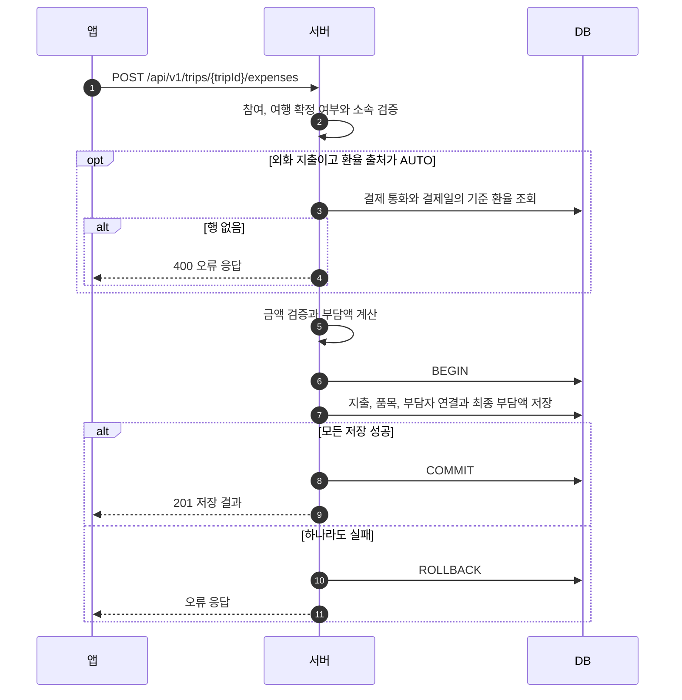
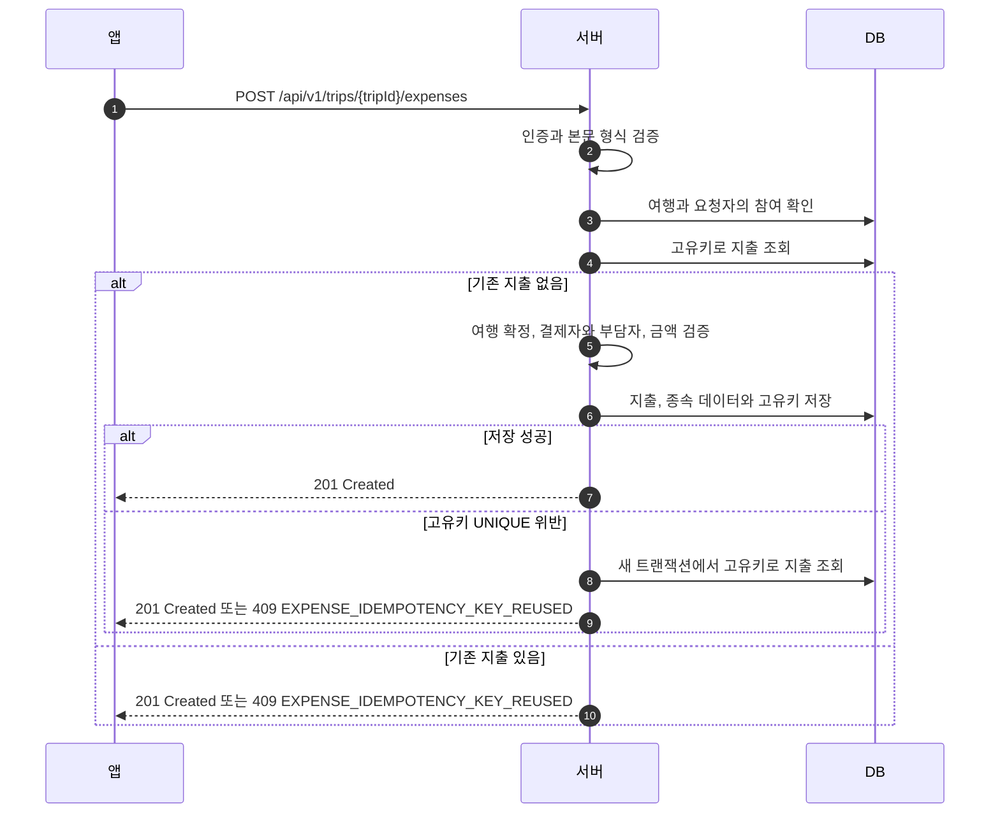
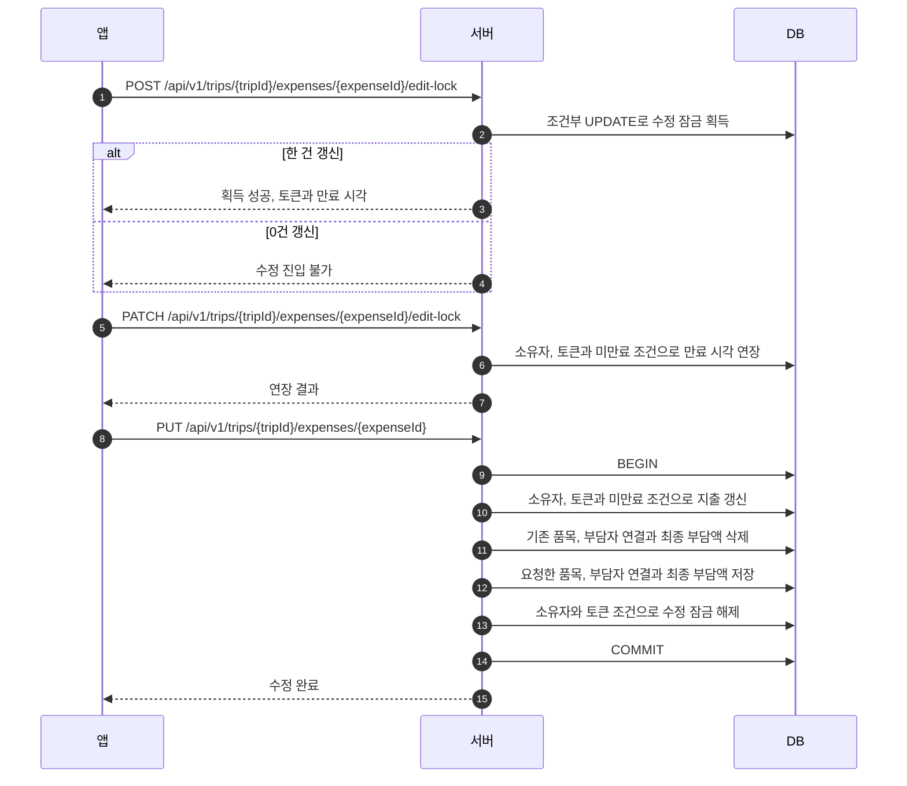
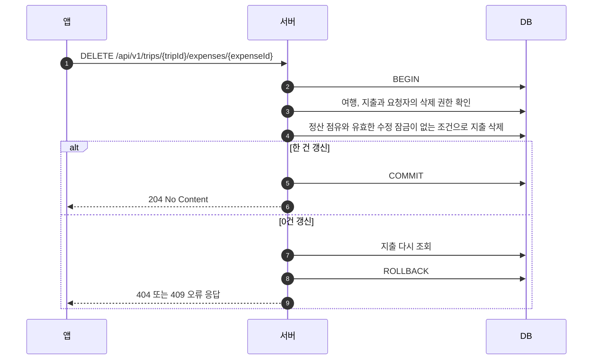
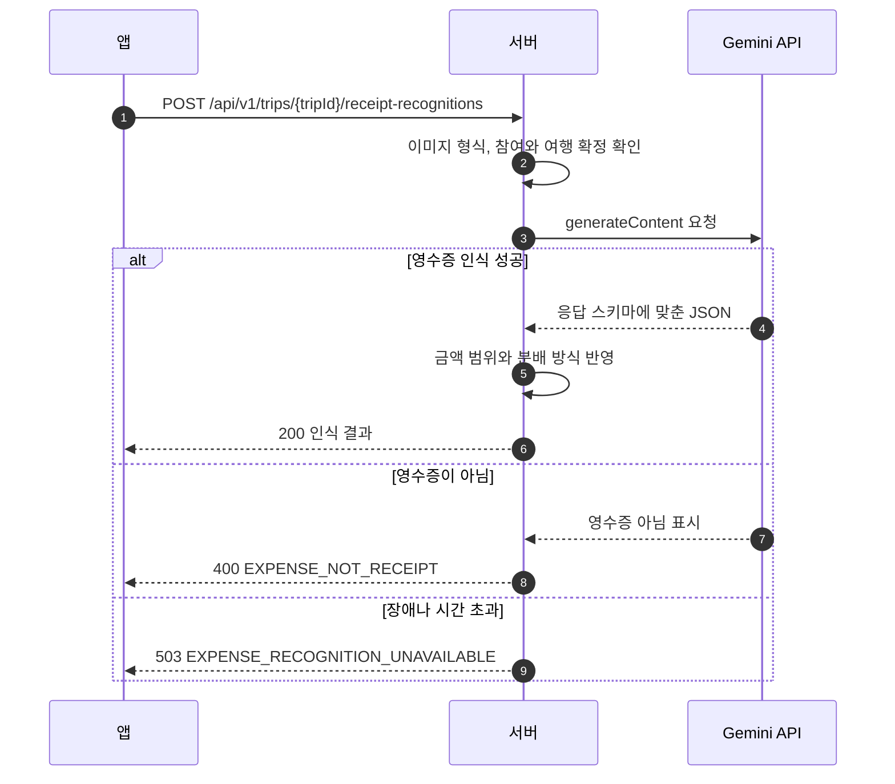

# 지출 설계서

## 개요

이 설계서는 지출의 계산과 저장, 지출 생성 멱등성, 지출 수정 잠금, 지출 삭제와 영수증 이미지 처리를 다룬다.
정산 준비가 지출을 점유하는 처리와 두 잠금의 경합은 [정산 설계서](settlement.md#정산-준비-잠금)를, 기본 환율 조회는 [환율 설계서](exchange-rate.md)를 따른다.
업무 규칙은 [지출 정책서](../policy/expense.md)와 [환율 정책서](../policy/exchange-rate.md)를 따른다.

## 지출 저장

서버는 지출, 품목, 품목별 부담자와 최종 부담액을 한 트랜잭션으로 저장하고, 적용 환율을 지출에 값으로 복사한다.

### 저장 데이터

| 이름 | 타입 | 제약 | 뜻 |
| --- | --- | --- | --- |
| `expense.trip_id` | `BIGINT` | NOT NULL, FK `trip.id` | 지출이 속한 여행 |
| `expense.name` | `VARCHAR(50)` | NOT NULL | 지출명 |
| `expense.split_type` | `split_type` | NOT NULL | 분배 방식. `EQUAL`(전체 1/N)과 `ITEM`(품목별) |
| `expense.original_amount` | `BIGINT` | NOT NULL | 할인 전 총액 |
| `expense.discount_amount` | `BIGINT` | NOT NULL | 전체 할인액 |
| `expense.amount` | `BIGINT` | NOT NULL | 최종 결제액 |
| `expense.currency` | `CHAR(3)` | NOT NULL | 결제 통화 |
| `expense.paid_date` | `DATE` | NOT NULL | 회원이 입력한 결제 당시의 현지 날짜 |
| `expense.payment_method` | `payment_method` | NOT NULL | 결제 수단. `CARD`, `CASH`, `TRAVEL_CARD` 중 하나 |
| `expense.payer_trip_member_id` | `BIGINT` | NOT NULL, FK `trip_member.id` | 결제자 |
| `expense.created_by_trip_member_id` | `BIGINT` | NOT NULL, FK `trip_member.id` | 기록자 |
| `expense.exchange_rate` | `DECIMAL(24,12)` | NOT NULL | 적용 환율. 결제 통화 1단위의 원화 금액 |
| `expense.exchange_rate_source` | `rate_source` | NOT NULL | 환율 결정 방식. `AUTO`(API 환율)와 `MANUAL`(직접 입력) |
| `expense.exchange_rate_provider` | `VARCHAR(50)` | NULL | 자동 환율을 고시한 기관의 코드. `ECB`는 유럽중앙은행. NULL이면 직접 입력 환율 또는 원화 지출 |
| `expense.exchange_rate_base_date` | `DATE` | NULL | 자동 환율의 실제 기준일. 결제일과 다를 수 있음. NULL이면 직접 입력 환율 또는 원화 지출 |
| `expense.krw_amount` | `BIGINT` | NOT NULL | 최종 결제액의 원화 환산액. 1원 단위 |
| `expense.settlement_id` | `BIGINT` | NULL, FK `settlement.id` | 지출을 점유한 정산. NULL이면 점유한 정산이 없음 |
| `expense.deleted_at` | `TIMESTAMPTZ` | NULL | 삭제 시각. NULL이면 삭제하지 않은 지출 |
| `expense_item.expense_id` | `BIGINT` | NOT NULL, FK `expense.id` | 품목이 속한 지출 |
| `expense_item.name` | `VARCHAR(50)` | NULL | 품목명. NULL이면 입력하지 않음 |
| `expense_item.amount` | `BIGINT` | NOT NULL | 할인 전 품목 금액 |
| `expense_item.discount_amount` | `BIGINT` | NOT NULL | 상품 할인액 |
| `expense_item.sort_order` | `INTEGER` | NOT NULL | 화면 표시 순서 |
| `expense_item_member.expense_item_id` | `BIGINT` | NOT NULL, FK `expense_item.id` | 부담자가 나누는 품목 |
| `expense_item_member.expense_id` | `BIGINT` | NOT NULL, FK `expense.id` | 품목이 속한 지출 |
| `expense_item_member.trip_member_id` | `BIGINT` | NOT NULL, FK `trip_member.id` | 품목의 부담자 |
| `expense_share_amount.expense_id` | `BIGINT` | NOT NULL, FK `expense.id` | 부담액의 지출 |
| `expense_share_amount.trip_id` | `BIGINT` | NOT NULL, FK `trip.id` | 부담액의 여행 |
| `expense_share_amount.trip_member_id` | `BIGINT` | NOT NULL, FK `trip_member.id` | 부담자 |
| `expense_share_amount.amount` | `BIGINT` | NOT NULL | 결제 통화의 최종 부담액 |
| `expense_share_amount.krw_amount` | `BIGINT` | NOT NULL | 원화로 환산한 최종 부담액. 1원 단위 |

- 결제 통화 금액 컬럼의 `BIGINT`는 [결제 통화의 최소 단위](../policy/expense.md#환산과-자투리)의 정수다. KRW 12000은 12000, USD 12.34는 1234로 저장한다.
- `krw_amount` 컬럼의 `BIGINT`는 1원 단위의 정수다.
- 서버는 품목의 `sort_order`를 요청한 품목 순서대로 0부터 매긴다.
- `expense_item_member`는 `(expense_item_id, trip_member_id)` 조합을 한 행만 둔다.
- `expense_share_amount`는 `(expense_id, trip_member_id)` 조합을 한 행만 둔다.
- 전체 1/N 지출이면 서버는 `expense_item` 행 없이 선택한 참여자별 부담액을 `expense_share_amount`에 저장한다.
- 품목별 지출이면 서버는 품목과 부담자 연결을 저장하고, 참여자별 합계를 `expense_share_amount`에 저장한다.
- 서버는 결제 시각, 시간대, 현재 위치와 국가코드를 저장하지 않는다.
- 서버는 등록 시각 `created_at`과 결제 날짜 `paid_date`를 구분해 저장한다.
- 지출을 저장하면 서버는 적용한 환율의 출처와 기준일을 `exchange_rate_source`, `exchange_rate_provider`, `exchange_rate_base_date`에 함께 보존한다([저장된 지출과 정산](../policy/exchange-rate.md#저장된-지출과-정산)).
- `expense.settlement_id`의 점유와 해제는 [정산 준비 잠금](settlement.md#정산-준비-잠금)을 따른다.

### 처리 흐름

다음은 지출 생성 요청의 처리 순서다.



- 부담액 계산 결과를 확인하는 단계에서 서버는 지출을 저장하지 않는다.
- 서버는 요청자의 여행 참여, 여행 확정 여부, 결제자와 부담자의 같은 여행 소속을 복합 FK 없이 서버에서 검증한다.
- 서버는 저장 요청에 계산 결과를 받지 않고 최종 결제액, 참여자별 부담액과 원화 환산액을 직접 계산한다. 근거: [Issue #82 논의 결과](https://github.com/JECT-Study/Billit-5th-Docs/issues/82)
- 외화 지출의 `exchangeRateSource`가 `AUTO`이면 서버는 `reference_exchange_rate`에서 고시 기관 `ECB`, 결제 통화와 `paidDate`가 같은 행을 조회한다.
- `AUTO`이면 서버는 요청의 `exchangeRate` 대신 조회한 기준 환율을 소수점 셋째 자리에서 `HALF_UP`으로 반올림해 `expense.exchange_rate`에 저장하고 적용한다. 반올림은 [결제일 기준 환율 조회](exchange-rate.md#결제일-기준-환율-조회)의 응답 `rate`와 같다.
- `AUTO`이면 서버는 조회한 행의 `provider`와 `base_date`를 `expense.exchange_rate_provider`와 `expense.exchange_rate_base_date`에 저장한다.
- `exchangeRateSource`가 `MANUAL`이거나 결제 통화가 `KRW`이면 서버는 요청의 `exchangeRate`를 적용하고 `expense.exchange_rate_provider`와 `expense.exchange_rate_base_date`를 NULL로 저장한다.
- 서버는 지출을 저장하거나 수정할 때 고시 기관 API를 호출하지 않는다.
- 서버는 같은 저장 요청의 중복 반영을 [지출 생성 멱등성](#지출-생성-멱등성)으로 막는다.
- 지출을 수정하면 서버는 생성과 같은 계산 기준과 환율 적용 방식을 쓴다.
- 지출 수정 API는 `PUT`으로 수정할 수 있는 입력값 전체를 받는다.
- 지출을 수정하면 서버는 기존 품목, 품목별 부담자 연결과 최종 부담액을 모두 삭제하고 요청대로 다시 저장한다. 근거: [Issue #88 논의 결과](https://github.com/JECT-Study/Billit-5th-Docs/issues/88)
- 서버가 품목을 다시 저장하므로 지출을 수정할 때마다 `expense_item.id`가 바뀐다.

서버는 부담액을 계산할 때 이 순서를 따른다.

1. 금액과 환율의 범위, 부담 참여자를 검증한다.
2. 금액을 결제 통화의 최소 단위 정수로 바꾼다.
3. 최종 결제액을 구한다.
4. 참여자별 부담 비율을 구한다.
5. 최종 결제액을 부담 비율대로 나누고 자투리를 배정한다.
6. 최종 결제액을 원화로 환산한다.
7. 원화 환산액을 결제 통화 부담액의 비율대로 나누고 자투리를 배정한다.

다음 표는 분배 방식별 최종 결제액이다.

| 분배 방식 | 최종 결제액 |
| --- | --- |
| 전체 1/N | `original_amount - discount_amount` |
| 품목별 | `original_amount - SUM(품목 discount_amount) - expense.discount_amount` |

- 상품 할인은 `expense_item.discount_amount`에만 저장하고, 최종 결제액에서 한 번만 뺀다.
- 부담 비율의 정의는 [분배와 할인](../policy/expense.md#분배와-할인)을, 자투리의 배정 순서와 원화 반올림은 [환산과 자투리](../policy/expense.md#환산과-자투리)를 따른다.
- 서버는 품목마다 부담자 수의 최소공배수를 곱해 부담 비율을 정수로 구하므로, 비율을 구하는 단계에서 반올림하지 않는다.
- 서버는 금액에 부담 비율을 곱해 비율의 합으로 나눈 몫을 먼저 배정하고, 남은 최소 단위를 나머지가 큰 참여자부터 1씩 더한다.
- 서버는 원화 환산액의 반올림에 `HALF_UP`을 쓴다.

다음은 저장 결과를 보여 주는 가상 예시다.

```text
1. 민지가 12,000원짜리 식사를 결제하고 지훈, 서연과 전체 1/N으로 나눈다. 할인과 환산은 없다.
   결과: `expense` 한 행(결제자 민지, `amount = 12000`, `currency = KRW`, `exchange_rate = 1`)과 `expense_share_amount` 세 행(각 4,000원)을 저장한다. `expense_item`과 `expense_item_member`에는 행을 만들지 않는다.

2. 민지와 지훈이 8,000원짜리 피자를 나누고 민지만 4,000원짜리 음료를 마신다. 피자에만 상품 할인 2,000원이 있다.
   결과: `expense.original_amount = 12000`, `expense.discount_amount = 0`, `expense.amount = 10000`이다. 피자 행의 `discount_amount`는 2,000원이다. 부담액은 민지 7,000원, 지훈 3,000원이다.

3. 2번 지출에 전체 할인 1,000원이 더 있다.
   결과: 민지의 할인액은 700원, 지훈은 300원이다. 최종 부담액은 민지 6,300원, 지훈 2,700원이고 합계는 최종 결제액 9,000원이다.

4. 민지(`trip_member_id = 3`), 지훈(`5`), 서연(`9`)이 10,000원을 전체 1/N으로 나눈다.
   결과: 3,333원씩 배정하면 1원이 남는다. 세 참여자의 나머지가 같으므로 `trip_member_id`가 가장 작은 민지가 1원을 더 받는다. 부담액은 민지 3,334원, 지훈 3,333원, 서연 3,333원이다.

5. 4번의 세 사람이 USD 10.00을 환율 1,380.55로 전체 1/N으로 나눈다.
   결과: 결제 통화 부담액은 민지 3.34달러, 지훈 3.33달러, 서연 3.33달러다. 원화 환산액 13,805.5원을 반올림해 `krw_amount = 13806`이다. 13,806원을 334:333:333으로 나누면 몫은 4,611원, 4,597원, 4,597원이고 1원이 남는다. 나머지가 큰 지훈과 서연 중 `trip_member_id`가 작은 지훈이 1원을 받는다. 원화 부담액은 민지 4,611원, 지훈 4,598원, 서연 4,597원이다.
```

### 트랜잭션과 동시성

- 서버는 지출, 품목, 품목별 부담자 연결과 최종 부담액을 한 트랜잭션에서 저장한다.
- 서버는 커밋에 성공한 뒤에만 저장 결과를 반환한다.
- 서버는 `AUTO`의 기준 환율을 지출 저장 트랜잭션을 열기 전에 조회한다.
- 지출을 수정하면 서버는 [지출 수정 잠금](#지출-수정-잠금)을 검증한 트랜잭션에서 지출과 종속 데이터를 갱신하고 잠금을 해제한다.

### 실패 처리

- 저장 중 하나라도 실패하면 서버는 같은 트랜잭션에서 저장한 지출, 품목, 부담자 연결과 부담액을 모두 롤백한다.
- 외화 지출의 `exchangeRateSource`가 `AUTO`인데 결제 통화와 `paidDate`가 같은 기준 환율 행이 없으면 서버는 지출을 저장하지 않고 `400`으로 거절한다.
- 입력 금액이 [분배와 할인](../policy/expense.md#분배와-할인)이나 [환산과 자투리](../policy/expense.md#환산과-자투리)의 기준을 벗어나면 서버는 지출을 저장하지 않는다. 오류 응답은 [EXP-03 지출 생성](../api-spec/expense.md#exp-03-지출-생성)을 따른다.

### 검증

- 할인과 자투리를 반영해도 참여자별 부담액의 합계는 최종 결제액과 같다.
- 같은 입력으로 두 번 계산하면 서버는 같은 부담액을 저장한다.
- 10,000원을 세 명이 전체 1/N으로 나누면 서버는 `trip_member_id`가 가장 작은 참여자에게 3,334원을 저장한다.
- 외화 지출에서 참여자별 `krw_amount`의 합계는 `expense.krw_amount`와 같다.
- 부담액 저장이 실패하면 서버는 같은 요청의 지출과 품목도 저장하지 않는다.
- 외화 지출을 `AUTO`로 저장하면 서버는 조회한 기준 환율과 그 행의 `provider`, `base_date`를 지출에 저장한다.
- 요청의 `exchangeRate`가 기준 환율과 달라도 `AUTO`이면 서버는 기준 환율을 적용한다.
- 기준 환율 행의 `rate`가 `9.0909`이면 서버는 `expense.exchange_rate`에 `9.09`를 저장한다.
- `MANUAL` 지출이나 원화 지출을 저장하면 서버는 `exchange_rate_provider`와 `exchange_rate_base_date`를 NULL로 저장한다.
- `AUTO`인 외화 지출의 기준 환율 행이 없으면 서버는 지출을 저장하지 않고 `400`을 반환한다.
- 지출을 저장하는 동안 서버는 고시 기관 API를 호출하지 않는다.
- 지출을 저장한 뒤 개인 환율을 등록하거나 삭제해도 서버는 저장한 지출의 `exchange_rate`와 부담액을 바꾸지 않는다.

## 지출 생성 멱등성

앱은 지출 생성 요청의 `Idempotency-Key` 헤더에 UUID 형식의 고유키를 보내고, 서버는 같은 회원이 같은 여행에서 같은 키로 다시 보낸 요청에 처음 만든 지출을 반환한다.

### 저장 데이터

| 이름 | 타입 | 제약 | 뜻 |
| --- | --- | --- | --- |
| `expense.idempotency_key` | `UUID` | NOT NULL, UNIQUE `uq_expense_idempotency_key` | 앱이 만든 지출 생성 고유키 |

- 서버는 고유키를 지출 생성에만 쓴다.
- 서버는 키 하나로 지출 하나만 만든다.
- 서버는 고유키를 만료 없이 지출과 함께 보관한다.
- 서버는 키를 사용한 회원을 그 키로 만든 지출의 `created_by_trip_member_id`로 확인한다.

### 처리 흐름

다음은 지출 생성 요청의 고유키 처리 순서다.



- 앱은 저장 시도마다 새 키를 만든다.
- 응답을 받지 못해 같은 저장을 다시 보낼 때만 앱은 같은 키를 쓴다.
- 서버는 본문 형식 검증, 여행과 참여 확인을 고유키 조회보다 먼저 실행한다.
- 서버는 여행 확정 여부, 결제자와 부담자, 금액의 검증을 고유키 조회 뒤에 실행한다.
- 서버는 같은 키의 요청을 같은 저장 요청의 재시도로 보고 처음 요청의 본문과 비교하지 않는다. 근거: [Issue #85 논의 결과](https://github.com/JECT-Study/Billit-5th-Docs/issues/85)
- 고유키로 찾은 지출을 같은 여행에서 같은 회원이 기록했고 삭제하지 않았으면 서버는 `201 Created`, `Location`과 그 지출의 현재 상세를 반환한다.
- 서버는 잠금 토큰과 저장 요청의 고유키를 섞어 쓰지 않는다.

다음은 커밋한 뒤 앱이 응답을 받지 못한 상황의 가상 예시다.

```text
1. 민지가 숙소비 저장을 누르고 앱이 고유키 `save-A`를 보낸다. 서버는 지출 501을 저장해 커밋했지만 앱은 응답을 받지 못한다.
   결과: 지출 501이 한 건 저장되어 있다.

2. 앱이 같은 숙소비 저장을 `save-A`로 다시 보낸다.
   결과: 서버는 새 지출을 만들지 않고 지출 501의 현재 상세를 `201 Created`로 반환한다. 숙소비는 한 건만 남는다.
```

### 트랜잭션과 동시성

- 서버는 처음 처리하는 요청의 지출, 종속 데이터와 고유키를 한 트랜잭션에서 저장한다.
- 서버는 지출 생성 처리 전체를 한 트랜잭션으로 묶지 않는다. PostgreSQL은 오류가 난 트랜잭션에서 조회를 실행할 수 없기 때문이다.
- 서버는 고유키를 사전에 조회한 결과만으로 같은 키의 동시 요청을 막지 않는다.
- 고유키 중복으로 저장에 실패하면 서버는 그 트랜잭션을 롤백한다.
- 롤백한 뒤 서버는 새 트랜잭션에서 고유키로 지출을 다시 조회한다.
- 같은 키의 요청이 동시에 오면 서버는 지출을 하나만 만든다.
- 같은 키의 동시 요청 중 늦게 처리한 요청에 서버는 재요청과 같은 응답을 보낸다.

### 실패 처리

- 키가 없거나 UUID 형식이 아니면 서버는 `400`으로 거절한다.
- 요청자가 여행에 참여 중이 아니면 서버는 같은 키의 재요청이어도 `403`으로 거절한다.
- 다른 회원이나 다른 여행에서 사용한 키이면 서버는 기존 지출 정보를 반환하지 않고 `409 EXPENSE_IDEMPOTENCY_KEY_REUSED`로 거절한다.
- 그 키로 만든 지출이 삭제되었으면 서버는 `409 EXPENSE_IDEMPOTENCY_KEY_REUSED`로 거절한다.
- 다시 조회했을 때 지출 행이 없으면 서버는 `409 EXPENSE_IDEMPOTENCY_KEY_REUSED`로 거절한다.
- 위반한 제약이 `uq_expense_idempotency_key`일 때만 서버는 고유키 중복으로 판단한다.
- 지출, 품목이나 부담액의 저장이 롤백되면 서버는 고유키를 성공한 요청으로 남기지 않는다.

### 검증

- 같은 고유키의 요청이 동시에 오면 서버는 지출을 한 건만 저장한다.
- 커밋한 뒤 응답을 받지 못한 요청을 같은 고유키로 다시 보내면 서버는 지출을 추가로 저장하지 않는다.
- 전체 롤백된 요청을 같은 고유키로 다시 보내면 서버는 지출을 저장한다.
- 다른 회원이 사용한 키로 요청하면 서버는 `409 EXPENSE_IDEMPOTENCY_KEY_REUSED`로 거절한다.
- 같은 회원이 같은 키로 본문 값을 바꿔 요청하면 서버는 처음 만든 지출을 반환한다.

## 지출 수정 잠금

서버는 수정 소유자, 토큰과 만료 시각을 `expense` 행에 저장하고, 조건부 갱신에 성공한 요청에만 지출 수정을 허용한다.
잠금의 유효 시간과 연장 단위는 [수정과 잠금](../policy/expense.md#수정과-잠금)을 따른다.

### 저장 데이터

| 이름 | 타입 | 제약 | 뜻 |
| --- | --- | --- | --- |
| `expense.edit_lock_owner_trip_member_id` | `BIGINT` | NULL, FK `trip_member.id` | 수정 잠금 소유자. NULL이면 수정 잠금이 없음 |
| `expense.edit_lock_expires_at` | `TIMESTAMPTZ` | NULL | 수정 잠금 만료 시각. NULL이면 수정 잠금이 없음 |
| `expense.edit_lock_token` | `UUID` | NULL | 수정 작업을 식별하는 잠금 토큰. NULL이면 수정 잠금이 없음 |

- 수정 잠금이 없으면 소유자, 만료 시각과 토큰은 모두 NULL이다.
- 수정 잠금이 있으면 소유자, 만료 시각과 토큰은 모두 값이 있다.
- 서버는 잠금을 해제하거나 교체할 때 소유자, 만료 시각과 토큰을 함께 바꾼다.
- 서버는 수정을 시작할 때마다 토큰을 새로 발급한다.
- 토큰은 인증과 권한 검증을 대체하지 않는다.
- 서버는 잠금 칼럼만 바꾸는 획득, 연장과 해제에서 `updated_at`을 바꾸지 않는다. 근거: [Issue #86 논의 결과](https://github.com/JECT-Study/Billit-5th-Docs/issues/86)

### 처리 흐름

다음은 수정 잠금의 획득부터 수정 저장까지의 호출 순서다.



- 서버는 요청자가 지출의 기록자나 관리자인지 검증한다.
- 서버는 `:now`와 `:expires_at`을 앱의 입력이 아니라 서버 시각으로 계산한다.
- 획득할 때 `:expires_at`은 `:now`에 잠금의 유효 시간을 더하고 초 단위로 내린 값이다.
- 연장할 때 서버는 요청마다 기존 `edit_lock_expires_at`에 연장 단위 `:extension`을 더한다.
- 같은 사용자라도 서버는 유효한 잠금을 새 획득 요청으로 덮어쓰지 않는다. 앱은 기존 토큰으로 연장한다.
- 수정 화면을 나가면 앱은 `DELETE /api/v1/trips/{tripId}/expenses/{expenseId}/edit-lock`으로 잠금을 해제한다.
- 같은 사용자의 요청도 다른 작업일 수 있으므로, 서버는 잠금을 해제할 때 사용자 ID와 토큰을 함께 비교한다.

### 쿼리

서버는 수정 권한을 검증한 뒤 아래 쿼리를 단독 트랜잭션에서 실행한다.
다음 쿼리는 정산 점유가 없고 유효한 수정 잠금이 없는 지출의 수정 잠금을 획득한다.

```sql
-- 수정 잠금 획득
UPDATE expense
SET edit_lock_owner_trip_member_id = :requester_trip_member_id,
    edit_lock_token = :new_token,
    edit_lock_expires_at = :expires_at
WHERE id = :expense_id
  AND trip_id = :trip_id
  AND deleted_at IS NULL
  AND settlement_id IS NULL
  AND (
      edit_lock_expires_at IS NULL
      OR edit_lock_expires_at <= :now
  )
RETURNING id, edit_lock_token, edit_lock_expires_at;
```

서버는 아래 쿼리를 단독 트랜잭션에서 실행한다.
다음 쿼리는 소유자와 토큰이 맞고 만료되지 않은 수정 잠금의 만료 시각을 늘린다.

```sql
-- 수정 잠금 연장
UPDATE expense
SET edit_lock_expires_at = edit_lock_expires_at + :extension
WHERE id = :expense_id
  AND trip_id = :trip_id
  AND deleted_at IS NULL
  AND settlement_id IS NULL
  AND edit_lock_owner_trip_member_id = :requester_trip_member_id
  AND edit_lock_token = :token
  AND edit_lock_expires_at > :now
RETURNING id, edit_lock_expires_at;
```

서버는 연장 요청마다 기존 만료 시각에 연장 단위를 더하므로, 늦게 도착한 연장 요청도 만료 시각을 줄이지 않는다.

서버는 수정할 수 있는 결제 정보 전체와 부담액을 아래 쿼리와 같은 조건으로 갱신한다.
다음은 수정 저장 트랜잭션의 첫 단계에서 소유자, 토큰과 만료 조건을 다시 검사하며 지출명과 금액을 바꾸는 축약 쿼리다.

```sql
-- 수정 저장의 지출 갱신
UPDATE expense
SET name = :name,
    original_amount = :original_amount,
    discount_amount = :discount_amount,
    amount = :amount,
    krw_amount = :krw_amount,
    updated_at = :now
WHERE id = :expense_id
  AND trip_id = :trip_id
  AND deleted_at IS NULL
  AND settlement_id IS NULL
  AND edit_lock_owner_trip_member_id = :requester_trip_member_id
  AND edit_lock_token = :token
  AND edit_lock_expires_at > :now
RETURNING id;
```

서버는 아래 쿼리를 수정 저장 트랜잭션의 마지막 단계와 정상 이탈 요청에서 실행한다.
다음 쿼리는 소유자와 토큰이 맞을 때만 수정 잠금을 비운다.

```sql
-- 수정 잠금 해제
UPDATE expense
SET edit_lock_owner_trip_member_id = NULL,
    edit_lock_token = NULL,
    edit_lock_expires_at = NULL
WHERE id = :expense_id
  AND trip_id = :trip_id
  AND edit_lock_owner_trip_member_id = :requester_trip_member_id
  AND edit_lock_token = :token
RETURNING id;
```

해제 쿼리는 정산 점유를 조건에 넣지 않는다.
토큰이 맞는 해제 요청을 정산 점유 때문에 거절하지 않기 위해서다. 근거: [Issue #86 논의 결과](https://github.com/JECT-Study/Billit-5th-Docs/issues/86)

### 트랜잭션과 동시성

- 서버는 수정 저장의 권한 검증, 지출 갱신, 종속 데이터 갱신과 잠금 해제를 한 트랜잭션에서 실행한다.
- 서버는 지출 갱신으로 얻은 행 잠금을 커밋할 때까지 유지한다.
- 서버는 수정 저장의 지출 조회와 지출 갱신을 다른 트랜잭션으로 나누지 않는다.
- 서버는 조건부 UPDATE 직전에 서버 시각을 한 번 구한다.
- 행 잠금을 기다리는 동안 다른 요청이 행을 바꾸면 서버는 바뀐 행으로 조건을 다시 확인해 조건에 맞지 않는 요청을 거절한다.
- 회원이 화면에서 지출을 편집하는 동안 서버는 DB 트랜잭션을 열어 두지 않는다.
- 정산 준비가 같은 지출을 점유하려고 경합하면 서버는 [수정과 정산 준비의 경합](settlement.md#수정과-정산-준비의-경합)을 따른다.

### 실패 처리

- `settlement_id`가 만료된 준비 정산을 가리키면 서버는 [만료된 정산 준비 정리](settlement.md#만료된-정산-준비-정리)를 거친 뒤 수정 잠금 획득을 다시 시도한다.
- 수정 잠금 획득의 갱신이 0건이고 지출에 정산 점유가 남아 있으면 서버는 `409 EXPENSE_SETTLEMENT_LOCKED`로 거절한다.
- 수정 잠금 획득의 갱신이 0건이고 그 사이 지출이 삭제되었으면 서버는 `404`로 거절한다.
- 수정 잠금 획득의 갱신이 0건이고 다른 사유가 없으면 서버는 유효한 잠금이 있다고 보고 `409 EXPENSE_EDIT_LOCKED`로 거절한다.
- 수정 잠금 연장의 갱신이 0건이면 서버는 기존 토큰의 수정 권한을 인정하지 않고 `409 EXPENSE_EDIT_LOCK_INVALID`로 거절한다.
- 만료된 토큰으로 연장을 요청하면 서버는 잠금을 되살리지 않는다. 앱은 수정 잠금을 다시 획득해야 한다.
- 수정 저장의 지출 갱신이 0건이면 서버는 트랜잭션을 롤백한다.
- 수정 저장의 지출 갱신이 0건이고 지출에 정산 점유가 있으면 서버는 `409 EXPENSE_SETTLEMENT_LOCKED`로 거절한다.
- 수정 저장의 지출 갱신이 0건이고 그 사이 지출이 삭제되었으면 서버는 `404`로 거절한다.
- 수정 저장의 지출 갱신이 0건이고 다른 사유가 없으면 서버는 `409 EXPENSE_EDIT_LOCK_INVALID`로 거절한다.
- 수정 저장 트랜잭션에서 수정 잠금 해제의 갱신이 0건이면 서버는 그 트랜잭션을 롤백한다.
- 수정 저장 중 종속 데이터의 삭제나 저장이 실패하면 서버는 지출 갱신, 기존 종속 데이터의 삭제와 잠금 해제를 함께 롤백한다.
- 정상 이탈 요청에서 해제의 갱신이 0건이고 다른 토큰이나 다른 회원의 유효한 잠금이 있으면 서버는 그 잠금을 유지하고 `409 EXPENSE_EDIT_LOCK_INVALID`로 거절한다.
- 정상 이탈 요청에서 해제의 갱신이 0건이고 유효한 잠금이 없으면 서버는 같은 요청의 재시도로 보고 `204`로 응답한다.

다음은 이전 토큰의 해제 요청이 늦게 도착한 가상 예시다.

```text
1. 민지가 지출 101의 수정 잠금을 획득한다.
   결과: 소유자 민지, 토큰 `edit-A`가 저장된다.

2. `edit-A`가 만료된 뒤 민지가 다시 수정 잠금을 획득한다.
   결과: 소유자 민지, 토큰 `edit-B`가 저장된다.

3. 첫 화면에서 보낸 `edit-A`의 해제 요청이 늦게 도착한다.
   결과: 토큰이 달라 0건 갱신이며 `edit-B`가 유지된다. 서버는 `409 EXPENSE_EDIT_LOCK_INVALID`로 응답한다.
```

### 검증

- 같은 사용자가 수정 잠금을 다시 획득한 뒤 이전 토큰으로 해제하거나 저장하면 서버는 새 작업의 잠금과 데이터를 바꾸지 않는다.
- 만료된 수정 토큰으로 연장하면 서버는 잠금을 되살리지 않는다.
- 두 회원이 같은 지출의 수정 잠금을 동시에 요청하면 서버는 한 회원에게만 잠금을 준다.
- 같은 잠금을 두 번 연장하면 서버는 만료 시각을 4분 늘린다.
- 유효한 잠금이 없을 때 해제를 요청하면 서버는 `204`로 응답한다.
- 수정 저장 중 품목 저장이 실패하면 서버는 기존 지출, 품목, 품목별 부담자 연결, 최종 부담액과 수정 잠금을 그대로 둔다.
- 품목별 지출을 전체 1/N으로 수정하면 서버는 그 지출의 `expense_item`과 `expense_item_member` 행을 모두 삭제한다.
- 수정 저장에 성공한 뒤 같은 토큰으로 다시 저장을 요청하면 서버는 `409 EXPENSE_EDIT_LOCK_INVALID`로 거절한다.

## 지출 삭제

서버는 `expense.deleted_at`에 삭제 시각을 기록하는 논리 삭제로 지출을 삭제한다.
서버는 정산 점유와 유효한 수정 잠금이 없는 지출만 조건부 UPDATE 한 번으로 삭제한다.
삭제 권한과 삭제할 수 없는 지출은 [등록과 권한](../policy/expense.md#등록과-권한)을 따른다.

### 처리 흐름

다음은 지출 삭제 요청의 처리 순서다.



- 서버는 `:now`를 앱의 입력이 아니라 서버 시각으로 구한다.
- 서버는 삭제한 지출의 품목, 품목별 부담자 연결, 최종 부담액과 생성 고유키를 지우지 않는다.
- 서버는 여행과 참여자의 누적 부담액을 합산할 때 삭제한 지출의 `expense_share_amount` 행을 더하지 않는다.
- 삭제한 지출의 생성 고유키로 지출 생성을 다시 요청하면 서버는 [지출 생성 멱등성](#지출-생성-멱등성)의 실패 처리에 따라 거절한다.

### 쿼리

서버는 삭제 권한을 확인한 트랜잭션에서 아래 쿼리를 실행한다.
다음 쿼리는 정산 점유가 없고 유효한 수정 잠금이 없는 지출에 삭제 시각과 수정 시각을 같은 값으로 기록한다.

```sql
-- 지출 삭제
UPDATE expense
SET deleted_at = :now,
    updated_at = :now
WHERE id = :expense_id
  AND trip_id = :trip_id
  AND deleted_at IS NULL
  AND settlement_id IS NULL
  AND (
      edit_lock_expires_at IS NULL
      OR edit_lock_expires_at <= :now
  )
RETURNING id;
```

삭제 쿼리는 수정 잠금 획득 쿼리와 같은 점유 조건을 검사한다.
삭제 쿼리는 수정 잠금의 소유자를 조건에 넣지 않는다.
요청한 회원의 유효한 잠금이 있어도 지출을 삭제하지 않기 위해서다. 근거: [Issue #89 논의 결과](https://github.com/JECT-Study/Billit-5th-Docs/issues/89)

### 트랜잭션과 동시성

- 서버는 삭제 권한 확인, 지출 삭제와 갱신이 0건일 때의 지출 조회를 한 트랜잭션에서 실행한다.
- 서버는 지출을 조회한 결과로 삭제 여부를 정하지 않고, 조건부 UPDATE의 결과로 정한다.
- 서버는 커밋에 성공한 뒤에만 `204`를 반환한다.
- 같은 지출의 수정 잠금 획득, 수정 저장이나 정산 준비와 경합하면 서버는 [수정과 정산 준비의 경합](settlement.md#수정과-정산-준비의-경합)을 따른다.

### 실패 처리

- 지출 삭제의 갱신이 0건이면 서버는 트랜잭션을 롤백한다.
- 지출 삭제의 갱신이 0건이고 지출에 정산 점유가 남아 있으면 서버는 `409 EXPENSE_SETTLEMENT_LOCKED`로 거절한다.
- 지출 삭제의 갱신이 0건이고 그 사이 지출이 삭제되었으면 서버는 `404`로 거절한다.
- 지출 삭제의 갱신이 0건이고 다른 사유가 없으면 서버는 유효한 수정 잠금이 있다고 보고 `409 EXPENSE_EDIT_LOCKED`로 거절한다.

### 검증

- 기록자가 지출을 삭제하면 서버는 그 지출의 `deleted_at`과 `updated_at`에 같은 시각을 기록한다.
- 지출을 삭제해도 서버는 그 지출의 `expense_item`, `expense_item_member`, `expense_share_amount` 행과 `idempotency_key`를 그대로 둔다.
- 만료되지 않은 수정 잠금이 있으면 잠금을 획득한 회원이 삭제를 요청해도 서버는 `409 EXPENSE_EDIT_LOCKED`로 거절한다.
- 수정 잠금의 만료 시각이 현재 시각과 같거나 지났으면 서버는 지출을 삭제한다.
- 정산이 점유한 지출의 삭제를 요청하면 서버는 `409 EXPENSE_SETTLEMENT_LOCKED`로 거절한다.
- 같은 지출에 삭제와 수정 잠금 획득이 동시에 오면 서버는 둘 중 하나만 반영한다.
- 같은 지출의 삭제 요청이 동시에 두 번 오면 서버는 지출을 한 번만 삭제한다.
- 같은 지출의 삭제 요청이 동시에 두 번 오면 서버는 둘 중 한 요청을 `404`로 거절한다.
- 이미 삭제한 지출을 다시 삭제하면 서버는 처음 삭제 시각을 바꾸지 않는다.

## 영수증 이미지 처리

서버는 앱에서 받은 영수증 이미지를 인식 Port로 보내고, Gemini Adapter가 Gemini API로 지출 정보를 추출한다.
인식 엔진을 바꿔도 서버는 API, 인식 결과 모델과 오류 코드를 바꾸지 않는다. 근거: [JECT-Study/Billit-5th-Server#83](https://github.com/JECT-Study/Billit-5th-Server/pull/83)
서버는 영수증 이미지를 메모리에서만 처리한다. 근거: [Issue #16](https://github.com/JECT-Study/Billit-5th-Docs/issues/16)

### 처리 흐름

다음은 영수증 인식의 호출 순서다.



- 서버는 Gemini API를 결제를 연결한 Cloud 프로젝트의 유료 티어로만 호출한다.
- 서버는 상태를 남기지 않는 `generateContent`를 쓰고 Interactions API를 쓰지 않는다. Interactions API는 유료 등급에서도 요청 내용을 기본 55일 저장하기 때문이다. 근거: [JECT-Study/Billit-5th-Server#82](https://github.com/JECT-Study/Billit-5th-Server/pull/82)
- 서버는 Google 검색 그라운딩을 쓰지 않는다. 그라운딩은 요청 데이터를 30일 따로 보관하기 때문이다.
- 서버는 응답 형식을 JSON 스키마로 지정하고, 스키마에는 인식 결과 모델의 값과 영수증 여부만 넣는다.
- 서버는 이미지를 Gemini API에 보내기 전에 민감 정보를 가리지 않는다.
- 서버는 응답 스키마와 인식 결과 모델에 카드번호, 카드 승인번호, 영수증 번호, 카드사, 가맹점 사업자번호, 주소와 전화번호를 담을 필드를 두지 않는다.
- 서버는 카드번호, 카드 승인번호, 영수증 번호, 카드사, 가맹점 사업자번호, 주소와 전화번호를 저장하지 않는다.
- 서버는 영수증 이미지를 디스크와 Object Storage에 쓰지 않는다.
- 인식이 끝나면 서버는 원본 이미지를 버린다.
- 서버는 웹 서버 접근 로그와 애플리케이션 로그에 요청 본문을 남기지 않는다.
- 인식에 실패하면 서버는 로그에 실패 사유와 HTTP 상태만 남기고, 인식 원문과 Gemini 오류 본문은 남기지 않는다.
- 서버는 Gemini API 호출을 재시도하지 않는다.
- 서버는 동시에 처리하는 영수증 인식 요청의 수를 제한한다.

수탁자와 국외 이전은 [개인정보 정책서](../policy/privacy.md#처리-위탁과-국외-이전)를, 서버 설정과 동시에 처리할 요청의 최대 수는 [운영 환경과 개인정보 보호](operations-privacy.md#영수증-인식-경로의-서버-설정)를 따른다.

### 실패 처리

- 이미지의 Content-Type과 파일 앞부분의 형식 표시가 JPEG, PNG, HEIC, WebP 중 같은 형식을 가리키지 않으면 서버는 Gemini API를 호출하지 않고 `415 EXPENSE_RECEIPT_UNSUPPORTED`로 거절한다.
- Gemini API가 영수증이 아니라고 응답하면 서버는 `400 EXPENSE_NOT_RECEIPT`로 응답한다.
- Gemini API에 2초 안에 연결하지 못하거나 20초 안에 응답을 받지 못하면 서버는 `503 EXPENSE_RECOGNITION_UNAVAILABLE`로 응답한다.
- Gemini API가 오류를 응답하거나 해석할 수 없는 응답을 보내면 서버는 `503 EXPENSE_RECOGNITION_UNAVAILABLE`로 응답한다.
- API 키가 없거나 인식 엔진을 끄면 서버는 Gemini API를 호출하지 않고 `503 EXPENSE_RECOGNITION_UNAVAILABLE`로 응답한다.
- 외부 장애나 시간 초과가 생기면 서버는 빈 인식 결과로 대신 응답하지 않는다.

### 검증

- 실제 영수증 이미지를 업로드하면 서버는 요청을 처리하는 동안 Tomcat 임시 디렉터리에 파일을 만들지 않는다.
- 서버는 영수증 인식 응답에 카드번호, 카드 승인번호, 영수증 번호, 카드사, 가맹점 사업자번호, 주소와 전화번호를 담지 않는다.
- 영수증이 아닌 이미지를 보내면 서버는 `400 EXPENSE_NOT_RECEIPT`로 응답한다.
- Gemini API가 20초 안에 응답하지 않으면 서버는 `503 EXPENSE_RECOGNITION_UNAVAILABLE`로 응답한다.
