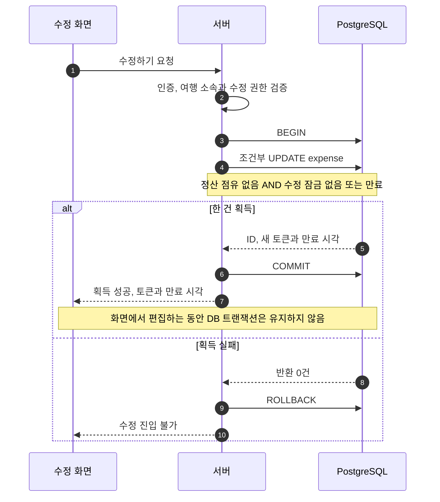
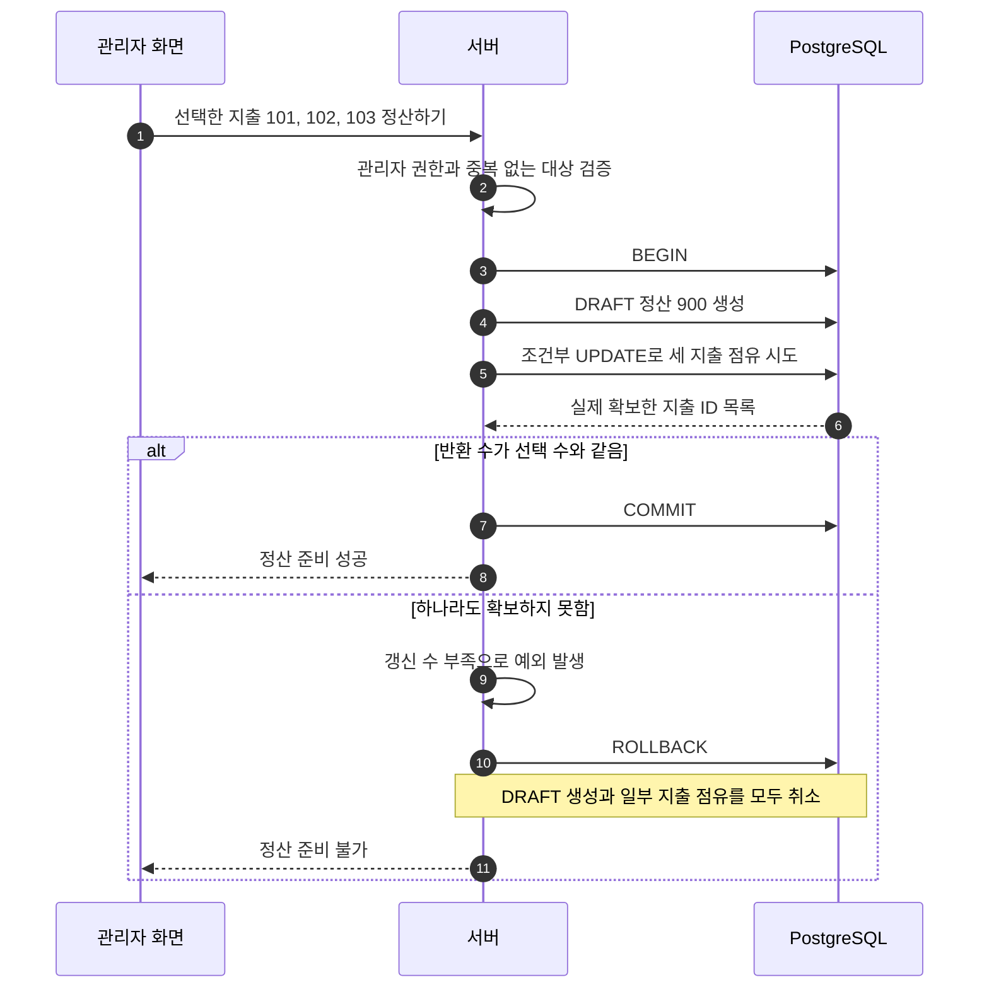
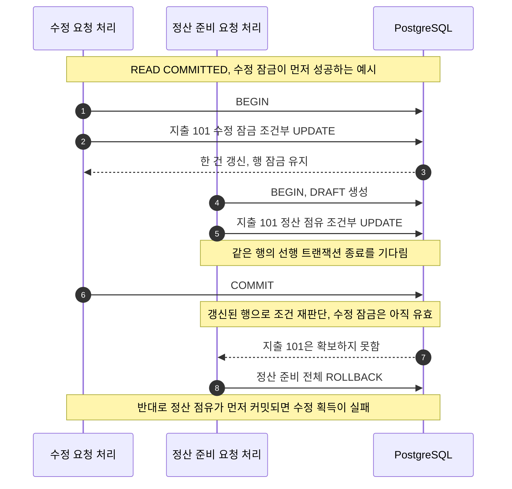
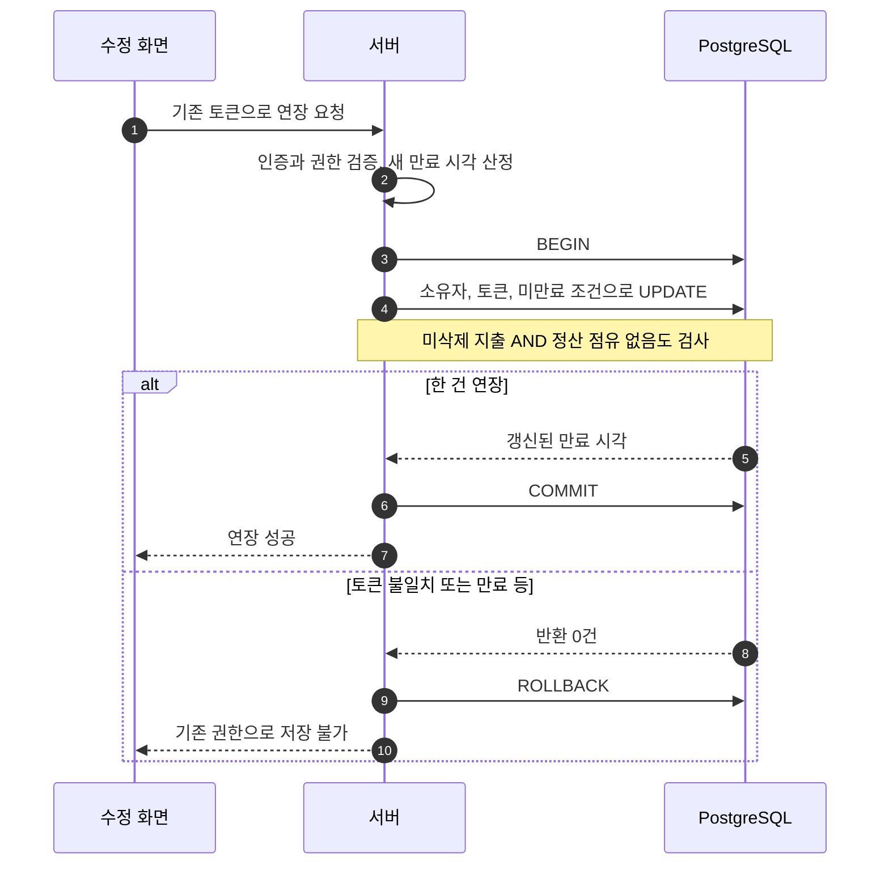
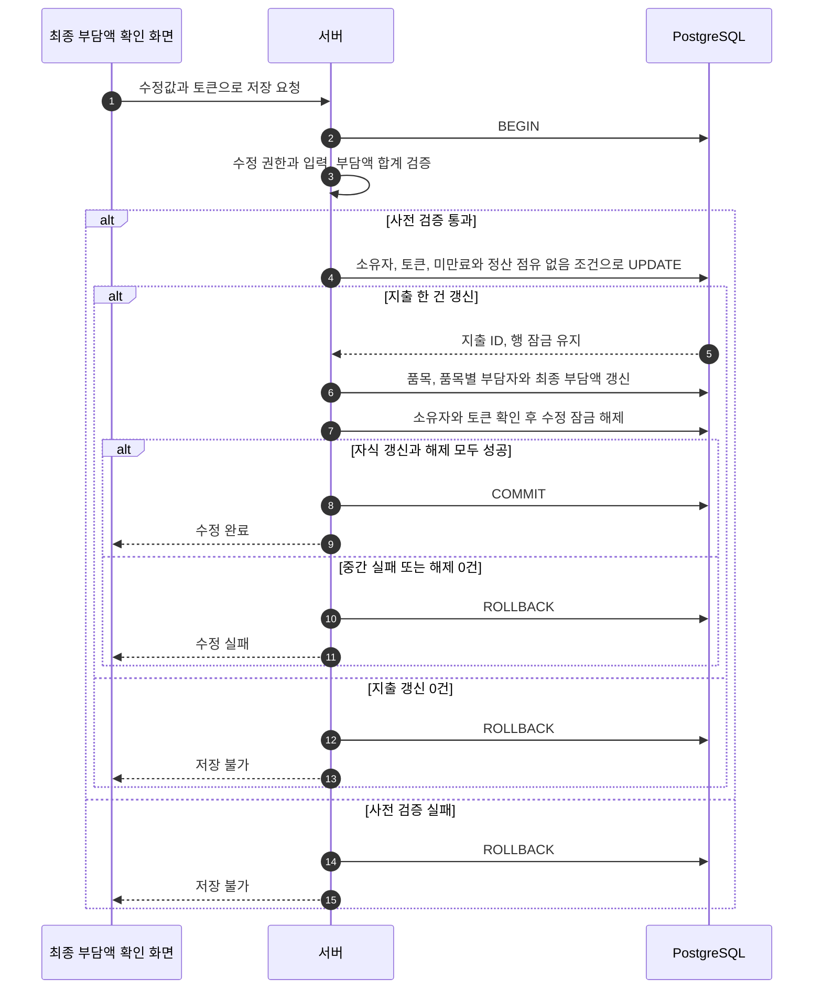
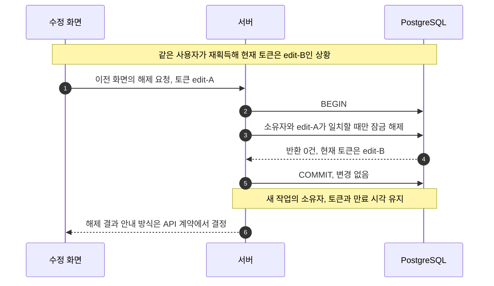
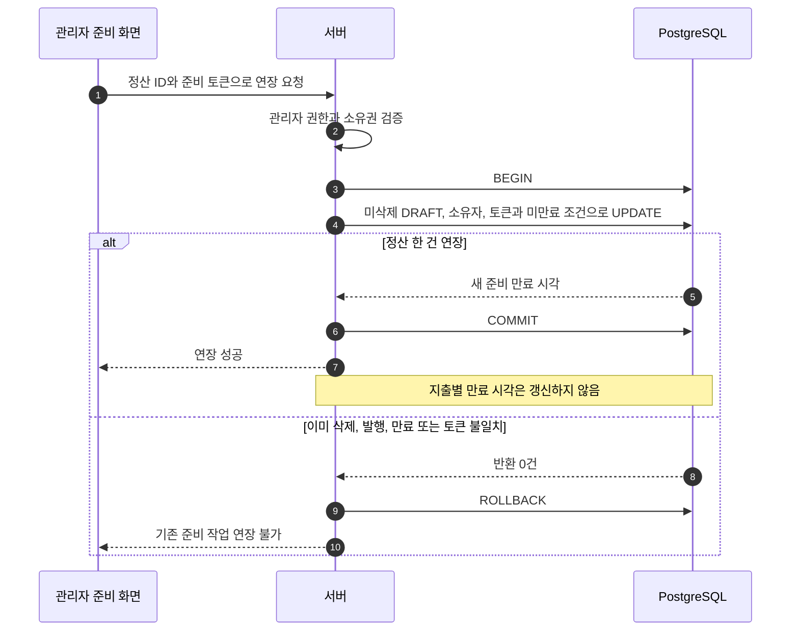
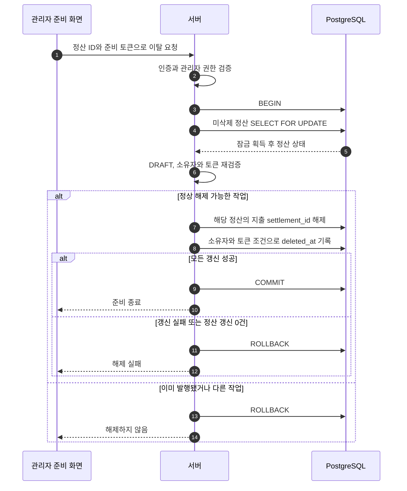
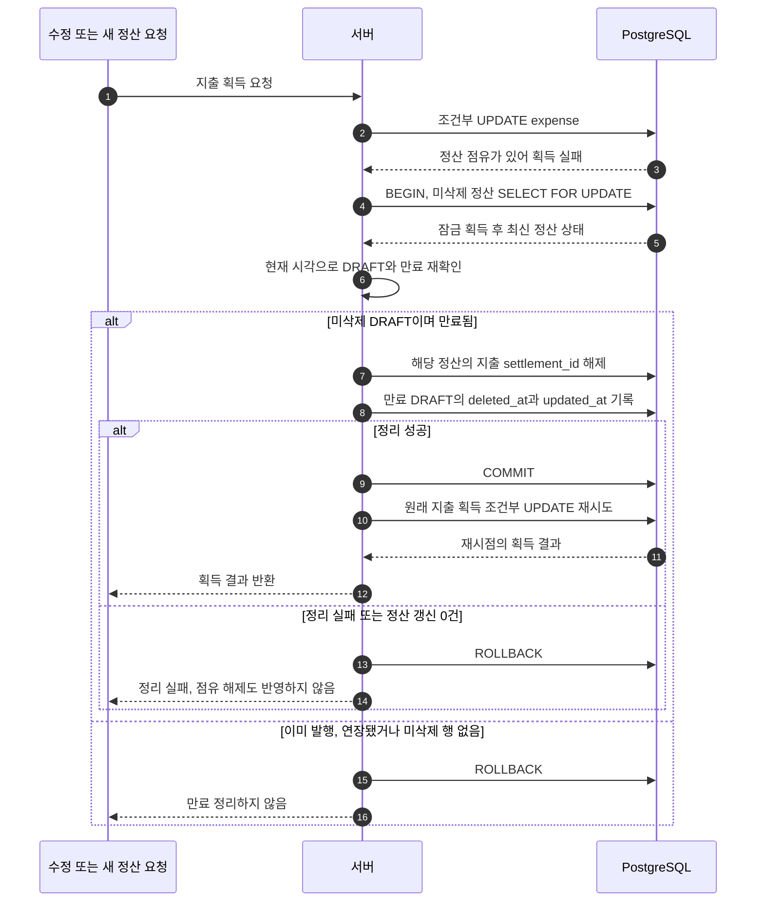

# 잠금과 동시성

관련 정책: [지출 수정](../policy/expense.md#수정과-잠금), [정산 준비](../policy/settlement.md#정산-준비와-잠금)

## 목차

- [두 잠금을 관리하는 방식](#두-잠금을-관리하는-방식)
- [저장 데이터](#저장-데이터)
- [지출 수정 잠금 획득](#지출-수정-잠금-획득)
- [정산 대상 일괄 확보](#정산-대상-일괄-확보)
- [수정과 정산이 동시에 요청되는 경우](#수정과-정산이-동시에-요청되는-경우)
- [지출 수정](#지출-수정)
- [정산 준비 연장과 정상 이탈](#정산-준비-연장과-정상-이탈)
- [만료된 정산 준비 정리](#만료된-정산-준비-정리)
- [구현 전 결정과 검증](#구현-전-결정과-검증)

## 두 잠금을 관리하는 방식

각 시퀀스는 아래 SQL과 처리 순서를 요약한다. 성공 응답은 커밋 이후에 보내며, 표시된 분기 외 SQL 오류도 해당 트랜잭션을 롤백한다.

지출 수정과 정산 준비는 모두 작업을 시작할 때 지출을 먼저 점유하는 오프라인 선점 잠금으로 볼 수 있다. 여기서 오프라인은 네트워크 단절이 아니라 여러 요청에 걸친 업무 작업을 뜻한다. 사용자가 화면에서 편집하는 동안 DB 트랜잭션을 열어두지 않고, 저장한 잠금 정보를 다음 요청에서도 확인한다. [패턴 설명](https://www.martinfowler.com/eaaCatalog/pessimisticOfflineLock.html)

| 구분 | 지출 수정 잠금 | 정산 준비 잠금 |
| --- | --- | --- |
| 잠그는 범위 | 지출 한 건 | 선택한 지출 묶음 |
| 지출에 저장하는 정보 | 수정 소유자, 토큰, 만료 시각 | 점유 정산의 `settlement_id` |
| 정산에 저장하는 정보 | 없음 | 준비 상태, 만료 시각, 토큰과 소유권 정보 |
| 시작 | 수정하기 요청의 잠금 획득 성공 | 선택한 N건 정산하기의 전체 확보 성공 |
| 해제 | 수정 저장, 정상 이탈 또는 만료 후 교체 | 확정 전 이탈 또는 만료 정리 |

수정 잠금은 `expense`에서 관리한다. 정산 준비의 만료와 토큰은 `settlement`에서 관리하며, 지출에는 어느 정산이 점유했는지만 둔다. 정산 준비 토큰과 소유권 데이터는 아래 저장 후보에서 다룬다.

```text
지출 101: settlement_id = 900 ─┐
지출 102: settlement_id = 900 ─┼─ 정산 900
지출 103: settlement_id = 900 ─┘    status = DRAFT
                                 준비 토큰과 만료 시각
```

이 구조에서는 정산 준비를 연장할 때 세 지출의 만료 시각을 각각 갱신하지 않고 정산 900의 만료 시각 한 곳을 갱신한다. 최초 지출 확보와 해제는 여러 행을 한 트랜잭션으로 처리해야 한다.

### 서로 확인할 조건

두 잠금은 같은 `expense` 행을 두고 경합한다. 다음 두 조건을 각각 조회한 뒤 무조건 갱신하지 않고, 점유를 변경하는 SQL의 `WHERE`에서 함께 검사한다.

1. `settlement_id IS NULL`: 현재 정산의 점유가 없다.
2. 수정 잠금이 없거나 만료됐다.

| 현재 지출 상태 | 새 수정 잠금 | 새 정산 점유 |
| --- | --- | --- |
| 정산 점유 없음, 유효한 수정 잠금 없음 | 가능 | 가능 |
| 유효한 수정 잠금 있음 | 새 획득 불가, 기존 작업은 연장 가능 | 불가 |
| `settlement_id` 있음 | 불가 | 불가 |

`settlement_id`가 가리키는 정산이 만료된 `DRAFT`라도 바로 덮어쓰지 않는다. 먼저 해당 준비 정산의 점유를 안전하게 정리한 뒤 다시 획득한다.

확정 후에도 `settlement_id`는 유지한다. 이때는 화면 작업을 위한 임시 잠금이 아니라 발행된 정산의 근거를 보호하는 업무 제약이다. 준비 만료를 이유로 풀지 않으며 [정산 취소 조건](settlement.md#수령-확인과-취소)을 따른다.

## 저장 데이터

| 테이블 | 컬럼 | 구분과 역할 |
| --- | --- | --- |
| `expense` | `edit_lock_owner_trip_member_id BIGINT NULL` | 기존 검토안. 수정 소유자 |
| `expense` | `edit_lock_expires_at TIMESTAMPTZ NULL` | 기존 검토안. 수정 만료 시각 |
| `expense` | `edit_lock_token` | 수정 작업 식별값 후보 |
| `expense` | `settlement_id BIGINT NULL` | 기존 검토안. `DRAFT`부터 현재 점유 정산을 가리킨다. |
| `settlement` | `status`, `preparation_lock_expires_at TIMESTAMPTZ NULL` | 기존 검토안. 준비 또는 발행 상태와 준비 만료 시각 |
| `settlement` | `deleted_at TIMESTAMPTZ NULL` | 논리 삭제에 필요. 현재 검토 DDL에는 없으며, 값이 있으면 폐기된 준비 정산이다. |
| `settlement` | `preparation_lock_token` | 준비 작업 식별값 후보 |
| `settlement` | `preparation_lock_owner_trip_member_id` | 준비 소유권 저장 후보 |

토큰 도입은 회의 결정이다. 토큰은 인증과 권한 검증을 대체하지 않는다.

> 구현 제안
>
> 위 후보 컬럼에 수정 및 준비 토큰과 준비 소유자를 저장하고, 아래 SQL과 시퀀스에서 사용한다. 정산 행 잠금으로 발행과 만료 정리를 조율한다.

> 논의 필요
>
> 토큰 컬럼별 배치, 타입, 헤더 이름과 발급 주체. 준비 소유자는 별도 컬럼 vs 관리자 정보로 식별
>
> 소유자와 토큰 및 만료 시각의 일관성을 DB CHECK로 보장 vs 애플리케이션 검증
>
> 현재 시각의 출처와 만료 경계, 잠금 변경 시 updated_at 갱신 여부

### 쿼리 전제

아래 SQL은 PostgreSQL 기준 검토용 예시다. 토큰, 준비 소유권과 정산의 `deleted_at` 컬럼이 추가됐다고 가정하며, 현재 DDL에 그대로 실행할 수 있는 구현이나 migration은 아니다. `:이름`은 서버가 바인딩할 값이다.

- 요청자는 인증된 여행 참여자다. 수정은 기록자 또는 관리자, 정산 준비는 관리자 권한을 서버에서 검증한다. 조회나 갱신은 같은 여행의 대상으로 제한한다.
- 잠금이 없으면 수정 소유자, 토큰과 만료 시각은 모두 NULL이다. 잠금이 있으면 셋 모두 값이 있어야 한다. 해제와 교체 시 함께 정리한다.
- `:now`, `:expires_at`은 클라이언트 입력을 신뢰하지 않고 서버에서 계산한다. 예시는 `만료 시각 <= 현재 시각`을 만료로 보는 안이다.
- 쿼리가 행 잠금을 오래 기다렸다면 요청 시작 시의 `:now`를 그대로 신뢰하지 않는다. 잠금 대기 후 현재 시각과 새 만료 시각을 재확인한다.
- 예시에서는 잠금만 바꾸는 요청의 `updated_at` 갱신을 생략했다. 업무 데이터 수정 예시에서는 명시했다.
- 갱신 결과가 0건이면 성공으로 응답하지 않는다. 정확한 오류 안내를 위한 후속 조회가 점유 성공을 대체하지 않는다.
- 만료되거나 정상 이탈한 준비 정산은 행을 지우지 않고 `deleted_at`을 기록한다. 활성 정산 조회, 이어받기, 연장과 발행에는 `deleted_at IS NULL`을 명시한다. 전역 필터가 자동으로 제외한다고 가정하지 않는다. [영속성 가이드](https://github.com/JECT-Study/Trip-Sheet-5th-Server/blob/develop/docs/contributing/persistence.md#삭제와-조회)

## 지출 수정 잠금 획득



민지가 지출 101의 ‘수정하기’를 누르면, 서버는 권한을 검증하고 다음 조건부 갱신으로 수정 작업을 확보한다.

```sql
UPDATE expense
SET edit_lock_owner_trip_member_id = :requester_trip_member_id,
    edit_lock_token = :new_token,
    edit_lock_expires_at = :expires_at
WHERE id = :expense_id
  AND trip_id = :trip_id
  AND deleted_at IS NULL
  AND settlement_id IS NULL
  AND (
      edit_lock_expires_at IS NULL
      OR edit_lock_expires_at <= :now
  )
RETURNING id, edit_lock_token, edit_lock_expires_at;
```

| 조건 | 막는 상황 |
| --- | --- |
| `settlement_id IS NULL` | 정산 준비 또는 발행된 정산에 점유된 지출을 수정하는 상황 |
| 만료 시각 없음 또는 만료 | 다른 유효한 수정 작업을 덮어쓰는 상황 |
| `trip_id`, `deleted_at` | 다른 여행이나 삭제된 지출을 대상으로 획득하는 상황 |

반환 행이 한 건이면 획득 성공이다. 새 토큰과 만료 시각을 앱에 전달하고 트랜잭션을 끝낸다. 반환 행이 없으면 잠금을 획득하지 못한 것이다. 같은 사용자라도 유효한 잠금을 새 요청으로 덮어쓰지 않으며, 기존 토큰으로 연장하는 흐름을 사용한다.

## 정산 대상 일괄 확보



```text
트랜잭션 시작
→ 관리자와 선택한 서로 다른 지출 ID 검증
→ DRAFT 생성
→ 아래 UPDATE로 지출 전체 점유 시도
→ 반환된 지출 수와 선택한 지출 수 비교
→ 전부 확보하면 커밋, 하나라도 부족하면 예외와 전체 롤백
```

`DRAFT` 생성 시 `created_at`은 NULL로 두고 준비 만료 시각을 기록한다.

> 논의 필요
>
> 방식 선택 전 settlement_method를 nullable로 변경 vs 방식 결정 시점 조정. 위 흐름의 DRAFT INSERT는 이 선택에 맞춰 작성한다.

```sql
UPDATE expense
SET settlement_id = :settlement_id,
    edit_lock_owner_trip_member_id = NULL,
    edit_lock_token = NULL,
    edit_lock_expires_at = NULL
WHERE id IN (:expense_ids)
  AND trip_id = :trip_id
  AND deleted_at IS NULL
  AND settlement_id IS NULL
  AND (
      edit_lock_expires_at IS NULL
      OR edit_lock_expires_at <= :now
  )
RETURNING id;
```

유효한 수정 잠금은 조건에서 제외한다. 만료된 수정 잠금의 흔적은 정산 점유와 함께 비우는 예시다. `:expense_ids`는 바인딩할 목록이며 문자열을 이어 붙여 SQL을 만들지 않는다.

### 예시: 세 건 중 한 건을 다른 사람이 수정 중인 경우

관리자가 지출 101, 102, 103으로 정산 900을 준비한다. 지출 102는 지훈이 수정 중이다.

| 지출 | 갱신 직전 상태 | 조건부 갱신 결과 | 전체 롤백 후 |
| --- | --- | --- | --- |
| 101 | 잠금 없음 | `settlement_id = 900` | 다시 NULL |
| 102 | 지훈의 유효한 수정 잠금 | 갱신하지 않음 | 지훈의 수정 잠금 유지 |
| 103 | 잠금 없음 | `settlement_id = 900` | 다시 NULL |

반환된 ID가 두 개인데 선택한 지출은 세 개이므로 서버가 예외를 발생시킨다. 정산 900 생성과 두 지출의 점유를 함께 롤백한다. 일부만 정산하거나 다른 작업인 지훈의 잠금을 해제하지 않는다.

같은 ID를 중복 전달한 요청의 처리 방식은 API 계약에서 정한다. 갱신 수는 반드시 서로 다른 지출 수와 비교한다.

## 수정과 정산이 동시에 요청되는 경우



다음 설명은 PostgreSQL `READ COMMITTED` 기준이다. 경합하는 `UPDATE`는 먼저 변경 중인 트랜잭션의 종료를 기다릴 수 있으며, 앞선 변경이 커밋되면 갱신된 행으로 `WHERE` 조건을 다시 판단한다. 실제 격리 수준이 다르면 오류와 재시도 처리도 별도로 확인해야 한다. [PostgreSQL 격리 수준](https://www.postgresql.org/docs/current/transaction-iso.html)

### 예시: 수정 잠금이 먼저 성공한 경우

| 순서 | 민지의 수정 요청 | 관리자의 정산 준비 요청 |
| --- | --- | --- |
| 1 | 지출 101의 조건을 만족해 소유자, 토큰과 만료 시각을 기록한다. | 같은 지출을 갱신하려면 필요 시 기다린다. |
| 2 | 커밋한다. | 수정 잠금이 아직 유효하면 조건을 만족하지 못한다. |
| 3 | 수정 화면으로 진입한다. | 101을 확보하지 못했으므로 정산 준비 전체를 롤백한다. |

반대로 정산 준비가 먼저 지출 101에 `settlement_id`를 기록하고 커밋하면, 수정 요청은 `settlement_id IS NULL`을 만족하지 못한다. 먼저 실행한 쪽이 롤백하거나 점유가 만료되는 경우에는 이후 요청이 다시 조건을 만족할 수 있다.

보장할 것은 ‘수정 또는 정산 중 하나가 유효하게 점유한 동안 다른 작업이 같은 지출을 함께 점유하지 못한다’는 것이다. 사전 조회에서 둘 다 가능하다고 봤더라도 최종 획득은 조건부 갱신 결과로 판단한다.

DB 행 잠금은 트랜잭션 동안 갱신을 조율하고, 커밋 후에는 저장된 점유 정보가 여러 HTTP 요청에 걸친 변경을 제한한다. 모든 수정, 삭제와 정산 진입 경로가 같은 규칙을 지켜야 한다. [PostgreSQL 잠금](https://www.postgresql.org/docs/current/explicit-locking.html)

## 지출 수정

### 수정 잠금 연장



기존 작업은 새로 획득하지 않고 소유자와 토큰이 일치하며 아직 만료되지 않았을 때 연장한다. 서버가 계산한 새 만료 시각은 현재보다 미래여야 한다.

```sql
UPDATE expense
SET edit_lock_expires_at = GREATEST(edit_lock_expires_at, :expires_at)
WHERE id = :expense_id
  AND trip_id = :trip_id
  AND deleted_at IS NULL
  AND settlement_id IS NULL
  AND edit_lock_owner_trip_member_id = :requester_trip_member_id
  AND edit_lock_token = :token
  AND edit_lock_expires_at > :now
RETURNING id, edit_lock_expires_at;
```

0건이면 기존 수정 권한으로 계속 저장할 수 없다. 만료된 토큰을 연장해 부활시키지 않고 최신 상태로 다시 획득해야 한다. `GREATEST`는 늦게 도착한 연장 요청이 이미 늘어난 만료 시각을 줄이지 않게 하는 예시다.

### 수정 저장



획득 때 검증했다고 저장을 무조건 허용하지 않는다. 다음은 지출명과 금액을 바꾸는 축약 예시이며, 실제로는 변경 가능한 결제 정보 전체와 부담액을 검증해야 한다.

```sql
UPDATE expense
SET name = :name,
    original_amount = :original_amount,
    discount_amount = :discount_amount,
    amount = :amount,
    krw_amount = :krw_amount,
    updated_at = :now
WHERE id = :expense_id
  AND trip_id = :trip_id
  AND deleted_at IS NULL
  AND settlement_id IS NULL
  AND edit_lock_owner_trip_member_id = :requester_trip_member_id
  AND edit_lock_token = :token
  AND edit_lock_expires_at > :now
RETURNING id;
```

```text
같은 트랜잭션 안에서 수행
→ 수정 권한과 입력, 부담액 합계 검증
→ 위 UPDATE 실행, 반환 0건이면 예외와 롤백
→ 품목, 품목별 부담자와 최종 부담액 갱신
→ 아래 해제 UPDATE 실행, 반환 0건이면 예외와 롤백
→ 커밋
```

처음 UPDATE로 얻은 행 잠금은 커밋까지 유지된다. 자식 데이터를 갱신하는 도중 다른 작업이 해당 지출을 먼저 점유할 수 없도록 한다. 반환값 조회와 실제 UPDATE를 별도 트랜잭션으로 나누면 안 된다.

저장 도중 실패하면 지출과 자식 변경, 잠금 해제를 함께 롤백한다. 기존 잠금은 커밋돼 있던 상태로 남으며, 이후 만료 여부에 따라 재시도나 재획득을 판단한다.

### 정상 해제와 이전 요청 방어



정상 이탈과 저장 마지막 단계에서는 현재 작업의 소유자와 토큰이 일치할 때만 수정 잠금을 비운다. 해제 자체에는 만료 전 조건을 요구하지 않는 예시다. 이미 새 작업이 점유했다면 토큰이 달라 해제되지 않는다.

```sql
UPDATE expense
SET edit_lock_owner_trip_member_id = NULL,
    edit_lock_token = NULL,
    edit_lock_expires_at = NULL
WHERE id = :expense_id
  AND trip_id = :trip_id
  AND settlement_id IS NULL
  AND edit_lock_owner_trip_member_id = :requester_trip_member_id
  AND edit_lock_token = :token
RETURNING id;
```

| 순서 | 사건 | 서버에 남는 수정 잠금 |
| --- | --- | --- |
| 1 | 민지가 첫 수정 작업을 시작한다. | 소유자 민지, 토큰 `edit-A` |
| 2 | 첫 작업이 만료되고 같은 민지가 다시 획득한다. | 소유자 민지, 토큰 `edit-B` |
| 3 | 첫 화면의 `edit-A` 해제 요청이 늦게 도착한다. | 토큰이 달라 0건 갱신, `edit-B` 유지 |

같은 사용자의 요청도 다른 작업일 수 있으므로 사용자 ID만 비교하지 않는다. 이탈 해제의 0건 응답을 어떻게 표시할지는 API 계약에서 정한다.

## 정산 준비 연장과 정상 이탈

### 정산 준비 연장 시퀀스



### 정상 이탈 시퀀스



정산 준비 연장은 지출마다 만료 시각을 갱신하지 않고 정산 행 한 곳을 갱신한다. 아래 예시는 준비 토큰과 소유자를 정산에 저장하는 제안안을 가정한다.

```sql
UPDATE settlement
SET preparation_lock_expires_at = GREATEST(preparation_lock_expires_at, :expires_at)
WHERE id = :settlement_id
  AND trip_id = :trip_id
  AND deleted_at IS NULL
  AND status = 'DRAFT'
  AND preparation_lock_owner_trip_member_id = :requester_trip_member_id
  AND preparation_lock_token = :token
  AND preparation_lock_expires_at > :now
RETURNING id, preparation_lock_expires_at;
```

정상 이탈은 아래 만료 정리와 같은 ‘정산 행 잠금 → 미삭제 및 상태 재확인 → 지출 점유 해제 → DRAFT의 deleted_at 기록’ 순서로 수행한다. 단, 만료 조건 대신 요청자의 소유권과 토큰을 검증한다. 발행된 정산은 이 경로로 논리 삭제하지 않는다.

> 논의 필요
>
> 소유자와 토큰이 맞는 정상 이탈은 만료 후에도 해제 허용 vs 만료 전 요청만 허용

발행 시에도 같은 정산 행을 먼저 잠그고 `deleted_at IS NULL`, `DRAFT`, 소유권, 토큰과 만료 여부를 검증하는 안을 사용한다. 발행 결과 저장은 [정산 준비와 확정](settlement.md#준비와-확정)을 따른다. 발행 후에는 준비 만료가 지출 해제 조건이 아니다.

## 만료된 정산 준비 정리



`settlement_id`가 남았다는 이유만으로 영구 차단하지 않고, 가리키는 정산이 만료된 준비 상태인지 확인한다. 정산 행 잠금을 사용해 발행, 연장과 만료 정리를 조율하는 구현 제안이다.

### 트랜잭션과 쿼리 예시

먼저 삭제되지 않은 정산을 잠근다. 이 SELECT의 결과와 이후 정리는 같은 트랜잭션과 연결에서 처리한다.

```sql
SELECT id, status, preparation_lock_expires_at
FROM settlement
WHERE id = :settlement_id
  AND trip_id = :trip_id
  AND deleted_at IS NULL
FOR UPDATE;
```

행 잠금 획득 후 현재 시각을 새로 확인하고 다음 조건을 검증한다.

- 삭제되지 않은 행이 존재하며 `status = DRAFT`다.
- `preparation_lock_expires_at`이 NULL이 아니며 현재 시각 이하로 만료됐다.
- 이미 발행됐거나 다른 요청이 연장했다면 정리하지 않는다.

검증을 통과한 경우에만 다음 두 변경을 수행한다.

```sql
UPDATE expense
SET settlement_id = NULL
WHERE settlement_id = :settlement_id
  AND trip_id = :trip_id
RETURNING id;

UPDATE settlement
SET deleted_at = :now,
    updated_at = :now
WHERE id = :settlement_id
  AND trip_id = :trip_id
  AND deleted_at IS NULL
  AND status = 'DRAFT'
  AND preparation_lock_expires_at <= :now
RETURNING id;
```

```text
트랜잭션 시작
→ 정산 행 FOR UPDATE
→ 잠금 획득 후 미삭제 상태와 만료 재확인
→ 해당 정산을 가리키는 지출만 해제
→ DRAFT의 deleted_at과 updated_at 기록, 갱신 0건이면 예외와 전체 롤백
→ 커밋
→ 원래 수정 또는 정산 요청에서 획득 조건을 다시 검증
```

논리 삭제는 행이 남으므로 FK를 끊거나 `expense.settlement_id`를 자동으로 비우지 않는다. 지출 점유 해제와 정산 논리 삭제를 같은 트랜잭션에서 완료해야 한다. 그래야 삭제된 준비 정산 때문에 지출이 계속 잠기는 상태가 남지 않는다. 아직 준비 단계이므로 발행용 `transfer`와 `settlement_expense`는 없다는 기존 설계를 전제로 한다.

정상 이탈을 구현할 때는 마지막 정산 UPDATE의 만료 조건을 소유자와 토큰 조건으로 바꾼다. `deleted_at IS NULL`과 `DRAFT` 조건은 유지한다. 검증 없이 이 쿼리를 모든 정산 삭제에 재사용하지 않는다.

이미 논리 삭제된 정산은 연장하거나 발행할 수 없다. 정상 정리 후에는 지출 점유도 없어야 한다. 삭제된 정산을 가리키는 지출이 발견되면 정리 불일치로 확인해야 하며, 그런 연결이 정상적으로 남는 구조로 설계하지 않는다.

`status = DRAFT`, `deleted_at`에 값이 있는 행은 발행 전 폐기된 준비 정산이다. 발행 후 취소를 뜻하는 `CANCELED`로 바꾸거나 정산취소 목록에 표시하지 않는다.

> 논의 필요
>
> 논리 삭제한 DRAFT의 보존 기간과 최종 물리 삭제 여부

### 예시: 앱 종료 뒤 수정 요청이 들어오는 경우

정산 900의 준비 만료가 14:05라고 가정한다. 시각과 ID는 설명용이며 유지 시간을 확정한 것은 아니다.

1. 관리자가 앱을 강제 종료해 해제 요청이 오지 않는다. 지출에는 `settlement_id = 900`이 남는다.
2. 14:06에 수정 요청이 들어온다. 처음 수정 잠금 획득은 `settlement_id` 때문에 실패한다.
3. 서버가 정산 900을 잠그고 미삭제 상태의 만료된 `DRAFT`인지 확인한 뒤 지출 점유를 풀고 `deleted_at`을 기록한다. 정산 행 자체는 남는다.
4. 수정 잠금 획득을 다시 시도한다. 그사이 다른 작업이 확보했다면 다시 실패할 수 있다.

정산 900이 14:04에 이미 발행됐다면 3번에서 정리하지 않는다. 발행과 정리가 경합할 때는 행 잠금을 얻은 뒤 상태를 다시 판단하므로, 발행된 정산을 과거 조회 결과만 보고 논리 삭제하지 않게 한다.

## 구현 전 결정과 검증

> 논의 필요
>
> | 안건 | 현재 상태 |
> | --- | --- |
> | 토큰과 소유권 | 컬럼별 배치, 타입, 발급 주체와 헤더 이름 선택 |
> | 만료와 연장 | 지출 수정 잠금은 획득 후 5분이며, 유효한 연장 요청마다 기존 만료 시각에 2분을 더한다. 연장 상한, 현재 시각의 출처와 만료 경계는 논의한다. 정산 준비 잠금의 최대 10분은 PM 제안이다. |
> | 격리 수준과 행 잠금 | 예시는 READ COMMITTED를 가정한다. 실제 설정과 대기 후 검증, 정산 행 잠금 방식을 확인한다. |
> | 잠금 순서와 교착 상태 | 정산 행과 여러 지출을 잠그는 순서, 교착 상태 및 타임아웃 실패 처리와 재시도 범위 |
> | 이어받기 | 유효한 준비 작업 재진입, 토큰 유실 시 처리와 토큰 교체 규칙 |
> | 스케줄러 | 요청 시 정리 외 1분 주기 청소를 도입할지 재확인. 도입 시 pg_cron 또는 서버 선택 |
> | 수정 시각 | 잠금만 바꾸는 벌크 SQL의 updated_at 갱신 여부 |
> | 준비 정산 보존 | 논리 삭제한 DRAFT의 보존 기간과 최종 물리 삭제 여부 |
> | 스키마 | 정산 방식 미선택과 created_at NULL, BaseEntity 충돌은 [ERD 변경 목록](erd-changes.md)에서 확인 |

실제 PostgreSQL에서 확인할 시나리오는 다음과 같다. 이 문서의 쿼리와 설명은 실제 DB 동시 실행으로 검증한 결과가 아니다.

| 시나리오 | 확인할 결과 |
| --- | --- |
| 같은 지출에 수정과 정산 준비 동시 요청 | 유효한 점유가 둘 다 성공하지 않음 |
| 세 지출 중 한 건 확보 실패 | DRAFT와 일부 지출 갱신 모두 롤백, 다른 수정 잠금 유지 |
| 수정 저장과 새 정산 준비 경합 | 수정의 지출 및 자식 변경이 한 번에 반영되며 점유 규칙 유지 |
| 같은 사용자의 재획득 후 이전 토큰 해제 또는 저장 | 새 작업과 데이터가 변경되지 않음 |
| 만료된 수정 및 준비 토큰의 연장 | 기존 작업이 부활하지 않음 |
| 준비 연장과 만료 정리 경합 | 잠금 후 재확인한 만료 상태에 따라 처리 |
| 발행과 이탈 또는 만료 정리 경합 | 발행된 정산의 연결과 지출 점유를 해제하지 않음 |
| 만료 정산의 지출 해제 후 논리 삭제 실패 | 지출 점유 해제까지 전체 롤백 |
| 논리 삭제한 DRAFT에 뒤늦은 연장과 발행 요청 | deleted_at 조건으로 진행 차단, 기존 삭제 시각 유지 |
| 수정 저장 중 자식 갱신 실패 | 지출 변경과 잠금 해제까지 전체 롤백 |
