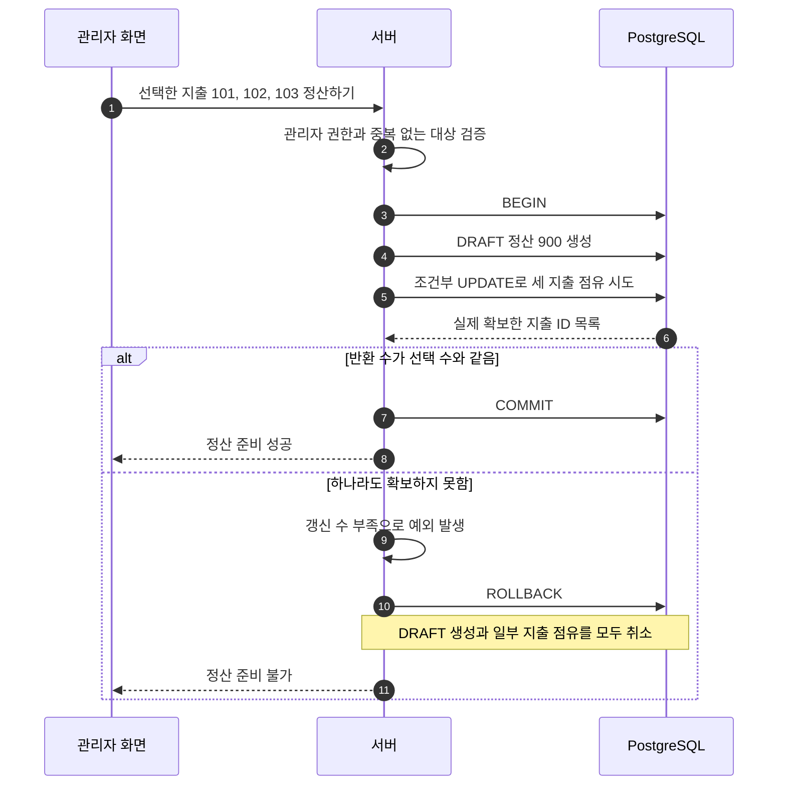
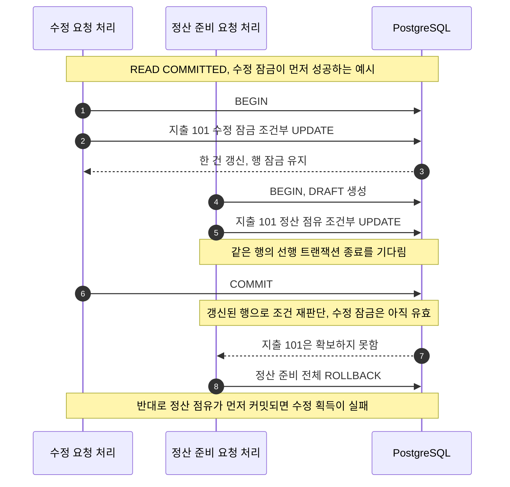
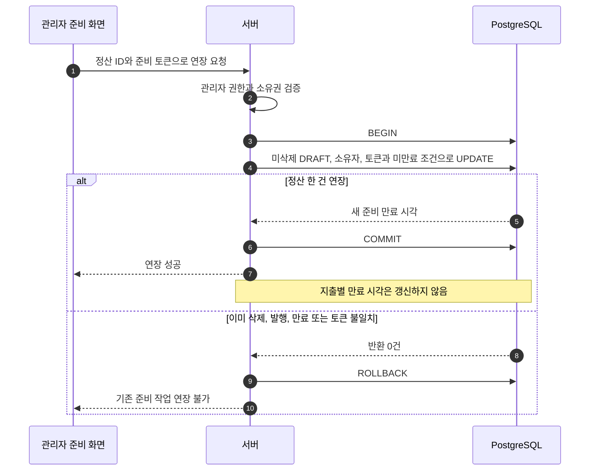
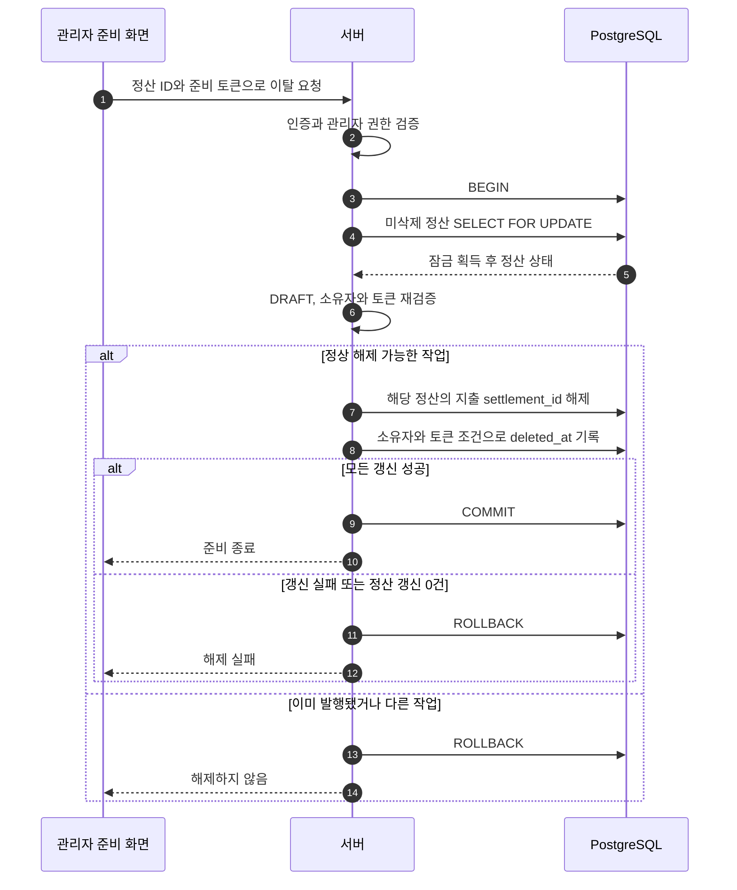
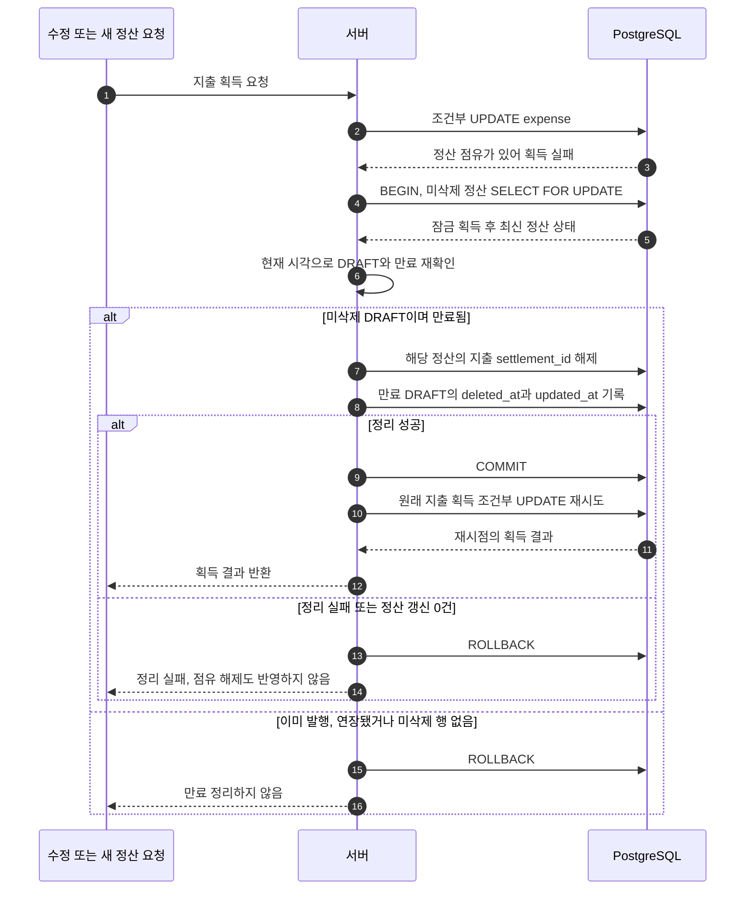

# 정산 설계서

관련 정책: [정산](../policy/settlement.md), [탈퇴 후 공동 기록](../policy/user.md#공동-기록과-미완료-정산)

## 결정한 방향

- 대상 선택 시 준비 정산을 만들고 지출을 점유하며, 확정 시 정산 대상과 송금 관계를 저장한다.
- 서버에서 참여자별 잔액을 계산해 송금 관계를 만든다. 0원 송금은 저장하지 않는다.
- 원화 통합은 지출별 저장 환율을, 통화별 정산은 원래 결제 통화를 사용한다.
- 발행 시각은 확정 시각이며 `settlement.created_at`에 기록한다. 준비 시에는 NULL로 둔다. 별도 `issued_at` 추가안은 최근 회의에서 기각됐다.

## 정산 대상 선택

대상 조회는 지출 목록 API를 사용한다. 개별 선택 시 앱은 선택한 지출 ID 목록을 보내고, 전체 선택 시 지출 목록의 필터 조건과 선택 해제한 지출 ID를 보낸다. 개별 선택의 ID 목록에 중복이 있으면 제거하고 고유 ID 집합을 대상으로 검증, 잠금과 계산을 수행한다. 동일 지출을 여러 번 합산하거나 중복만을 이유로 실패시키지 않는다. 서버는 같은 여행에서 필터에 해당하는 정산 가능 지출을 조회하고 제외 ID를 제거한다. 전체 선택 범위는 현재 로드한 페이지로 제한하지 않는다. 전체 선택 시점에 확정한 대상 ID 범위를 유지하고, 이후 새로 생성되거나 필터에 새로 해당하는 지출은 자동 포함하지 않는다. 선택된 지출의 금액과 품목 등 내용은 정산 준비 시점의 최신 저장값을 사용한다. 선택 이후 내용이 바뀌어도 재확인을 요구하지 않으며, 결제일 변경으로 선택 당시 필터에서 벗어나더라도 선택 ID 범위는 유지한다. 대상 ID 보존은 과거 금액과 품목을 사용하는 스냅샷을 의미하지 않는다.

조회 결과는 잠금 획득을 보장하지 않는다. 대상을 구한 뒤 기존 준비 처리의 권한 및 상태 검증과 전체 성공 또는 전체 롤백 규칙을 적용한다. 대상 조회와 잠금 사이에 상태가 바뀐 지출을 조용히 제외해 일부만 정산 준비하지 않는다.

> 논의 필요
>
> 전체 선택 시 확정한 ID 범위를 보존하고 식별할 방법을 정한다. 서버에 선택 기록과 만료를 두는 방식 또는 검증 가능한 선택 토큰 등을 비교하며, 필터와 제외 ID만으로 과거 범위를 복원할 수 있다고 가정하지 않는다. 최신 저장값 조회와 잠금 획득 사이의 일관성 보장, 제외 ID 유효성 검증과 최대 선택 건수도 정한다.

## 저장 데이터

기존 구조는 기존 검토 DDL `settlement.sql`을 기준으로 한다. 아래 변경 사항은 아직 해당 DDL에 적용되지 않았다.

| 테이블 | 컬럼 | 역할과 변경 |
| --- | --- | --- |
| `settlement` | `id BIGINT`, `trip_id BIGINT`, `status` | 준비 단계부터 정산 ID를 발급하고 여행 및 생애 상태를 기록한다. |
| `settlement` | `settlement_method`, `settlement_currency CHAR(3) NULL` | 원화 통합 또는 통화별 구분. 통화별이면 단일 정산 통화는 NULL이다. |
| `settlement` | `created_at TIMESTAMPTZ NULL` | 최근 회의에 따라 nullable로 변경하고 확정 시 기록한다. |
| `settlement` | `updated_at TIMESTAMPTZ` | 최종 변경 시각 |
| `settlement` | `deleted_at TIMESTAMPTZ NULL` | 만료 또는 정상 이탈한 DRAFT의 논리 삭제 시각. 현재 검토 DDL에는 없어 추가가 필요하다. |
| `settlement` | 준비 잠금 관련 컬럼 | [잠금 설계](#저장-데이터-1)를 따른다. |
| `settlement_expense` | `settlement_id`, `trip_id`, `expense_id` | 발행 시 포함 지출을 연결한다. PK는 `(settlement_id, expense_id)`다. |
| `transfer` | `settlement_id`, `trip_id`, `sender_trip_member_id`, `receiver_trip_member_id` | 정산별 송금인과 수령인. 모두 `trip_member`를 기준으로 연결한다. |
| `transfer` | `currency CHAR(3)`, `amount BIGINT`, `received_at TIMESTAMPTZ NULL` | 실제 송금 통화와 금액, 수령 확인 시각 |

`settlement_method`는 기존 DDL에서 NOT NULL이며 준비 생성은 방식 선택보다 앞선다.

> 논의 필요
>
> DRAFT의 settlement_method를 nullable로 변경 vs 방식 결정 시점 조정

## 잔액과 송금 관계

```text
참여자 잔액 = 해당 참여자가 결제한 금액 합계 - 해당 참여자의 부담액 합계
양수 = 받을 금액
음수 = 보낼 금액
0 = 송금 관계 생성 대상에서 제외
```

원화 통합은 각 지출의 원화 결제액과 원화 부담액으로 계산한다. 통화별은 결제 통화별로 잔액을 구하며 서로 다른 통화를 직접 상계하지 않는다. 계산 단위와 반올림은 [지출 계산](expense.md#논의-필요)에서 함께 확정한다.

알고리즘이 배열 인덱스 `from`, `to`를 반환하면 실제 저장 전 `trip_member.id`로 변환한다. 닉네임이나 `member.id`로 연결하지 않는다. 비회원도 여행 참여자 ID를 가지며 송금인이 될 수 있기 때문이다.

송금 관계는 선택 지출의 결제액과 부담액으로 계산한다.

> 논의 필요
>
> 최소 횟수 보장 vs 최적 대비 추가 송금 횟수의 수치 기준. PM 요청에 따라 개발팀이 알고리즘과 허용 기준을 제안한다.
>
> PM의 ‘1회 송금’이 전체 정산 기준인지 개인별 기준인지 확인한다. POC는 최악의 경우와 동일 입력의 결과 일치를 포함한다.

### 예시: 결제액과 부담액으로 송금 관계를 만드는 과정

민지가 숙소비 90,000원을, 지훈이 식사비 30,000원을 냈고 두 지출 모두 민지, 지훈, 서연 셋이 균등 부담한다. 원화 지출이며 할인과 자투리는 없다.

| 참여자 | 결제액 합계 | 부담액 합계 | 잔액 |
| --- | --- | --- | --- |
| 민지 | 90,000원 | 40,000원 | +50,000원 |
| 지훈 | 30,000원 | 40,000원 | -10,000원 |
| 서연 | 0원 | 40,000원 | -40,000원 |

이 경우 지훈이 민지에게 10,000원, 서연이 민지에게 40,000원을 보내면 잔액이 모두 해소된다. `transfer`에는 이 두 송금 관계를 저장한다. 식사비를 결제한 지훈도 자신이 쓴 몫보다 적게 냈으므로 받을 사람이 아니라 보낼 사람이 된다.

이 입력의 결과를 설명하는 예시이며, 특정 알고리즘을 채택했거나 모든 입력의 최소 횟수를 검증했다는 뜻은 아니다.

## 정산서 표시

직접 결제한 적 없는 참여자 사이에도 송금 관계가 생길 수 있다. 저장된 지출과 부담액으로 각자의 결제 및 부담 내역을 제공하고, 정산서 하단에 송금 관계의 계산 근거를 안내한다.

> 구현 제안
>
> 안내 문구 후보: “각 참여자의 총 결제 금액과 부담 금액을 기준으로 송금 관계를 계산했어요. 송금 횟수를 줄이는 과정에서 직접 결제한 적 없는 참여자 간에도 송금이 발생할 수 있습니다.”

> 논의 필요
>
> 최종 안내 문구 선택. 최소 횟수 보장 확정 전에는 ‘가장 적은 횟수’라고 단정하지 않는다.

송금 관계가 없는 0원 상태는 transfer를 만들지 않고 버튼 비활성화와 안내로 표시한다. 문구를 위해 0원 송금 행을 추가하지 않는다.

## 준비와 확정

> 논의 필요
>
> 잠금만 연장할 때 updated_at 갱신 vs 업무 변경 때만 갱신

1. [일괄 잠금](#정산-대상-일괄-확보)으로 `DRAFT`와 선택 지출 점유를 확보한다.
2. 정산 방식을 선택하고 저장된 지출로 미리보기를 계산한다. 같은 입력이면 항상 같은 송금 결과가 나오게 한다. 결과와 대상 지출, 적용한 정산 방식을 발행 전 결과로 보존한다.
3. 확정 트랜잭션에서 `deleted_at IS NULL`, `DRAFT`, 요청자 권한, 소유권과 만료, 대상 지출의 점유 상태를 다시 검증한다.
4. 사용자가 확인한 보존 미리보기와 현재 준비의 대상 지출, 정산 방식 및 결과의 일치를 검증하고 `settlement_expense`와 양수 금액의 `transfer`만 저장한다. 다른 결과로 자동 발행하지 않는다.
5. 일반 정산은 `IN_PROGRESS`로 바꾸고 `created_at`에 확정 시각을 기록한다. 준비 만료 시각을 비우되 지출의 `settlement_id`는 유지한다.
6. 커밋 후 저장된 결과로 정산서를 제공한다. 중간 저장에 실패하면 전체 롤백한다.

미리보기와 확정은 지출 입력, 환율, 정렬과 자투리 기준을 같게 유지한다.

> 논의 필요
>
> 미리보기 결과와 입력의 저장 위치, 결과 식별자 또는 버전, 정산 방식 변경 시 이전 결과 무효화 방식을 결정한다. 불일치 시 오류 매핑과 새 미리보기 확인 흐름도 구체화한다.

확정 전에 만료되거나 정상 이탈하면 지출 점유 해제와 준비 정산의 `deleted_at` 기록을 같은 트랜잭션에서 처리한다. 준비 정산 행은 남기며, 삭제된 DRAFT는 활성 조회와 재진입, 연장 및 발행에서 제외한다. 발행 후 취소 상태인 `CANCELED`와 구분한다.

### 예시: 준비를 시작한 시각과 정산서 발행 시각

앞의 두 지출로 정산 900을 만든다고 가정한다. 아래 시각과 ID는 설명용이다.

| 단계 | `settlement.status` | `settlement.created_at` | 지출 점유와 결과 |
| --- | --- | --- | --- |
| 14:00에 ‘선택한 N건 정산하기’ | `DRAFT` | NULL | 두 지출의 `settlement_id = 900`, 발행용 송금 내역은 아직 저장하지 않음 |
| 14:02에 미리보기 확인 | `DRAFT` | NULL | 같은 지출을 계속 점유하며 송금 관계를 보여줌 |
| 14:03에 정산 확정 | `IN_PROGRESS` | 14:03 | 포함 지출 연결과 두 송금 관계 저장, 지출 점유 유지 |

화면에 보여줄 발행 시각은 14:03이다. 준비 화면에서 머문 시간은 발행 시각에 포함하지 않는다. 이처럼 최초 저장 이후에 값을 채워야 하므로 공통 `BaseEntity`의 생성 시각 매핑과 충돌한다.

## 수령 확인과 취소

수령 확인, 취소, 발행과 만료 정리가 같은 정산을 동시에 바꾸지 않도록 동일 정산 행을 잠그고 상태를 재검증하는 방식은 기존 검토안이다.

| 요청 | 검증 | 같은 트랜잭션의 변경 |
| --- | --- | --- |
| 수령 확인 | `IN_PROGRESS`, 로그인한 실제 수령인, 아직 확인하지 않은 송금 | `received_at` 기록, 확인 가능한 나머지 관계가 모두 완료되면 `COMPLETED` |
| 정산 취소 | 관리자, `IN_PROGRESS`, 수령 확인 0건 | `CANCELED` 전환, 해당 정산을 가리키는 지출의 `settlement_id` 해제 |

첫 수령 확인만으로 별도 상태를 추가하지 않는다. 이후에도 `IN_PROGRESS`일 수 있지만 취소는 불가능하다. 수령인이 탈퇴했거나 여행을 나간 관계는 확인 불가로 제외하고, 송금인만 탈퇴했다면 로그인한 수령인은 확인할 수 있다.

취소 후 재정산은 새 정산 ID로 진행하는 기존 검토안이다. `settlement_expense.expense_id` 단독 UNIQUE를 두지 않는다.

> 논의 필요
>
> 취소된 송금과 포함 지출 연결의 보존 범위는 PM 논의 중이다. 삭제와 스냅샷 구조는 답변 후 결정한다.

### 예시: 한 건만 받았어도 취소할 수 없는 이유

앞의 두 송금 중 지훈이 보낸 10,000원을 민지가 ‘받았어요’로 확인했다면, 서연의 40,000원이 남아 있어 정산 상태는 `IN_PROGRESS`다. 하지만 수령 확인이 이미 한 건 있으므로 정산 취소는 거절한다.

나중에 민지가 서연의 송금도 확인하면 두 관계가 모두 완료돼 `COMPLETED`로 바뀐다. 첫 수령 확인은 ‘취소 가능 여부’를 바꾸며, 마지막 수령 확인은 ‘정산 완료 여부’까지 바꾼다.

### 예시: 모두 0원인 정산

두 사람이 각각 10,000원씩 결제했고 부담액도 각각 10,000원이면 둘 다 잔액이 0원이다. `transfer`는 만들지 않는다.

이 0원 상태의 화면은 ‘받았어요’를 비활성화하고 “송금할 금액이 없습니다.”라고 안내한다. 송금 행을 저장하지 않는 것과 정산 상태 전환은 구분한다.

> 논의 필요
>
> 전체 송금 0건이면 확정 즉시 COMPLETED vs 별도 완료 처리

## 논의 필요

> 논의 필요
>
> - 송금 관계가 처음부터 0건인 경우의 완료 시점. 0원 버튼과 안내는 위 확정 동작을 따른다.
> - 수령인 탈퇴 등으로 확인 가능한 관계가 처음부터 없는 경우의 완료 시점
> - 최소 송금 보장 수준과 알고리즘, 보존 미리보기의 저장 및 식별과 일치 검증 구현
> - 준비 단계의 미선택 정산 방식 표현과 준비 소유권 컬럼
> - 취소된 정산의 `transfer`와 지출 연결 보존, 수정 전 지출 금액의 스냅샷 필요 여부
> - `created_at`을 발행 시각으로 쓸 때 [BaseEntity 충돌](#정산-시각과-baseentity) 처리

실제 DB 검증에서는 수령 확인과 취소의 동시 성공 방지, 확정 중 실패 롤백, 중복 확정 시 송금 중복 생성 방지, 취소 후 재정산과 과거 이력 조회를 확인한다.

## 두 잠금을 관리하는 방식

각 시퀀스는 아래 SQL과 처리 순서를 요약한다. 성공 응답은 커밋 이후에 보내며, 표시된 분기 외 SQL 오류도 해당 트랜잭션을 롤백한다.

지출 수정과 정산 준비는 모두 작업을 시작할 때 지출을 먼저 점유하는 오프라인 선점 잠금으로 볼 수 있다. 여기서 오프라인은 네트워크 단절이 아니라 여러 요청에 걸친 업무 작업을 뜻한다. 사용자가 화면에서 편집하는 동안 DB 트랜잭션을 열어두지 않고, 저장한 잠금 정보를 다음 요청에서도 확인한다. [패턴 설명](https://www.martinfowler.com/eaaCatalog/pessimisticOfflineLock.html)

| 구분 | 지출 수정 잠금 | 정산 준비 잠금 |
| --- | --- | --- |
| 잠그는 범위 | 지출 한 건 | 선택한 지출 묶음 |
| 지출에 저장하는 정보 | 수정 소유자, 토큰, 만료 시각 | 점유 정산의 `settlement_id` |
| 정산에 저장하는 정보 | 없음 | 준비 상태, 만료 시각, 토큰과 소유권 정보 |
| 시작 | 수정하기 요청의 잠금 획득 성공 | 선택한 N건 정산하기의 전체 확보 성공 |
| 해제 | 수정 저장, 정상 이탈 또는 만료 후 교체 | 확정 전 이탈 또는 만료 정리 |

수정 잠금은 `expense`에서 관리한다. 정산 준비의 만료와 토큰은 `settlement`에서 관리하며, 지출에는 어느 정산이 점유했는지만 둔다. 정산 준비 토큰과 소유권 데이터는 아래 저장 후보에서 다룬다.

```text
지출 101: settlement_id = 900 ─┐
지출 102: settlement_id = 900 ─┼─ 정산 900
지출 103: settlement_id = 900 ─┘    status = DRAFT
                                 준비 토큰과 만료 시각
```

이 구조에서는 정산 준비를 연장할 때 세 지출의 만료 시각을 각각 갱신하지 않고 정산 900의 만료 시각 한 곳을 갱신한다. 최초 지출 확보와 해제는 여러 행을 한 트랜잭션으로 처리해야 한다.

### 서로 확인할 조건

두 잠금은 같은 `expense` 행을 두고 경합한다. 다음 두 조건을 각각 조회한 뒤 무조건 갱신하지 않고, 점유를 변경하는 SQL의 `WHERE`에서 함께 검사한다.

1. `settlement_id IS NULL`: 현재 정산의 점유가 없다.
2. 수정 잠금이 없거나 만료됐다.

| 현재 지출 상태 | 새 수정 잠금 | 새 정산 점유 |
| --- | --- | --- |
| 정산 점유 없음, 유효한 수정 잠금 없음 | 가능 | 가능 |
| 유효한 수정 잠금 있음 | 새 획득 불가, 기존 작업은 연장 가능 | 불가 |
| `settlement_id` 있음 | 불가 | 불가 |

`settlement_id`가 가리키는 정산이 만료된 `DRAFT`라도 바로 덮어쓰지 않는다. 먼저 해당 준비 정산의 점유를 안전하게 정리한 뒤 다시 획득한다.

확정 후에도 `settlement_id`는 유지한다. 이때는 화면 작업을 위한 임시 잠금이 아니라 발행된 정산의 근거를 보호하는 업무 제약이다. 준비 만료를 이유로 풀지 않으며 [정산 취소 조건](#수령-확인과-취소)을 따른다.

## 저장 데이터

| 테이블 | 컬럼 | 구분과 역할 |
| --- | --- | --- |
| `expense` | `edit_lock_owner_trip_member_id BIGINT NULL` | 기존 검토안. 수정 소유자 |
| `expense` | `edit_lock_expires_at TIMESTAMPTZ NULL` | 기존 검토안. 수정 만료 시각 |
| `expense` | `edit_lock_token` | 수정 작업 식별값 후보 |
| `expense` | `settlement_id BIGINT NULL` | 기존 검토안. `DRAFT`부터 현재 점유 정산을 가리킨다. |
| `settlement` | `status`, `preparation_lock_expires_at TIMESTAMPTZ NULL` | 기존 검토안. 준비 또는 발행 상태와 준비 만료 시각 |
| `settlement` | `deleted_at TIMESTAMPTZ NULL` | 논리 삭제에 필요. 현재 검토 DDL에는 없으며, 값이 있으면 폐기된 준비 정산이다. |
| `settlement` | `preparation_lock_token` | 준비 작업 식별값 후보 |
| `settlement` | `preparation_lock_owner_trip_member_id` | 준비 소유권 저장 후보 |

토큰 도입은 회의 결정이다. 토큰은 인증과 권한 검증을 대체하지 않는다.

> 구현 제안
>
> 위 후보 컬럼에 수정 및 준비 토큰과 준비 소유자를 저장하고, 아래 SQL과 시퀀스에서 사용한다. 정산 행 잠금으로 발행과 만료 정리를 조율한다.

> 논의 필요
>
> 토큰 컬럼별 배치, 타입, 헤더 이름과 발급 주체. 준비 소유자는 별도 컬럼 vs 관리자 정보로 식별
>
> 소유자와 토큰 및 만료 시각의 일관성을 DB CHECK로 보장 vs 애플리케이션 검증
>
> 현재 시각의 출처와 만료 경계, 잠금 변경 시 updated_at 갱신 여부

### 쿼리 전제

아래 SQL은 PostgreSQL 기준 검토용 예시다. 토큰, 준비 소유권과 정산의 `deleted_at` 컬럼이 추가됐다고 가정하며, 현재 DDL에 그대로 실행할 수 있는 구현이나 migration은 아니다. `:이름`은 서버가 바인딩할 값이다.

- 요청자는 인증된 여행 참여자다. 수정은 기록자 또는 관리자, 정산 준비는 관리자 권한을 서버에서 검증한다. 조회나 갱신은 같은 여행의 대상으로 제한한다.
- 잠금이 없으면 수정 소유자, 토큰과 만료 시각은 모두 NULL이다. 잠금이 있으면 셋 모두 값이 있어야 한다. 해제와 교체 시 함께 정리한다.
- `:now`, `:expires_at`은 클라이언트 입력을 신뢰하지 않고 서버에서 계산한다. 예시는 `만료 시각 <= 현재 시각`을 만료로 보는 안이다.
- 쿼리가 행 잠금을 오래 기다렸다면 요청 시작 시의 `:now`를 그대로 신뢰하지 않는다. 잠금 대기 후 현재 시각과 새 만료 시각을 재확인한다.
- 예시에서는 잠금만 바꾸는 요청의 `updated_at` 갱신을 생략했다. 업무 데이터 수정 예시에서는 명시했다.
- 갱신 결과가 0건이면 성공으로 응답하지 않는다. 정확한 오류 안내를 위한 후속 조회가 점유 성공을 대체하지 않는다.
- 만료되거나 정상 이탈한 준비 정산은 행을 지우지 않고 `deleted_at`을 기록한다. 활성 정산 조회, 이어받기, 연장과 발행에는 `deleted_at IS NULL`을 명시한다. 전역 필터가 자동으로 제외한다고 가정하지 않는다. [영속성 가이드](https://github.com/JECT-Study/Trip-Sheet-5th-Server/blob/develop/docs/contributing/persistence.md#삭제와-조회)

## 정산 대상 일괄 확보



```text
트랜잭션 시작
→ 관리자와 선택한 서로 다른 지출 ID 검증
→ DRAFT 생성
→ 아래 UPDATE로 지출 전체 점유 시도
→ 반환된 지출 수와 선택한 지출 수 비교
→ 전부 확보하면 커밋, 하나라도 부족하면 예외와 전체 롤백
```

`DRAFT` 생성 시 `created_at`은 NULL로 두고 준비 만료 시각을 기록한다.

> 논의 필요
>
> 방식 선택 전 settlement_method를 nullable로 변경 vs 방식 결정 시점 조정. 위 흐름의 DRAFT INSERT는 이 선택에 맞춰 작성한다.

```sql
UPDATE expense
SET settlement_id = :settlement_id,
    edit_lock_owner_trip_member_id = NULL,
    edit_lock_token = NULL,
    edit_lock_expires_at = NULL
WHERE id IN (:expense_ids)
  AND trip_id = :trip_id
  AND deleted_at IS NULL
  AND settlement_id IS NULL
  AND (
      edit_lock_expires_at IS NULL
      OR edit_lock_expires_at <= :now
  )
RETURNING id;
```

유효한 수정 잠금은 조건에서 제외한다. 만료된 수정 잠금의 흔적은 정산 점유와 함께 비우는 예시다. `:expense_ids`는 바인딩할 목록이며 문자열을 이어 붙여 SQL을 만들지 않는다.

### 예시: 세 건 중 한 건을 다른 사람이 수정 중인 경우

관리자가 지출 101, 102, 103으로 정산 900을 준비한다. 지출 102는 지훈이 수정 중이다.

| 지출 | 갱신 직전 상태 | 조건부 갱신 결과 | 전체 롤백 후 |
| --- | --- | --- | --- |
| 101 | 잠금 없음 | `settlement_id = 900` | 다시 NULL |
| 102 | 지훈의 유효한 수정 잠금 | 갱신하지 않음 | 지훈의 수정 잠금 유지 |
| 103 | 잠금 없음 | `settlement_id = 900` | 다시 NULL |

반환된 ID가 두 개인데 선택한 지출은 세 개이므로 서버가 예외를 발생시킨다. 정산 900 생성과 두 지출의 점유를 함께 롤백한다. 일부만 정산하거나 다른 작업인 지훈의 잠금을 해제하지 않는다.

같은 ID를 중복 전달한 요청의 처리 방식은 API 계약에서 정한다. 갱신 수는 반드시 서로 다른 지출 수와 비교한다.

## 수정과 정산이 동시에 요청되는 경우



다음 설명은 PostgreSQL `READ COMMITTED` 기준이다. 경합하는 `UPDATE`는 먼저 변경 중인 트랜잭션의 종료를 기다릴 수 있으며, 앞선 변경이 커밋되면 갱신된 행으로 `WHERE` 조건을 다시 판단한다. 실제 격리 수준이 다르면 오류와 재시도 처리도 별도로 확인해야 한다. [PostgreSQL 격리 수준](https://www.postgresql.org/docs/current/transaction-iso.html)

### 예시: 수정 잠금이 먼저 성공한 경우

| 순서 | 민지의 수정 요청 | 관리자의 정산 준비 요청 |
| --- | --- | --- |
| 1 | 지출 101의 조건을 만족해 소유자, 토큰과 만료 시각을 기록한다. | 같은 지출을 갱신하려면 필요 시 기다린다. |
| 2 | 커밋한다. | 수정 잠금이 아직 유효하면 조건을 만족하지 못한다. |
| 3 | 수정 화면으로 진입한다. | 101을 확보하지 못했으므로 정산 준비 전체를 롤백한다. |

반대로 정산 준비가 먼저 지출 101에 `settlement_id`를 기록하고 커밋하면, 수정 요청은 `settlement_id IS NULL`을 만족하지 못한다. 먼저 실행한 쪽이 롤백하거나 점유가 만료되는 경우에는 이후 요청이 다시 조건을 만족할 수 있다.

보장할 것은 ‘수정 또는 정산 중 하나가 유효하게 점유한 동안 다른 작업이 같은 지출을 함께 점유하지 못한다’는 것이다. 사전 조회에서 둘 다 가능하다고 봤더라도 최종 획득은 조건부 갱신 결과로 판단한다.

DB 행 잠금은 트랜잭션 동안 갱신을 조율하고, 커밋 후에는 저장된 점유 정보가 여러 HTTP 요청에 걸친 변경을 제한한다. 모든 수정, 삭제와 정산 진입 경로가 같은 규칙을 지켜야 한다. [PostgreSQL 잠금](https://www.postgresql.org/docs/current/explicit-locking.html)

## 정산 준비 연장과 정상 이탈

### 정산 준비 연장 시퀀스



### 정상 이탈 시퀀스



정산 준비 연장은 지출마다 만료 시각을 갱신하지 않고 정산 행 한 곳을 갱신한다. 아래 예시는 준비 토큰과 소유자를 정산에 저장하는 제안안을 가정한다.

```sql
UPDATE settlement
SET preparation_lock_expires_at = GREATEST(preparation_lock_expires_at, :expires_at)
WHERE id = :settlement_id
  AND trip_id = :trip_id
  AND deleted_at IS NULL
  AND status = 'DRAFT'
  AND preparation_lock_owner_trip_member_id = :requester_trip_member_id
  AND preparation_lock_token = :token
  AND preparation_lock_expires_at > :now
RETURNING id, preparation_lock_expires_at;
```

정상 이탈은 아래 만료 정리와 같은 ‘정산 행 잠금 → 미삭제 및 상태 재확인 → 지출 점유 해제 → DRAFT의 deleted_at 기록’ 순서로 수행한다. 단, 만료 조건 대신 요청자의 소유권과 토큰을 검증한다. 발행된 정산은 이 경로로 논리 삭제하지 않는다.

> 논의 필요
>
> 소유자와 토큰이 맞는 정상 이탈은 만료 후에도 해제 허용 vs 만료 전 요청만 허용

발행 시에도 같은 정산 행을 먼저 잠그고 `deleted_at IS NULL`, `DRAFT`, 소유권, 토큰과 만료 여부를 검증하는 안을 사용한다. 발행 결과 저장은 [정산 준비와 확정](#준비와-확정)을 따른다. 발행 후에는 준비 만료가 지출 해제 조건이 아니다.

## 만료된 정산 준비 정리



`settlement_id`가 남았다는 이유만으로 영구 차단하지 않고, 가리키는 정산이 만료된 준비 상태인지 확인한다. 정산 행 잠금을 사용해 발행, 연장과 만료 정리를 조율하는 구현 제안이다.

### 트랜잭션과 쿼리 예시

먼저 삭제되지 않은 정산을 잠근다. 이 SELECT의 결과와 이후 정리는 같은 트랜잭션과 연결에서 처리한다.

```sql
SELECT id, status, preparation_lock_expires_at
FROM settlement
WHERE id = :settlement_id
  AND trip_id = :trip_id
  AND deleted_at IS NULL
FOR UPDATE;
```

행 잠금 획득 후 현재 시각을 새로 확인하고 다음 조건을 검증한다.

- 삭제되지 않은 행이 존재하며 `status = DRAFT`다.
- `preparation_lock_expires_at`이 NULL이 아니며 현재 시각 이하로 만료됐다.
- 이미 발행됐거나 다른 요청이 연장했다면 정리하지 않는다.

검증을 통과한 경우에만 다음 두 변경을 수행한다.

```sql
UPDATE expense
SET settlement_id = NULL
WHERE settlement_id = :settlement_id
  AND trip_id = :trip_id
RETURNING id;

UPDATE settlement
SET deleted_at = :now,
    updated_at = :now
WHERE id = :settlement_id
  AND trip_id = :trip_id
  AND deleted_at IS NULL
  AND status = 'DRAFT'
  AND preparation_lock_expires_at <= :now
RETURNING id;
```

```text
트랜잭션 시작
→ 정산 행 FOR UPDATE
→ 잠금 획득 후 미삭제 상태와 만료 재확인
→ 해당 정산을 가리키는 지출만 해제
→ DRAFT의 deleted_at과 updated_at 기록, 갱신 0건이면 예외와 전체 롤백
→ 커밋
→ 원래 수정 또는 정산 요청에서 획득 조건을 다시 검증
```

논리 삭제는 행이 남으므로 FK를 끊거나 `expense.settlement_id`를 자동으로 비우지 않는다. 지출 점유 해제와 정산 논리 삭제를 같은 트랜잭션에서 완료해야 한다. 그래야 삭제된 준비 정산 때문에 지출이 계속 잠기는 상태가 남지 않는다. 아직 준비 단계이므로 발행용 `transfer`와 `settlement_expense`는 없다는 기존 설계를 전제로 한다.

정상 이탈을 구현할 때는 마지막 정산 UPDATE의 만료 조건을 소유자와 토큰 조건으로 바꾼다. `deleted_at IS NULL`과 `DRAFT` 조건은 유지한다. 검증 없이 이 쿼리를 모든 정산 삭제에 재사용하지 않는다.

이미 논리 삭제된 정산은 연장하거나 발행할 수 없다. 정상 정리 후에는 지출 점유도 없어야 한다. 삭제된 정산을 가리키는 지출이 발견되면 정리 불일치로 확인해야 하며, 그런 연결이 정상적으로 남는 구조로 설계하지 않는다.

`status = DRAFT`, `deleted_at`에 값이 있는 행은 발행 전 폐기된 준비 정산이다. 발행 후 취소를 뜻하는 `CANCELED`로 바꾸거나 정산취소 목록에 표시하지 않는다.

> 논의 필요
>
> 논리 삭제한 DRAFT의 보존 기간과 최종 물리 삭제 여부

### 예시: 앱 종료 뒤 수정 요청이 들어오는 경우

정산 900의 준비 만료가 14:05라고 가정한다. 시각과 ID는 설명용이며 유지 시간을 확정한 것은 아니다.

1. 관리자가 앱을 강제 종료해 해제 요청이 오지 않는다. 지출에는 `settlement_id = 900`이 남는다.
2. 14:06에 수정 요청이 들어온다. 처음 수정 잠금 획득은 `settlement_id` 때문에 실패한다.
3. 서버가 정산 900을 잠그고 미삭제 상태의 만료된 `DRAFT`인지 확인한 뒤 지출 점유를 풀고 `deleted_at`을 기록한다. 정산 행 자체는 남는다.
4. 수정 잠금 획득을 다시 시도한다. 그사이 다른 작업이 확보했다면 다시 실패할 수 있다.

정산 900이 14:04에 이미 발행됐다면 3번에서 정리하지 않는다. 발행과 정리가 경합할 때는 행 잠금을 얻은 뒤 상태를 다시 판단하므로, 발행된 정산을 과거 조회 결과만 보고 논리 삭제하지 않게 한다.

## 구현 전 결정과 검증

> 논의 필요
>
> | 안건 | 현재 상태 |
> | --- | --- |
> | 토큰과 소유권 | 컬럼별 배치, 타입, 발급 주체와 헤더 이름 선택 |
> | 만료와 연장 | 지출 수정 잠금은 획득 후 5분이며, 유효한 연장 요청마다 기존 만료 시각에 2분을 더한다. 연장 상한, 현재 시각의 출처와 만료 경계는 논의한다. 정산 준비 잠금의 최대 10분은 PM 제안이다. |
> | 격리 수준과 행 잠금 | 예시는 READ COMMITTED를 가정한다. 실제 설정과 대기 후 검증, 정산 행 잠금 방식을 확인한다. |
> | 잠금 순서와 교착 상태 | 정산 행과 여러 지출을 잠그는 순서, 교착 상태 및 타임아웃 실패 처리와 재시도 범위 |
> | 이어받기 | 유효한 준비 작업 재진입, 토큰 유실 시 처리와 토큰 교체 규칙 |
> | 스케줄러 | 요청 시 정리 외 1분 주기 청소를 도입할지 재확인. 도입 시 pg_cron 또는 서버 선택 |
> | 수정 시각 | 잠금만 바꾸는 벌크 SQL의 updated_at 갱신 여부 |
> | 준비 정산 보존 | 논리 삭제한 DRAFT의 보존 기간과 최종 물리 삭제 여부 |
> | 스키마 | 정산 방식 미선택과 created_at NULL, BaseEntity 충돌은 [정산 테이블 변경](#정산-테이블-변경)에서 확인 |

실제 PostgreSQL에서 확인할 시나리오는 다음과 같다. 이 문서의 쿼리와 설명은 실제 DB 동시 실행으로 검증한 결과가 아니다.

| 시나리오 | 확인할 결과 |
| --- | --- |
| 같은 지출에 수정과 정산 준비 동시 요청 | 유효한 점유가 둘 다 성공하지 않음 |
| 세 지출 중 한 건 확보 실패 | DRAFT와 일부 지출 갱신 모두 롤백, 다른 수정 잠금 유지 |
| 수정 저장과 새 정산 준비 경합 | 수정의 지출 및 자식 변경이 한 번에 반영되며 점유 규칙 유지 |
| 같은 사용자의 재획득 후 이전 토큰 해제 또는 저장 | 새 작업과 데이터가 변경되지 않음 |
| 만료된 수정 및 준비 토큰의 연장 | 기존 작업이 부활하지 않음 |
| 준비 연장과 만료 정리 경합 | 잠금 후 재확인한 만료 상태에 따라 처리 |
| 발행과 이탈 또는 만료 정리 경합 | 발행된 정산의 연결과 지출 점유를 해제하지 않음 |
| 만료 정산의 지출 해제 후 논리 삭제 실패 | 지출 점유 해제까지 전체 롤백 |
| 논리 삭제한 DRAFT에 뒤늦은 연장과 발행 요청 | deleted_at 조건으로 진행 차단, 기존 삭제 시각 유지 |
| 수정 저장 중 자식 갱신 실패 | 지출 변경과 잠금 해제까지 전체 롤백 |

## 정산 테이블 변경

| 대상 | 기존 검토 DDL | 변경 방향 | 확정 범위 |
| --- | --- | --- | --- |
| `settlement.created_at` | `TIMESTAMPTZ NOT NULL`, 준비 생성 시 기록 | NULL 허용, 준비 시 비워두고 정산 확정 시 기록 | 회의 결정. `issued_at` 추가안은 기각됐다. |
| `settlement.deleted_at` | 컬럼 없음 | `TIMESTAMPTZ NULL` 추가, 만료 또는 정상 이탈한 준비 정산을 논리 삭제 | 후속 설계에서 정리한 방향. 지출 점유 해제와 같은 트랜잭션에서 기록한다. |
| 잠금 식별값 | 소유자와 만료 시각만 존재 | 잠금 작업별 토큰 저장 및 요청 전달 | 토큰 도입은 회의 결정. 테이블별 배치, 이름과 타입은 제안이다. |

### 추가 컬럼 후보

| 테이블 후보 | 컬럼 후보 | 타입 후보 | 값과 NULL 의미 | 관련 설계 |
| --- | --- | --- | --- | --- |
| `settlement` | `preparation_lock_token` | `UUID` 또는 문자열 | 준비 작업 식별값 | [준비 잠금](#저장-데이터-1) |
| `settlement` | `preparation_lock_owner_trip_member_id` | `BIGINT` | 준비 잠금 소유자 후보 | [준비 잠금](#저장-데이터-1) |
| `settlement` | `deleted_at` | `TIMESTAMPTZ NULL` | NULL이면 미삭제, 값이 있으면 폐기한 준비 정산. 활성 조회와 연장 및 발행에서 제외 | [만료 정리](#만료된-정산-준비-정리) |

### 기존 구조에서 유지할 관계

| 대상 | 역할 및 주의점 |
| --- | --- |
| `expense.settlement_id` | 현재 점유 정산이다. `DRAFT`도 포함하며 과거 포함 이력과 구분한다. |
| `settlement_expense` | 발행 시 포함 지출 연결이다. `(settlement_id, expense_id)` 복합 PK를 유지하고 `expense_id` 단독 UNIQUE를 두지 않는 기존 검토안이다. |
| `transfer` | 송금인과 수령인은 `trip_member.id`를 참조한다. 금액 0원 행은 저장하지 않는다. |

기존 연결 구조는 지출 ID를 보존하며 금액 스냅샷은 포함하지 않는다. 취소 후 지출이 수정되면 단순 FK로는 당시 산출 근거를 복원할 수 없다.

> 논의 필요
>
> 취소 정산의 송금 및 포함 지출 이력 보존 범위는 PM 논의 중이다. 보존 범위 결정 후 금액 스냅샷 필요 여부를 정한다.

#### 예시: 같은 지출을 취소 후 다시 정산하는 경우

지출 101이 정산 900에 포함됐다가 수령 확인 전에 취소됐고, 이후 정산 901에 다시 포함된다고 가정한다.

현재 점유는 `expense.settlement_id`를 NULL로 해제했다가 새 준비 시 901로 바꾸면 된다. 과거 포함 연결을 보존하는 안에서는 다음 두 행이 함께 존재할 수 있어야 한다.

| `settlement_id` | `expense_id` | 의미 |
| --- | --- | --- |
| 900 | 101 | 취소한 정산에 포함됐던 지출 |
| 901 | 101 | 새 정산에 포함한 지출 |

이 때문에 복합 PK는 유지하되 `expense_id`만의 UNIQUE는 두지 않는다. 다만 101의 금액이 재정산 전에 12,000원에서 15,000원으로 바뀌면, 두 연결 모두 같은 현재 지출을 가리킨다. 연결만 보존해서는 ‘정산 900 당시에는 12,000원이었다’를 복원할 수 없다. 스냅샷 선택은 위 논의 사항을 따른다.

## 정산 시각과 BaseEntity

[BaseEntity](https://github.com/JECT-Study/Trip-Sheet-5th-Server/blob/09dd7bfbaf37974fecfa3bb2fa2c22ea3378d20c/src/main/kotlin/com/ject/global/persistence/BaseEntity.kt)는 `@CreatedDate`로 최초 저장 시 `created_at`을 기록하고, 매핑에서 `updatable = false`로 지정한다. 정산 시각 결정과 그대로 호환되지 않는다. 코드 확인 기준은 백엔드 커밋 `09dd7bfbaf37974fecfa3bb2fa2c22ea3378d20c`이며, DB 적용이나 배포 동작을 검증한 것은 아니다.

| 충돌 | 구현 시 확인할 내용 |
| --- | --- |
| DRAFT 최초 저장 시 자동 시각 기록 | 정산 `created_at`은 발행 전 NULL이어야 한다. 공통 Auditing이 값을 채우지 않아야 한다. |
| `updatable = false` | 확정 시 NULL에서 발행 시각으로 바꿀 수 있어야 한다. |
| 공통 필드 상속 | 정산만 별도 매핑할지 등 적용 방식을 합의해야 한다. 다른 Entity의 생성 시각 정책까지 변경하지 않는다. |

PM 답변은 발행 시각이 확정 시각임을 확인했다. 저장 컬럼은 기존 개발 결정대로 nullable `created_at`을 사용한다.

> 논의 필요
>
> BaseEntity 상속 제외 vs 정산 전용 Auditing 및 매핑 구성
>
> 준비 시작 시각 별도 보존 여부. 기존에 기각한 issued_at 추가와 구분한다.

정산의 논리 삭제에 `deleted_at`이 필요하더라도 BaseEntity 전체 상속을 자동으로 결정하지 않는다. 공통 생성 시각과 발행 시각의 충돌을 먼저 해소하고, 논리 삭제 필드는 정산 매핑에 명시적으로 반영한다. 조회와 조건부 갱신에서도 `deleted_at IS NULL`을 직접 검사한다.

## 추가 결정이 필요한 스키마

> 논의 필요
>
> | 안건 | 기존 상태와 결정할 내용 |
> | --- | --- |
> | 정산 방식 미선택 | `settlement_method NOT NULL`과 방식 선택 전 `DRAFT` 생성이 충돌한다. nullable 변경 또는 생성 순서 조정 필요 |
> | 금액 타입과 단위 | 원본 통화 최소 단위와 원화 소수 보존, 합계 검증을 먼저 정한 뒤 `BIGINT` 유지 여부 결정 |
> | 지출명 | 입력 길이 제한 없는 정책과 `VARCHAR(50)` 간 차이 해소 |
> | 동일 여행 제약 | 단일 FK 외 서비스 검증 또는 복합 FK 적용 방식 |
> | 취소 이력과 개인정보 | 보존 범위가 정해진 뒤 스냅샷, 삭제와 익명화 구조 검토 |
> | 폐기한 준비 정산 | 논리 삭제한 DRAFT의 보존 기간과 최종 물리 삭제 여부. 발행된 정산 취소 이력과 구분 |
> | 인덱스 | 만료 DRAFT 조회와 멱등성 키 범위를 확정한 뒤 필요한 인덱스 설계. 이름만 먼저 확정하지 않는다. |

실제 반영 시에는 기존 데이터, NULL과 상태 조합, 제약 제거 및 추가 영향과 마이그레이션 후 매핑을 검증한다. 검토 DDL의 변경 제안과 실제 마이그레이션 적용 결과는 구분한다.
