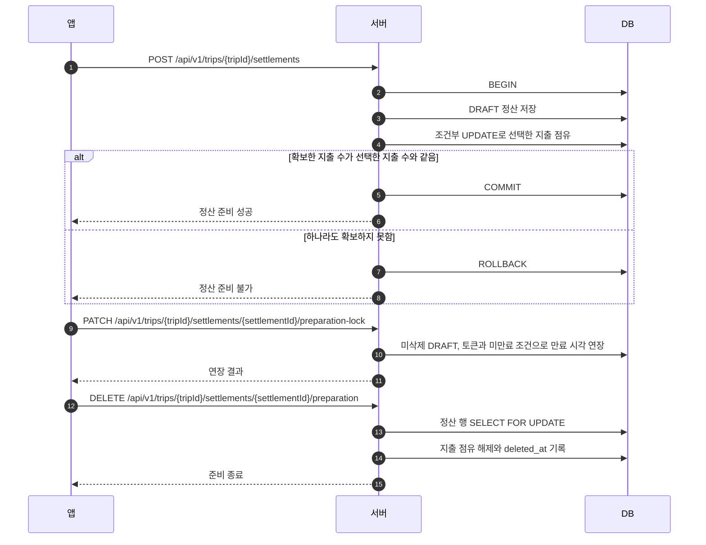
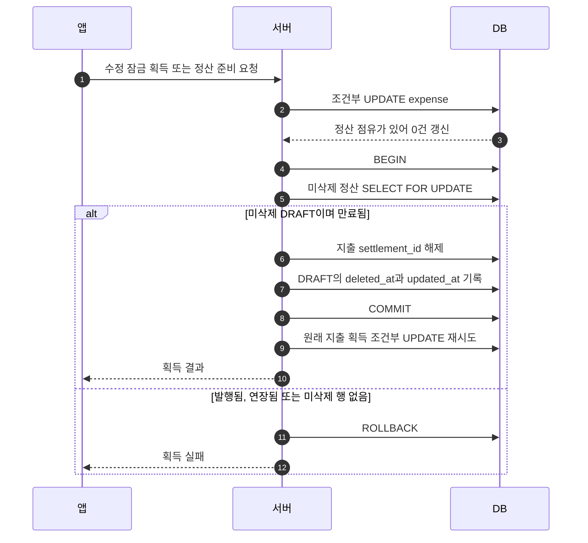
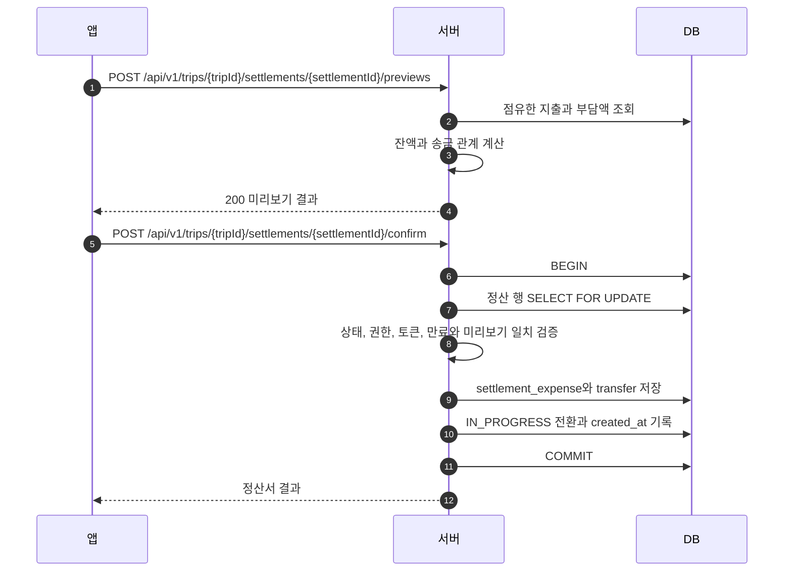

# 정산 설계서

## 개요

이 설계서는 정산 준비 잠금, 지출 수정 잠금과의 경합, 잔액과 송금 관계 계산, 정산 발행과 수령 확인, 취소를 다룬다.
지출 수정 잠금과 지출의 저장 구조는 [지출 설계서](expense.md)를 따른다.
업무 규칙은 [정산 정책서](../policy/settlement.md)와 [탈퇴 후 공동 기록](../policy/user.md#공동-기록과-미완료-정산)을 따른다.

## 정산 준비 잠금

관리자가 정산할 지출을 고르면 서버는 준비(`DRAFT`) 정산을 만든다.
서버는 선택한 지출 전체의 `expense.settlement_id`에 그 정산을 기록해 지출을 점유한다.

### 저장 데이터

| 이름 | 타입 | 제약 | 뜻 |
| --- | --- | --- | --- |
| `settlement.trip_id` | `BIGINT` | NOT NULL, FK `trip.id` | 정산의 여행 |
| `settlement.status` | `settlement_status` | NOT NULL | 정산 상태. `DRAFT`, `IN_PROGRESS`, `COMPLETED`, `CANCELED` 중 하나 |
| `settlement.preparation_lock_expires_at` | `TIMESTAMPTZ` | NULL | 준비 잠금 만료 시각. NULL이면 준비 잠금이 없음 |
| `settlement.deleted_at` | `TIMESTAMPTZ` | NULL | 만료되거나 정상 이탈한 준비 정산의 논리 삭제 시각. NULL이면 삭제하지 않은 정산 |

- 서버는 준비 잠금의 만료 시각과 토큰을 `settlement`에 저장한다.
- 서버는 지출에 점유한 정산의 `settlement_id`만 저장한다.
- 서버는 정산 준비를 연장할 때 지출마다 만료 시각을 갱신하지 않고 정산 행 한 곳만 갱신한다.
- `status = DRAFT`이고 `deleted_at`에 값이 있는 행은 발행 전에 폐기한 준비 정산이다. 서버는 이 행을 `CANCELED`로 바꾸거나 정산 취소 목록에 넣지 않는다.

> 논의 필요
>
> - 준비 소유자를 별도 컬럼으로 식별함 vs 관리자 정보로 식별함
> - 준비 토큰의 타입, 헤더 이름과 발급 주체
> - 정산 방식을 고르기 전에 `DRAFT`를 만들 때 `settlement_method`를 NULL 허용으로 바꿈 vs 방식을 정하는 시점을 앞당김
> - 준비 잠금의 만료 시간과 연장 주기. 최대 10분은 PM 제안이다.
> - 논리 삭제한 `DRAFT`의 보존 기간과 최종 물리 삭제 여부

### 처리 흐름

다음은 정산 준비의 시작, 연장과 정상 이탈의 호출 순서다.



- 개별 선택이면 앱은 선택한 지출 ID 목록을 보낸다.
- 전체 선택이면 앱은 지출 목록의 필터 조건과 선택을 해제한 지출 ID를 보낸다.
- 개별 선택의 ID 목록에 중복이 있으면 서버는 중복을 제거한 ID 집합으로 검증, 잠금과 계산을 실행한다.
- 전체 선택이면 서버는 같은 여행에서 필터에 맞는 정산 가능 지출 중 제외 ID를 뺀 지출을 대상으로 정한다.
- 서버는 전체 선택의 조회 범위를 앱이 불러온 페이지로 제한하지 않는다.
- 서버는 전체 선택 시점에 확정한 대상 ID 범위를 유지한다.
- 서버는 선택한 뒤 새로 만들어지거나 필터에 새로 맞게 된 지출을 대상에 넣지 않는다.
- 결제일을 바꿔 선택 당시의 필터에서 벗어난 지출도 서버는 선택 ID 범위에 유지한다.
- 서버는 선택한 지출의 금액과 품목으로 정산 준비 시점의 최신 저장값을 쓴다. 대상 ID를 유지하는 것은 과거 금액과 품목을 쓰는 스냅샷이 아니다.
- 선택한 뒤 지출 내용이 바뀌어도 서버는 회원에게 재확인을 요구하지 않는다.
- 서버는 `DRAFT`를 만들 때 `created_at`을 NULL로 둔다.
- 서버는 `DRAFT`를 만들 때 준비 만료 시각을 기록한다.
- 정상 이탈의 처리 순서는 [만료된 정산 준비 정리](#만료된-정산-준비-정리)와 같다.
- 정상 이탈에서 서버는 만료 조건 대신 요청자의 준비 소유권과 토큰을 검증한다.
- 서버는 발행한 정산을 정상 이탈 경로로 논리 삭제하지 않는다.

> 논의 필요
>
> - 전체 선택 시 확정한 ID 범위를 보존하고 식별하는 방법. 필터와 제외 ID만으로 과거 범위를 복원할 수 있다고 가정하지 않는다.
> - 최신 저장값 조회와 잠금 획득 사이의 일관성, 제외 ID의 유효성 검증과 최대 선택 건수
> - 토큰이 맞는 정상 이탈을 만료 후에도 허용함 vs 만료 전 요청만 허용함
> - 유효한 준비 작업에 다시 들어올 때의 처리, 토큰을 잃었을 때의 처리와 토큰 교체 규칙

### 쿼리

서버는 아래 쿼리를 `DRAFT` 저장과 같은 트랜잭션에서 실행한다.
`:expense_ids`에는 중복을 제거한 ID 목록을 바인딩한다.
다음 쿼리는 선택한 지출 중 정산 점유와 유효한 수정 잠금이 없는 지출을 정산에 점유시킨다.

```sql
-- 선택한 지출 일괄 점유
UPDATE expense
SET settlement_id = :settlement_id,
    edit_lock_owner_trip_member_id = NULL,
    edit_lock_token = NULL,
    edit_lock_expires_at = NULL
WHERE id IN (:expense_ids)
  AND trip_id = :trip_id
  AND deleted_at IS NULL
  AND settlement_id IS NULL
  AND (
      edit_lock_expires_at IS NULL
      OR edit_lock_expires_at <= :now
  )
RETURNING id;
```

이 쿼리는 만료된 수정 잠금의 값을 정산 점유와 함께 비운다.

서버는 관리자 권한과 준비 소유권을 검증한 뒤 아래 쿼리를 단독 트랜잭션에서 실행한다.
다음 쿼리는 토큰이 맞고 만료되지 않은 준비 정산의 만료 시각을 늘린다.

```sql
-- 준비 잠금 연장
UPDATE settlement
SET preparation_lock_expires_at = GREATEST(preparation_lock_expires_at, :expires_at)
WHERE id = :settlement_id
  AND trip_id = :trip_id
  AND deleted_at IS NULL
  AND status = 'DRAFT'
  AND preparation_lock_token = :token
  AND preparation_lock_expires_at > :now
RETURNING id, preparation_lock_expires_at;
```

### 트랜잭션과 동시성

- 서버는 `DRAFT` 저장과 선택한 지출의 점유를 한 트랜잭션에서 실행한다.
- 서버는 점유 UPDATE가 반환한 지출 수를 중복을 제거한 선택 지출 수와 비교한다.
- 서버는 `:now`와 `:expires_at`을 앱의 입력이 아니라 서버 시각으로 계산한다.
- 서버는 행 잠금을 기다린 뒤에 현재 시각과 새 만료 시각을 다시 계산한다.
- 서버는 활성 정산의 조회, 이어받기, 연장과 발행에 `deleted_at IS NULL` 조건을 직접 쓴다. 전역 필터가 자동으로 제외한다고 가정하지 않는다.

> 논의 필요
>
> 잠금만 연장할 때 `updated_at`을 갱신함 vs 업무 데이터를 바꿀 때만 갱신함

### 실패 처리

- 반환한 지출 수가 선택한 지출 수보다 적으면 서버는 `DRAFT` 저장과 일부 지출의 점유를 모두 롤백한다.
- 일부 지출을 확보하지 못해도 서버는 다른 작업의 수정 잠금을 해제하지 않는다.
- 대상을 조회한 뒤 잠금 사이에 상태가 바뀐 지출이 있으면 서버는 정산 준비를 거절한다.
- 준비 잠금 연장의 갱신이 0건이면 서버는 기존 준비 작업의 연장을 거절한다.

다음은 일부 지출을 확보하지 못한 가상 예시다.

```text
1. 관리자가 지출 101, 102, 103으로 정산 900을 준비한다. 지출 102는 지훈이 수정 중이다.
   결과: 조건부 갱신은 101과 103만 반환한다. 서버는 정산 900의 저장과 두 지출의 점유를 롤백하고, 지훈의 수정 잠금을 유지한다.
```

### 검증

- 세 지출 중 한 건을 확보하지 못하면 서버는 `DRAFT`와 다른 지출의 점유를 모두 롤백하고 다른 회원의 수정 잠금을 유지한다.
- 만료된 준비 토큰으로 연장하면 서버는 준비 작업을 되살리지 않는다.
- 논리 삭제한 `DRAFT`에 연장이나 발행을 요청하면 서버는 진행을 거절하고 기존 삭제 시각을 유지한다.

## 수정과 정산 준비의 경합

지출 수정 잠금과 정산 준비 잠금은 같은 `expense` 행을 두고 경합한다.
서버는 점유를 바꾸는 SQL의 `WHERE`에서 두 잠금의 조건을 함께 검사한다.

### 처리 흐름

두 잠금은 회원이 화면에서 작업하는 동안 DB 트랜잭션을 열어 두지 않고, 저장한 잠금 정보를 다음 요청에서 확인하는 [오프라인 선점 잠금](https://www.martinfowler.com/eaaCatalog/pessimisticOfflineLock.html)이다.
다음 표는 두 잠금의 차이다.

| 구분 | 지출 수정 잠금 | 정산 준비 잠금 |
| --- | --- | --- |
| 잠그는 범위 | 지출 한 건 | 선택한 지출 묶음 |
| 지출에 저장하는 정보 | 수정 소유자, 토큰, 만료 시각 | 점유한 정산의 `settlement_id` |
| 정산에 저장하는 정보 | 없음 | 준비 상태, 만료 시각, 토큰과 소유권 정보 |
| 시작 | 수정 잠금 획득 성공 | 선택한 지출 전체의 확보 성공 |
| 해제 | 수정 저장, 정상 이탈, 만료 뒤 교체 | 확정 전 이탈, 만료 정리 |

다음 표는 지출 상태에 따라 새 점유를 받는지 보여 준다.

| 현재 지출 상태 | 새 수정 잠금 | 새 정산 점유 |
| --- | --- | --- |
| 정산 점유 없음, 유효한 수정 잠금 없음 | 받음 | 받음 |
| 유효한 수정 잠금 있음 | 새 획득은 받지 않고 기존 작업의 연장만 받음 | 받지 않음 |
| `settlement_id` 있음 | 받지 않음 | 받지 않음 |

- 서버는 두 조건을 따로 조회한 뒤 무조건 갱신하지 않는다.
- `settlement_id`가 만료된 `DRAFT`를 가리켜도 서버는 바로 덮어쓰지 않고 [만료된 정산 준비 정리](#만료된-정산-준비-정리)를 거친 뒤 다시 획득을 시도한다.
- 정산을 확정한 뒤에도 서버는 `settlement_id`를 유지한다. 이때 `settlement_id`는 발행한 정산의 근거를 보호하며, 준비 만료로 풀지 않는다.
- 지출 수정, 삭제와 정산 진입의 모든 경로는 같은 점유 조건을 검사한다.

### 트랜잭션과 동시성

이 절의 동작은 PostgreSQL의 `READ COMMITTED` 격리 수준을 전제로 한다.

- 같은 지출을 갱신하는 트랜잭션이 이미 있으면 서버의 `UPDATE`는 앞선 트랜잭션이 끝날 때까지 기다린다.
- 앞선 변경이 커밋되면 서버는 갱신된 행으로 `WHERE` 조건을 다시 판단한다.
- 수정 잠금이 먼저 커밋되고 아직 유효하면 서버는 정산 준비의 점유에 실패하고 정산 준비 전체를 롤백한다.
- 정산 점유가 먼저 커밋되면 서버는 수정 잠금 획득에 실패한다.
- 먼저 실행한 쪽이 롤백되거나 점유가 만료되면 이후 요청은 다시 조건을 만족할 수 있다.
- 사전 조회에서 둘 다 가능하다고 판단했어도 서버는 최종 획득을 조건부 갱신의 결과로 판단한다.

> 논의 필요
>
> - 실제 격리 수준과 잠금 대기 뒤의 검증 방식. BE 담당자가 운영 DB 설정을 확인한다.
> - 정산 행과 여러 지출을 잠그는 순서, 교착 상태와 타임아웃의 실패 처리와 재시도 범위

### 검증

- 같은 지출에 수정 잠금과 정산 준비를 동시에 요청하면 서버는 둘 중 하나만 점유를 기록한다.
- 수정 저장과 새 정산 준비가 경합하면 서버는 수정의 지출과 종속 데이터 변경을 한 번에 반영하고 점유 조건을 유지한다.

## 만료된 정산 준비 정리

지출 획득이 만료된 준비 정산의 점유 때문에 실패하면 서버는 그 정산의 행을 잠근다.
서버는 지출 점유 해제와 정산 논리 삭제를 한 트랜잭션에서 실행한다.

### 처리 흐름

다음은 만료된 준비 정산을 정리한 뒤 지출 획득을 다시 시도하는 호출 순서다.



- 서버는 `settlement_id`가 남았다는 이유만으로 지출을 계속 차단하지 않고, 가리키는 정산이 만료된 준비 정산인지 확인한다.
- 서버는 정산 행을 잠근 뒤에 현재 시각을 다시 확인한다.
- 원래 요청이 정산 준비이면 서버는 정리를 커밋한 뒤 새 `DRAFT` 저장부터 다시 실행한다. 처음 시도의 `DRAFT`는 점유 실패로 이미 롤백되었기 때문이다.
- 정리 대상은 삭제되지 않았고 `status = DRAFT`이며 `preparation_lock_expires_at`이 현재 시각 이하인 정산이다.
- 서버는 정리한 정산 행을 지우지 않고 `deleted_at`을 기록한다.
- 서버는 논리 삭제를 이유로 FK를 끊거나 `expense.settlement_id`를 자동으로 비우지 않는다.
- 준비 단계에는 발행용 `transfer`와 `settlement_expense`가 없다.

> 추후 검토
>
> 요청할 때 정리하는 방식 외에 1분 주기로 만료 정산을 정리하는 스케줄러를 도입할지 검토한다. 도입하면 `pg_cron`과 서버 스케줄러 중에서 정한다.

### 쿼리

서버는 아래 쿼리의 결과와 이후 정리를 같은 트랜잭션과 연결에서 처리한다.
다음 쿼리는 삭제되지 않은 정산 행을 잠근다.

```sql
-- 정리할 정산 행 잠금
SELECT id, status, preparation_lock_expires_at
FROM settlement
WHERE id = :settlement_id
  AND trip_id = :trip_id
  AND deleted_at IS NULL
FOR UPDATE;
```

서버는 아래 쿼리를 정산 행 잠금과 같은 트랜잭션에서 실행한다.
다음 쿼리는 정리할 정산을 가리키는 지출의 점유를 푼다.

```sql
-- 지출 점유 해제
UPDATE expense
SET settlement_id = NULL
WHERE settlement_id = :settlement_id
  AND trip_id = :trip_id
RETURNING id;
```

서버는 아래 쿼리를 앞의 두 쿼리와 같은 트랜잭션에서 실행한다.
다음 쿼리는 만료된 `DRAFT`를 논리 삭제한다.

```sql
-- 만료된 준비 정산 논리 삭제
UPDATE settlement
SET deleted_at = :now,
    updated_at = :now
WHERE id = :settlement_id
  AND trip_id = :trip_id
  AND deleted_at IS NULL
  AND status = 'DRAFT'
  AND preparation_lock_expires_at <= :now
RETURNING id;
```

정상 이탈에서는 서버가 마지막 쿼리의 만료 조건을 토큰 조건으로 바꾸고, `deleted_at IS NULL`과 `DRAFT` 조건은 유지한다.

### 트랜잭션과 동시성

- 서버는 정산 행 잠금, 지출 점유 해제와 정산 논리 삭제를 한 트랜잭션에서 실행한다.
- 발행, 연장과 만료 정리가 경합하면 서버는 정산 행 잠금을 얻은 뒤의 상태로 처리를 판단한다.
- 서버는 과거 조회 결과만 보고 발행한 정산을 논리 삭제하지 않는다.

### 실패 처리

- 정산이 이미 발행되었거나 다른 요청이 연장했으면 서버는 정리하지 않는다.
- 논리 삭제의 갱신이 0건이면 서버는 지출 점유 해제까지 롤백한다.
- 삭제된 정산을 가리키는 지출이 발견되면 서버는 정리 불일치로 기록한다.

정산 900의 준비 만료 시각이 14:05라고 가정한다.
다음은 앱을 종료한 뒤 수정 요청이 들어온 가상 예시다.

```text
1. 관리자가 앱을 강제 종료해 해제 요청이 오지 않는다.
   결과: 지출에 `settlement_id = 900`이 남는다.

2. 14:06에 지출 수정 요청이 들어온다.
   결과: 첫 수정 잠금 획득은 `settlement_id` 때문에 실패한다. 서버는 정산 900을 잠그고 만료된 `DRAFT`임을 확인한 뒤 지출 점유를 풀고 `deleted_at`을 기록한다. 이어서 수정 잠금 획득을 다시 시도한다.

3. 정산 900이 14:04에 이미 발행되었다.
   결과: 서버는 정산 900을 정리하지 않고 수정 잠금 획득은 실패한다.
```

### 검증

- 준비 연장과 만료 정리가 경합하면 서버는 잠금 뒤 다시 확인한 만료 상태에 따라 처리한다.
- 발행과 이탈이나 만료 정리가 경합하면 서버는 발행한 정산의 연결과 지출 점유를 해제하지 않는다.
- 만료 정산의 지출 점유를 해제한 뒤 논리 삭제가 실패하면 서버는 점유 해제까지 롤백한다.

## 정산 계산과 발행

서버는 참여자별 잔액으로 송금 관계를 계산한다.
정산을 확정하면 서버는 포함 지출과 양수 금액의 송금 관계를 저장한다.

### 저장 데이터

| 이름 | 타입 | 제약 | 뜻 |
| --- | --- | --- | --- |
| `settlement.settlement_method` | `settlement_method` | NOT NULL | 정산 방식. `SINGLE_CURRENCY`(원화 통합)와 `BY_CURRENCY`(통화별) |
| `settlement.settlement_currency` | `CHAR(3)` | NULL | 원화 통합의 정산 통화. NULL이면 통화별 정산 |
| `settlement.created_at` | `TIMESTAMPTZ` | NULL | 정산 확정 시각. NULL이면 확정 전 |
| `settlement_expense.settlement_id` | `BIGINT` | NOT NULL, FK `settlement.id` | 포함 지출을 연결한 정산 |
| `settlement_expense.trip_id` | `BIGINT` | NOT NULL, FK `trip.id` | 정산의 여행 |
| `settlement_expense.expense_id` | `BIGINT` | NOT NULL, FK `expense.id` | 발행할 때 포함한 지출 |
| `transfer.settlement_id` | `BIGINT` | NOT NULL, FK `settlement.id` | 송금 관계의 정산 |
| `transfer.trip_id` | `BIGINT` | NOT NULL, FK `trip.id` | 정산의 여행 |
| `transfer.sender_trip_member_id` | `BIGINT` | NOT NULL, FK `trip_member.id` | 송금인 |
| `transfer.receiver_trip_member_id` | `BIGINT` | NOT NULL, FK `trip_member.id` | 수령인 |
| `transfer.currency` | `CHAR(3)` | NOT NULL | 송금 통화 |
| `transfer.amount` | `BIGINT` | NOT NULL | 송금액 |
| `transfer.received_at` | `TIMESTAMPTZ` | NULL | 수령 확인 시각. NULL이면 확인하지 않음 |

- 서버는 발행 시각을 `settlement.created_at`에 기록한다.
- `settlement`에는 `issued_at`을 두지 않는다.
- `settlement_expense`는 `(settlement_id, expense_id)` 조합을 한 행만 두고, `expense_id` 단독 UNIQUE는 두지 않는다.
- 서버는 금액 0원인 `transfer` 행을 저장하지 않는다.
- 서버는 송금인과 수령인을 `trip_member.id`로 저장한다. 비로그인 참여자도 송금인이 될 수 있다.

> 논의 필요
>
> - `created_at`을 발행 시각으로 쓰기 위해 공통 `BaseEntity`의 상속에서 정산을 제외함 vs 정산 전용 Auditing과 매핑을 둠
> - 준비를 시작한 시각을 별도로 보존할지 여부

### 처리 흐름

다음 식은 참여자의 잔액이다.

```text
# 참여자 잔액
참여자 잔액 = 참여자가 결제한 금액 합계 - 참여자의 부담액 합계
양수: 받을 금액
음수: 보낼 금액
0: 송금 관계를 만들지 않음
```

다음은 미리보기부터 정산 확정까지의 호출 순서다.



- 원화 통합이면 서버는 각 지출의 원화 결제액과 원화 부담액으로 잔액을 계산한다.
- 통화별이면 서버는 결제 통화별로 잔액을 계산하고, 서로 다른 통화를 직접 상계하지 않는다.
- 계산 알고리즘이 배열 인덱스로 송금인과 수령인을 반환하면 서버는 저장하기 전에 `trip_member.id`로 바꾼다.
- 같은 입력이면 서버는 같은 송금 결과를 계산한다.
- 서버는 미리보기 결과, 대상 지출과 정산 방식을 발행 전 결과로 보존한다.
- 서버는 미리보기와 확정에 같은 지출 입력, 환율, 정렬과 자투리 기준을 적용한다.
- 확정할 때 서버는 사용자가 확인한 미리보기와 현재 준비의 대상 지출, 정산 방식과 결과가 같은지 검증한다.
- 확정하면 서버는 준비 만료 시각을 비운다.
- 확정해도 서버는 지출의 `settlement_id`를 유지한다.
- 계산 단위와 반올림은 [지출 저장](expense.md#지출-저장)의 논의와 함께 정한다.

민지가 숙소비 90,000원을, 지훈이 식사비 30,000원을 내고 두 지출을 민지, 지훈, 서연이 균등하게 부담한다고 가정한다.
다음은 송금 관계와 발행 시각의 가상 예시다.

```text
1. 14:00에 관리자가 두 지출로 정산 900을 준비한다.
   결과: `status = DRAFT`, `created_at`은 NULL이다. 두 지출에 `settlement_id = 900`을 기록한다.

2. 14:02에 미리보기를 확인한다.
   결과: 잔액은 민지 +50,000원, 지훈 -10,000원, 서연 -40,000원이다. 송금 관계는 지훈이 민지에게 10,000원, 서연이 민지에게 40,000원이다.

3. 14:03에 정산을 확정한다.
   결과: `status = IN_PROGRESS`, `created_at`은 14:03이다. 포함 지출 연결과 송금 관계 두 건을 저장하고 지출 점유를 유지한다.
```

> 논의 필요
>
> - 최소 송금 횟수를 보장함 vs 최적 대비 추가 송금 횟수의 수치 기준. 개발팀이 알고리즘과 허용 기준을 제안한다.
> - PM이 요청한 1회 송금이 전체 정산 기준인지 개인별 기준인지
> - 미리보기 결과와 입력의 저장 위치, 결과 식별자나 버전, 정산 방식을 바꿀 때 이전 결과를 무효로 만드는 방식
> - 정산서 하단에 송금 관계의 계산 근거를 안내하는 문구. 최소 횟수 보장을 정하기 전에는 `가장 적은 횟수`라고 단정하지 않는다.

### 트랜잭션과 동시성

- 서버는 확정 트랜잭션에서 정산 행을 잠근 뒤 `deleted_at IS NULL`, `DRAFT`, 요청자 권한, 준비 소유권, 토큰, 만료와 대상 지출의 점유 상태를 다시 검증한다.
- 서버는 포함 지출 연결, 송금 관계 저장과 상태 전환을 한 트랜잭션에서 실행한다.
- 서버는 커밋한 뒤 저장한 결과로 정산서를 제공한다.

### 실패 처리

- 미리보기와 현재 준비의 결과가 다르면 서버는 확정을 거절한다.
- 확정 중 저장이 하나라도 실패하면 서버는 확정 트랜잭션 전체를 롤백한다.

> 논의 필요
>
> 미리보기와 확정 결과가 다를 때의 오류 코드와 새 미리보기를 확인하는 흐름

### 검증

- 같은 입력으로 미리보기와 확정을 하면 서버는 같은 송금 관계를 저장한다.
- 확정 중 송금 관계 저장이 실패하면 서버는 포함 지출 연결과 상태 전환도 롤백한다.
- 같은 정산의 확정을 두 번 요청하면 서버는 송금 관계를 한 번만 저장한다.
- 정산을 확정하면 서버는 `created_at`에 확정 시각을 기록한다.

## 수령 확인과 취소

서버는 수령 확인과 취소, 발행, 만료 정리가 같은 정산을 동시에 바꾸지 않도록 정산 행을 잠근 뒤 상태를 다시 검증한다.

### 처리 흐름

다음 표는 요청별 검증과 같은 트랜잭션의 변경이다.

| 요청 | 검증 | 같은 트랜잭션의 변경 |
| --- | --- | --- |
| [수령 확인](../api-spec/settlement.md#settle-13-수령-확인) | `IN_PROGRESS`, 로그인한 실제 수령인, 확인하지 않은 송금 | `received_at` 기록, 확인할 수 있는 나머지 관계가 모두 끝나면 `COMPLETED` 전환 |
| [정산 취소](../api-spec/settlement.md#settle-14-발행-정산-취소) | 관리자, `IN_PROGRESS`, 수령 확인 0건 | `CANCELED` 전환, 정산을 가리키는 지출의 `settlement_id` 해제 |

- 첫 수령 확인을 기록해도 서버는 별도 상태를 추가하지 않고 `IN_PROGRESS`를 유지한다.
- 수령 확인이 한 건이라도 있으면 서버는 정산 취소를 거절한다.
- 수령인이 탈퇴했거나 여행을 나간 송금 관계는 서버가 확인할 수 없는 관계로 보고 완료 판단에서 제외한다.
- 송금인만 탈퇴했으면 로그인한 수령인은 수령을 확인할 수 있다.
- 완료한 정산의 탈퇴자 송금 관계와 금액의 삭제는 [유저 설계서](user.md#처리-흐름)를 따른다.
- 취소한 정산의 지출을 다시 정산하면 서버는 새 정산 ID로 준비한다.

앞의 정산 900에 지훈이 민지에게 보내는 10,000원과 서연이 민지에게 보내는 40,000원이 있다고 가정한다.
다음은 수령 확인과 취소의 가상 예시다.

```text
1. 민지가 지훈의 10,000원을 받았다고 확인한다.
   결과: 정산 상태는 `IN_PROGRESS`로 남는다. 이후 관리자의 정산 취소는 거절한다.

2. 민지가 서연의 40,000원도 받았다고 확인한다.
   결과: 정산 상태는 `COMPLETED`로 바뀐다.

3. 수령 확인 전에 정산 900을 취소하고 지출 101을 정산 901에 다시 넣는다.
   결과: 서버는 `settlement_expense`에 (901, 101)을 저장한다. 정산 900의 연결 (900, 101)을 남기는지는 취소 이력의 보존 범위에 따라 달라지며, 남겨도 `expense_id` 단독 UNIQUE가 없으므로 두 행을 함께 저장할 수 있다.
```

> 논의 필요
>
> - 취소한 정산의 `transfer`와 포함 지출 연결의 보존 범위, 수정 전 지출 금액의 스냅샷 필요 여부. PM 논의 결과를 따른다.
> - 송금 관계가 처음부터 0건인 정산을 확정 즉시 `COMPLETED`로 바꿈 vs 별도로 완료 처리함
> - 수령인 탈퇴로 확인할 수 있는 관계가 처음부터 없는 정산의 완료 시점
> - 수령인의 나가기나 탈퇴로 확인할 수 있는 관계가 남지 않을 때의 완료 전환. 나가기와 탈퇴 트랜잭션에서 정산 행을 잠그고 완료를 판단함 vs 다른 시점에 판단함

### 트랜잭션과 동시성

- 서버는 수령 확인과 정산 취소를 같은 정산 행의 잠금을 얻은 트랜잭션에서 실행한다.
- 서버는 정산 행을 잠근 뒤 정산 상태와 수령 확인 건수를 다시 확인한다.

### 검증

- 같은 정산에 수령 확인과 취소를 동시에 요청하면 서버는 둘 중 하나만 반영한다.
- 취소한 정산의 지출을 다시 정산하면 서버는 새 정산 ID로 포함 지출 연결을 저장한다.
