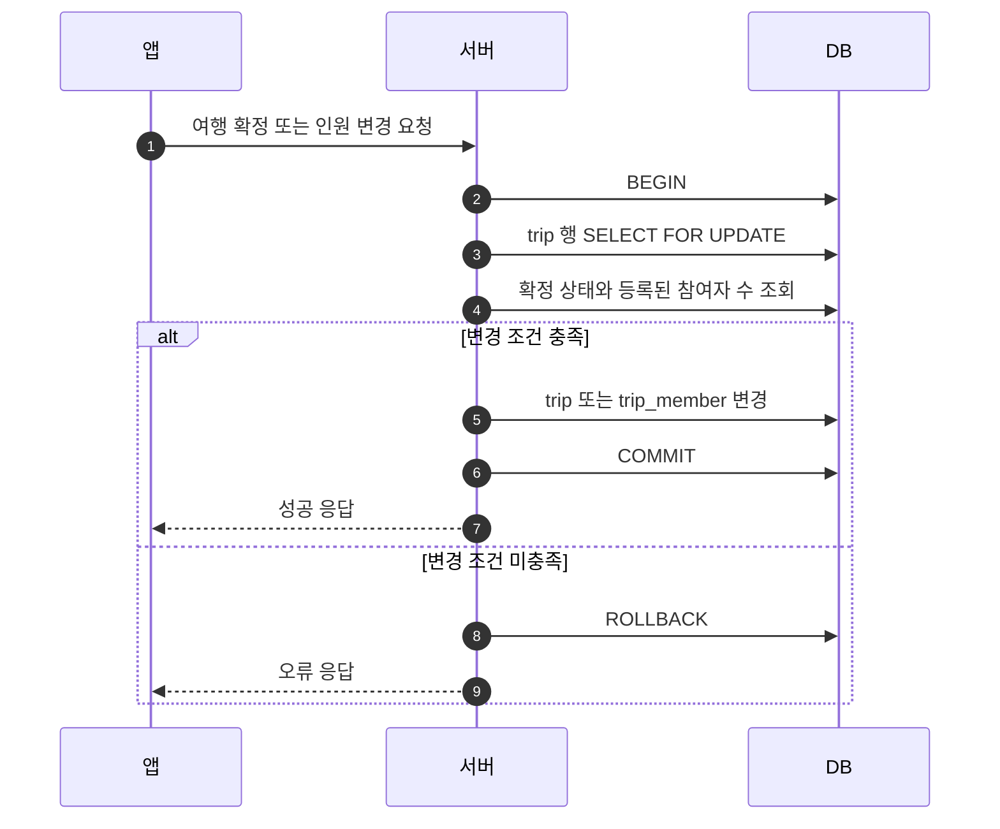
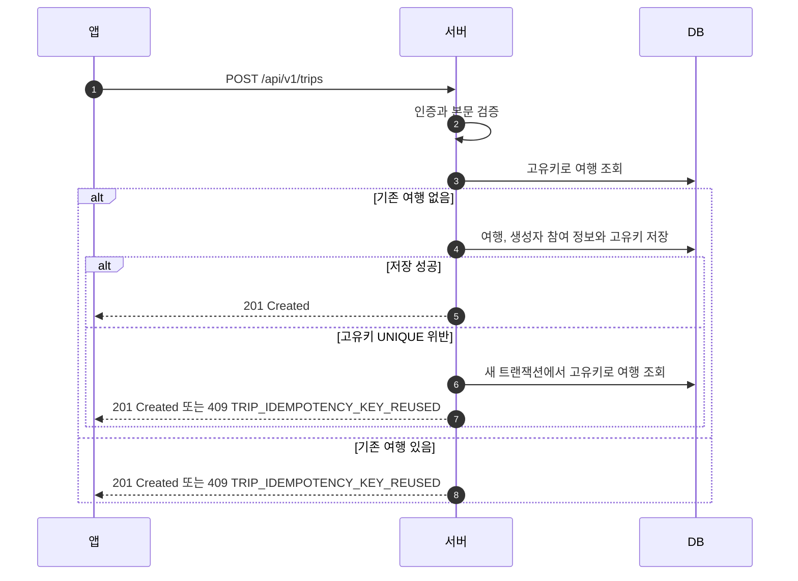

# 여행 설계서

## 개요

이 설계서는 여행과 여행 참여자의 저장 구조, 참여 인원이 바뀌는 요청의 잠금과 여행 생성 멱등성을 다룬다.
업무 규칙은 [여행 정책서](../policy/trip.md)를 따른다.

## 여행과 참여자

서버는 참여자마다 `trip_member` 행 하나를 두고, 여행 확정과 인원이 바뀌는 요청을 `trip` 행 잠금으로 차례로 처리한다.

### 저장 데이터

| 이름 | 타입 | 제약 | 뜻 |
| --- | --- | --- | --- |
| `trip.country_code` | `VARCHAR(3)` | NOT NULL | 대표 국가 코드. 기타 국가이면 `ETC` |
| `trip.custom_country_name` | `VARCHAR(10)` | NULL | 직접 입력한 기타 국가명. NULL이면 `country_code`가 `ETC`가 아님 |
| `trip.member_capacity` | `INTEGER` | NOT NULL | 생성자를 포함한 총인원 |
| `trip.status` | `trip_status` | NOT NULL | 여행 확정 상태. `UNCONFIRMED`(확정 전)와 `CONFIRMED`(확정 후) |
| `trip.confirmed_at` | `TIMESTAMPTZ` | NULL | 여행 확정 시각. NULL이면 확정 전 |
| `trip_member.member_id` | `BIGINT` | NULL, FK `member.id` | 로그인 참여자의 회원. NULL이면 비로그인 참여자 |
| `trip_member.trip_nickname` | `VARCHAR(10)` | NULL | 로그인 참여자와 비로그인 참여자의 여행방 닉네임. NULL이면 탈퇴한 회원 |
| `trip_member.role` | `trip_member_role` | NOT NULL | 여행별 역할. `ADMIN`(여행 생성자이자 관리자)과 `MEMBER` |
| `trip_member.trip_member_status` | enum | 정하지 않음 | 참여자 상태. `MEMBER`(로그인 참여자), `GUEST`(비로그인 참여자), `LEFT`(나간 회원), `WITHDRAWN`(탈퇴 회원) |
| `trip_member.left_at` | `TIMESTAMPTZ` | NULL | 여행을 나간 시각. NULL이면 나간 적이 없음 |

- `trip`에는 `CHECK ((country_code = 'ETC') = (custom_country_name IS NOT NULL))` 제약을 둔다.
- `trip_member`에는 `UNIQUE (trip_id, trip_nickname)` 제약과 `UNIQUE (trip_id, member_id)` 제약을 둔다.
- 서버는 `trip`에 생성자 컬럼을 두지 않고, `role = ADMIN`인 `trip_member` 행으로 여행 생성자이자 관리자를 판단한다. 근거: [Issue #27](https://github.com/JECT-Study/Billit-5th-Docs/issues/27)
- 다른 업무 영역은 참여자를 `member.id`가 아닌 `trip_member.id`로 참조한다.

### 처리 흐름

다음은 여행 확정과 인원이 바뀌는 요청의 처리 순서다.



- 인원이 바뀌는 요청은 여행 참여, 여행 나가기, 비로그인 참여자 등록과 삭제, 총인원 변경이다.
- 로그인 참여자가 참여하거나 관리자가 비로그인 참여자를 등록하면 서버는 `trip_member` 행을 만든다.
- 서버는 빈자리 행을 미리 만들지 않는다. 빈자리 수는 `trip.member_capacity`에서 등록된 참여자 수를 뺀 값이다([총인원과 빈자리](../policy/trip.md#총인원과-빈자리)).
- 총인원을 바꾸면 서버는 `trip_member` 행을 만들거나 지우지 않는다.
- 회원이 여행에 참여하면 서버는 `member_id`가 있는지 보고 참여자 상태를 정한다.
- 회원이 여행을 나가면 서버는 행을 지우지 않고 참여자 상태를 `LEFT`로 바꾼다.
- 회원이 여행을 나가면 서버는 `left_at`에 나간 시각을 기록한다.
- 서버는 나간 회원의 행을 지출과 정산에서 계속 참조하므로 `deleted_at`으로 조회에서 제외하지 않는다.
- 나간 회원이 확정 전에 다시 참여하면 서버는 새 행을 만들지 않고 기존 행을 다시 쓴다([재참여](../policy/trip.md#재참여)).
- 관리자가 비로그인 참여자를 삭제하면 서버는 그 행을 지운다.
- 대표 국가가 기타 국가이면 서버는 `country_code`에 `ETC`를, 입력한 국가명을 `custom_country_name`에 저장한다.
- 회원이 계정 닉네임(`member.nickname`)을 바꿔도 서버는 `trip_nickname`을 바꾸지 않는다.

다음은 여행방 닉네임 제약의 가상 예시다. 같은 여행의 참여자 행 21에 여행방 닉네임 `민수`가 있다고 가정한다.

```text
1. 관리자가 비로그인 참여자를 `민수`로 등록하거나 다른 비로그인 참여자의 이름을 `민수`로 수정한다.
   결과: 서버는 요청을 거절한다.

2. 회원이 여행방 닉네임 `민수`로 참여하거나 자신의 여행방 닉네임을 `민수`로 수정한다.
   결과: 서버는 요청을 거절한다.

3. 행 21의 회원이 계정 닉네임을 바꾼다.
   결과: 행 21의 여행방 닉네임은 `민수`로 남는다.
```

### 트랜잭션과 동시성

- 여행 확정이나 인원이 바뀌는 요청이 오면 서버는 같은 트랜잭션에서 `trip` 행을 `SELECT ... FOR UPDATE`로 먼저 잠근다. 근거: [Issue #25](https://github.com/JECT-Study/Billit-5th-Docs/issues/25)
- 서버는 `trip` 행을 잠근 뒤에 확정 상태와 등록된 참여자 수를 확인한다.
- 서버는 `trip` 행 잠금을 기다리는 시간에 `lock_timeout` 상한을 둔다.
- 같은 여행방 닉네임의 저장 요청이 동시에 오면 서버는 `UNIQUE (trip_id, trip_nickname)` 제약으로 한 건만 저장한다.

> 추후 검토
>
> 등록된 참여자 수 조회가 병목이 되면 `trip`에 등록 인원 컬럼을 두고 조건부 UPDATE로 바꾸는 방안을 검토한다.

### 실패 처리

- 잠금 대기가 `lock_timeout`을 넘으면 서버는 재시도하지 않고 오류를 반환한다. 응답은 [TRIP-11 여행 확정](../api-spec/trip.md#trip-11-여행-확정)을 따른다.
- 같은 여행에 이미 있는 여행방 닉네임으로 등록하거나 수정하면 서버는 요청을 거절한다.
- 같은 회원이 같은 여행에 다시 참여하면 서버는 `UNIQUE (trip_id, member_id)` 제약으로 두 번째 행을 저장하지 않는다.
- 등록된 참여자 수가 총인원과 같으면 서버는 참여와 비로그인 참여자 등록을 거절한다.

## 여행 생성 멱등성

앱은 여행 생성 요청의 `Idempotency-Key` 헤더에 UUID 형식의 고유키를 보내고, 서버는 같은 회원이 같은 키로 다시 보낸 요청에 처음 만든 여행을 반환한다.

### 저장 데이터

| 이름 | 타입 | 제약 | 뜻 |
| --- | --- | --- | --- |
| `trip.idempotency_key` | `UUID` | NOT NULL, UNIQUE `uq_trip_idempotency_key` | 앱이 만든 여행 생성 고유키 |

- 서버는 고유키를 여행 생성에만 쓰며, 키 하나로 여행 하나만 만든다.
- 서버는 고유키를 만료 없이 여행과 함께 보관한다.
- 서버는 키를 사용한 회원을 그 키로 만든 여행의 `role = ADMIN`인 `trip_member.member_id`로 확인한다. 근거: [Issue #27](https://github.com/JECT-Study/Billit-5th-Docs/issues/27)

### 처리 흐름

다음은 여행 생성 요청의 처리 순서다.



- 앱은 생성 시도마다 새 키를 만들고, 응답을 받지 못해 같은 요청을 다시 보낼 때만 같은 키를 쓴다.
- 서버는 요청자 인증과 본문 검증을 고유키 조회보다 먼저 실행한다.
- 본문 검증 범위는 필수값, 형식과 범위, 여행 기간 순서, `countryCode`와 `customCountryName`의 조합이다.
- 서버는 본문 검증을 통과한 같은 키의 요청을 같은 생성 요청의 재시도로 보고 처음 요청의 본문과 비교하지 않는다.
- 고유키로 찾은 여행을 같은 회원이 만들었으면 서버는 `201 Created`와 `Location`을 반환하고, `data`에 그 여행의 현재 정보를 담는다.

### 트랜잭션과 동시성

- 서버는 여행, 생성자 참여 정보와 고유키의 저장을 한 트랜잭션으로 묶는다.
- 서버는 여행 생성 처리 전체를 한 트랜잭션으로 묶지 않는다. PostgreSQL은 오류가 난 트랜잭션에서 더 이상 조회할 수 없기 때문이다.
- 고유키 중복으로 저장에 실패하면 서버는 그 트랜잭션을 롤백하고 새 트랜잭션에서 고유키로 여행을 다시 조회한다. 근거: [Issue #26](https://github.com/JECT-Study/Billit-5th-Docs/issues/26)
- 같은 키의 요청이 동시에 오면 서버는 여행을 하나만 만들고, 늦게 처리한 요청에는 재요청과 같은 응답을 보낸다.

### 실패 처리

- 키가 없거나 UUID 형식이 아니면 서버는 `400`으로 거절한다.
- 요청 본문이 유효하지 않으면 서버는 이미 사용한 키여도 고유키를 조회하지 않고 `400`으로 거절한다.
- 다른 회원이 이미 사용한 키이면 서버는 기존 여행 정보를 반환하지 않고 `409 TRIP_IDEMPOTENCY_KEY_REUSED`로 거절한다.
- 그 키로 만든 여행이 삭제되었으면 서버는 `409 TRIP_IDEMPOTENCY_KEY_REUSED`로 거절한다.
- 다시 조회했을 때 여행 행이 없으면 서버는 `409 TRIP_IDEMPOTENCY_KEY_REUSED`로 거절한다.
- 저장 실패의 SQLSTATE가 `23505`이고 위반한 제약이 `uq_trip_idempotency_key`일 때만 서버는 고유키 중복으로 판단한다.
- 저장 중 하나라도 실패하면 서버는 여행, 생성자 참여 정보와 고유키를 모두 롤백한다.

### 검증

- 같은 키의 요청이 동시에 오면 서버는 여행과 생성자 참여 정보를 한 번만 만든다.
- 응답을 받지 못한 뒤 같은 키로 다시 요청하면 서버는 처음 만든 여행을 `201 Created`로 반환한다.
- 저장 중 생성자 참여 정보 저장이 실패하면 서버는 여행과 고유키도 저장하지 않는다.
- 다른 회원이 사용한 키로 요청하면 서버는 `409 TRIP_IDEMPOTENCY_KEY_REUSED`로 거절한다.
- 삭제한 여행의 키로 요청하면 서버는 `409 TRIP_IDEMPOTENCY_KEY_REUSED`로 거절한다.
- 같은 회원이 같은 키로 본문 값을 바꿔 요청하면 서버는 처음 만든 여행을 반환한다.
